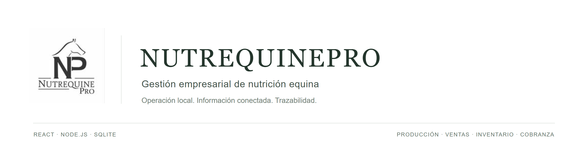

<p align="center">
  
</p>

<p align="center">
  <strong>Producción, ventas, inventario y cobranza en una aplicación local.</strong><br />
  Operaciones conectadas, cálculos trazables y datos bajo el control de la empresa.
</p>

<p align="center">
  <a href="#instalación-local-en-windows-11">Instalación local</a> ·
  <a href="#catálogo-empresarial-original">Catálogo empresarial</a> ·
  <a href="app/docs/ARQUITECTURA.md">Arquitectura</a> ·
  <a href="app/integration/README.md">Integración</a> ·
  <a href="https://github.com/VicWaltzO/NutrequinePro/actions/workflows/quality.yml">Verificaciones</a>
</p>

## Una operación conectada de principio a fin

Nutrequine Pro organiza el trabajo de una empresa de nutrición equina: preparar una
producción, conocer sus costos, registrar una venta, entregar producto y cobrarla.
Cada paso tiene efectos sobre los demás. La aplicación conserva esas relaciones
para que el equipo pueda consultar qué ocurrió, qué está pendiente y de dónde
proviene cada importe o movimiento.

La propuesta es reunir la operación diaria en una herramienta que la empresa pueda
ejecutar en su propio equipo. La versión actual funciona con React, Node.js y SQLite,
sin una cuenta de ChatGPT o Cloudflare y sin servicios externos durante el uso normal.

| Área             | Qué permite gestionar                                                    |
| ---------------- | ------------------------------------------------------------------------ |
| Resumen          | Consultar indicadores, existencias y operaciones pendientes.             |
| Producción       | Trabajar con fórmulas versionadas, núcleos, sacos, insumos y costos.     |
| Ventas           | Registrar ventas al contado o crédito, entregas y operaciones futuras.   |
| Inventario       | Consultar existencias y movimientos asociados a la operación.            |
| Clientes y sedes | Organizar clientes, destinos de entrega y sus relaciones.                |
| Cobranza         | Registrar pagos, aplicaciones, saldos pendientes y créditos disponibles. |
| Gastos y balance | Revisar egresos y un resultado comercial estimado.                       |
| Configuración    | Administrar parámetros, productos, usuarios y permisos.                  |
| Historial        | Consultar rectificaciones, devoluciones, anulaciones y reversiones.      |

## Captura de producción

Al indicar los núcleos, los insumos se recalculan de inmediato. Cada insumo permite
ajustar su precio para ese lote y aplicar un descuento opcional, sin cambiar el
catálogo ni los precios de otras producciones. El cobro real se inicia en el teórico
neto y acompaña los cambios de cantidad, precio y descuento; si se edita manualmente,
conserva ese importe hasta elegir **Restablecer al teórico neto**.

Las filas nuevas de insumos comienzan pagadas. El operador puede marcar varias como
pendientes antes de guardar, independientemente del cobro registrado. Los borradores
existentes conservan sus precios, cobros y estados de pago. Consulta las
[interacciones y compatibilidad de producción](app/docs/UX_OPERATIVA.md) para conocer
el detalle y las comparaciones visuales.

## La complejidad que resuelve

Una venta registrada, una entrega realizada y un pago recibido representan hechos
distintos. Nutrequine conserva sus estados y relaciones. Las correcciones dejan
rastro y los documentos históricos conservan los precios, pesos y fórmulas utilizados
cuando se registró la operación.

La producción también necesita distinguir el peso de la fórmula del peso comercial.
Por ejemplo, la fórmula original de Potripregnant suma 988 kg por núcleo, mientras
sus parámetros comerciales establecen 40 sacos de 25 kg. Esos valores se mantienen
separados. Los cálculos usan céntimos y gramos enteros; el backend valida las
operaciones y SQLite confirma sus escrituras de forma atómica.

El balance es una herramienta de gestión con resultado estimado. La versión actual
no implementa contabilidad formal, valoración FIFO ni un libro completo de pagos a
proveedores. Sus [reglas y límites comerciales](app/README.md#decisiones-técnicas-y-límites-explícitos)
están documentados para que el alcance resulte claro.

## Una arquitectura local y modular

**Chrome → React/Vite → Fastify/Node.js → SQLite.** El frontend y la API comparten
un mismo origen local. Las reglas comerciales permanecen en el backend y la
persistencia está encapsulada detrás de su adaptador.

- **Interfaz:** React 19, TypeScript, Vite y componentes organizados por funcionalidad.
- **Backend:** Node.js y Fastify, con autenticación local, sesiones y permisos.
- **Datos:** SQLite en disco, con archivos separados para negocio y autenticación.
- **Operación:** recursos gráficos locales, migraciones versionadas y herramientas de respaldo.

Los roles **ADMIN**, **OPERATOR** y **VIEWER** se validan desde el servidor. Las
sesiones usan cookies administradas por el navegador; el token CSRF permanece en
memoria. El servidor comprueba Host y Origin y escucha únicamente en `127.0.0.1`.

Esta edición está preparada para una instalación local. El acceso por LAN o Internet,
la identidad corporativa y el aislamiento multiempresa requieren trabajo adicional.
La [integración como módulo](app/integration/README.md) dispone de contratos y
procedimientos propios; no implica que exista ya un ERP corporativo completo.

## Requisitos explícitos

El procedimiento siguiente está dirigido a **Windows 11** y a una instalación nueva.

| Requisito           | Condición                                                                                                        |
| ------------------- | ---------------------------------------------------------------------------------------------------------------- |
| Node.js             | **24.18.0 o superior**, disponible en `PATH`. Incluye npm.                                                       |
| Git                 | Instalado y disponible en `PATH`, para clonar y actualizar el repositorio.                                       |
| Terminal            | Windows PowerShell **5.1** o PowerShell **7**. No hace falta abrirla como administrador.                         |
| Navegador           | Google Chrome instalado.                                                                                         |
| Conexión            | Necesaria para descargar el repositorio y las dependencias. La aplicación compilada opera localmente.            |
| Archivos            | Permiso para crear el clon y un directorio privado en el perfil del usuario.                                     |
| Puerto              | **4317** libre en `127.0.0.1`, o un puerto elegido expresamente en la configuración.                             |
| Datos empresariales | Catálogo original aprobado o una base existente autorizada, si se necesita operar con información de la empresa. |

SQLite está incluido en Node mediante `node:sqlite`. No necesitas instalar un
servidor de base de datos, Docker, una CLI SQLite adicional ni herramientas de
Cloudflare. El navegador automatizado y OpenSSL se utilizan en las pruebas de
desarrollo; no son requisitos adicionales del servidor operativo.

## Instalación local en Windows 11

Ejecuta los bloques en orden, en la **misma ventana de PowerShell**. Git se usa desde
la raíz del repositorio; los comandos de npm se ejecutan dentro de `app/`.

Si ya tienes una instalación con datos, pasa a [volver a iniciar](#volver-a-iniciar-sin-perder-información).
No repitas la creación de bases o credenciales sobre ella. Los ejemplos nuevos usan
`NutrequinePro-Local`; una instalación anterior puede tener otro directorio, como
`NutrequinePro-Demo`. Conserva sus rutas originales.

### 1. Descargar main e instalar las dependencias

El clon se guardará en `Documentos\NutrequinePro`. El bloque se detiene si esa carpeta
ya existe, para evitar mezclar instalaciones.

```powershell
$ErrorActionPreference = 'Stop'

node -e "const [major, minor] = process.versions.node.split('.').map(Number); if (major < 24 || (major === 24 && minor < 18)) { console.error('Se requiere Node.js 24.18 o superior.'); process.exit(1); }"
if ($LASTEXITCODE -ne 0) { throw 'Actualice Node.js antes de continuar.' }

$codigo = Join-Path ([Environment]::GetFolderPath('MyDocuments')) 'NutrequinePro'
if (Test-Path -LiteralPath $codigo) { throw 'La carpeta de código ya existe. Conserve esa instalación o elija otra ruta.' }

git clone --single-branch --branch main https://github.com/VicWaltzO/NutrequinePro.git $codigo
if ($LASTEXITCODE -ne 0) { throw 'No se pudo clonar el repositorio.' }

Set-Location -LiteralPath (Join-Path $codigo 'app')
npm.cmd ci
if ($LASTEXITCODE -ne 0) { throw 'Falló la instalación de dependencias.' }
```

### 2. Compilar el frontend y el backend

```powershell
npm.cmd run build
if ($LASTEXITCODE -ne 0) { throw 'Falló la compilación. No continúe.' }

npm.cmd run check:distribution
if ($LASTEXITCODE -ne 0) { throw 'La distribución no superó la revisión.' }
```

La salida queda en `app/dist-node/`: backend, dependencias de ejecución, herramientas
administrativas y frontend compilado en `public-client/`. Se genera localmente y
no se debe subir a Git.

### 3. Crear las bases y el administrador local

Este bloque prepara una instalación **nueva** en
`%LOCALAPPDATA%\NutrequinePro-Local`, fuera del repositorio. Elige una contraseña de
al menos **15 caracteres** y consérvala de forma segura. No hay contraseña predeterminada.

```powershell
$ErrorActionPreference = 'Stop'
$datos = Join-Path $env:LOCALAPPDATA 'NutrequinePro-Local'
if (Test-Path -LiteralPath $datos) { throw 'El directorio de datos ya existe. Use el procedimiento de arranque existente.' }

node scripts/sqlite-admin.mjs directory --directory $datos
if ($LASTEXITCODE -ne 0) { throw 'No se pudo crear el directorio privado.' }

$base = Join-Path $datos 'negocio.sqlite'
$acceso = Join-Path $datos 'acceso.sqlite'
node scripts/sqlite-admin.mjs init --database $base | Out-Null
if ($LASTEXITCODE -ne 0) { throw 'No se pudo preparar la base comercial.' }

$secreto = Read-Host 'Elija la contraseña de admin.local (mínimo 15 caracteres)' -AsSecureString
$credencial = [System.Management.Automation.PSCredential]::new('admin.local', $secreto)
$encodingAnterior = $OutputEncoding

try {
    $OutputEncoding = [System.Text.UTF8Encoding]::new($false)
    $provision = @{
        user_id = [guid]::NewGuid().ToString()
        name = 'Administrador local'
        login = 'admin.local'
        password = $credencial.GetNetworkCredential().Password
    } | ConvertTo-Json -Compress

    $provision | node server/admin.mts --database $base --auth-database $acceso --mode new
    if ($LASTEXITCODE -ne 0) { throw 'Falló la provisión. Conserve los archivos y el diagnóstico; no sobrescriba las bases.' }
} finally {
    $provision = $null
    $credencial = $null
    $secreto = $null
    $OutputEncoding = $encodingAnterior
}

$config = Join-Path $datos 'servidor.json'
$ajustes = @{
    database = $base
    auth_database = $acceso
    port = 4317
    frontend_directory = (Join-Path (Get-Location).Path 'dist-node/public-client')
} | ConvertTo-Json

[IO.File]::WriteAllText($config, $ajustes, [Text.UTF8Encoding]::new($false))
Write-Host 'Instalación preparada. Usuario: admin.local. Utilice la contraseña que acaba de elegir.'
```

La contraseña se transmite por stdin y no se escribe en argumentos ni archivos de
provisión. UTF-8 explícito conserva los acentos en PowerShell 5.1. La configuración
se guarda sin BOM y hereda los permisos del directorio privado.

### 4. Iniciar y abrir la aplicación

```powershell
npm.cmd start -- --config $config
```

Deja la terminal abierta. Cuando aparezca `LISTENING`, abre Chrome y visita:

**[http://127.0.0.1:4317/](http://127.0.0.1:4317/)**

Inicia sesión como **admin.local**, con tu contraseña. Usa exactamente `127.0.0.1`;
`localhost` es otro Host y no coincide con el perímetro configurado. Si el puerto
está ocupado, selecciona otro en el JSON privado y utiliza el mismo en la URL.

Ya puedes acceder al panel y sus formularios. La provisión anterior crea el
administrador y las bases; la carga de maestros empresariales es un paso explícito,
descrito a continuación.

## Catálogo empresarial original

El proyecto conserva **4 productos, 10 insumos, 4 fórmulas con 40 relaciones y
5 sedes**, junto con el logo y la fotografía original. Son datos maestros reales
de la empresa. Sus identificadores, precios y cantidades se conservan en
[`seed-state.mjs`](app/lib/seed-state.mjs) y se contrastan con la
[especificación comercial](app/docs/ESPECIFICACION_MAESTRA_MVP.md).

La inicialización actual utiliza un estado vacío para no insertar información
empresarial indiscriminadamente. Una base recién creada no muestra esos maestros
hasta que se aprovisionan. No ejecutes el archivo de datos como si fuera una
migración ni sustituyas una base existente para recuperarlos.

El paquete **NUTREQUINE_DATOS_MAESTROS** se entrega por separado y permanece fuera
de GitHub. Incluye JSON por entidad, unidades, imágenes originales, comprobaciones
SHA-256 y un procedimiento de importación para el desarrollador. Antes de cargarlo
hay que revisar los cambios y respaldar la base; la importación debe comprobar IDs,
respetar las relaciones y conservar los maestros que el administrador haya modificado.
No se incorporan automáticamente clientes, ventas, pagos ni inventario.

## Volver a iniciar sin perder información

Detén el servidor con **Ctrl+C** y espera a que termine. Para iniciarlo en una nueva
ventana de PowerShell, utiliza las rutas de tu instalación:

```powershell
$ErrorActionPreference = 'Stop'
$codigo = Join-Path ([Environment]::GetFolderPath('MyDocuments')) 'NutrequinePro'
Set-Location -LiteralPath (Join-Path $codigo 'app')

$config = Join-Path $env:LOCALAPPDATA 'NutrequinePro-Local/servidor.json'
if (-not (Test-Path -LiteralPath $config)) { throw 'Seleccione el servidor.json de su instalación existente.' }

npm.cmd start -- --config $config
```

Los datos sobreviven al reinicio porque permanecen en SQLite, fuera del código.
**No repitas `init` ni `--mode new`.** Si utilizaste la guía anterior con
`NutrequinePro-Demo`, cambia únicamente esa parte de la ruta del ejemplo.

Antes de actualizar o sustituir el código, realiza el respaldo correspondiente y
conserva la configuración privada. Sigue el procedimiento de
[respaldo y restauración](app/docs/RESPALDO_RESTAURACION.md), incluidas las
consideraciones de la base de autenticación. No copies bases o credenciales dentro
del repositorio ni de `dist-node/`.

## Desarrollo y comprobaciones

Desde `app/`, con dependencias instaladas y bases privadas ya preparadas:

```powershell
$config = Join-Path $env:LOCALAPPDATA 'NutrequinePro-Local/servidor.json'
npm.cmd run dev -- --config $config
```

Vite funciona como middleware de Fastify: recarga de interfaz y API comparten el
mismo puerto, con las comprobaciones de sesión, Host, Origin y CSRF activas.

Para ejecutar la verificación completa del código y las pruebas de navegador:

```powershell
$ErrorActionPreference = 'Stop'
npm.cmd run verify
if ($LASTEXITCODE -ne 0) { throw 'Falló la verificación del proyecto.' }

$env:REGRESSION_BROWSER_CHANNEL = 'chrome'
npm.cmd run test:e2e
if ($LASTEXITCODE -ne 0) { throw 'Fallaron las pruebas de navegador.' }
```

`verify` reúne pruebas automatizadas, los tres chequeos TypeScript, ESLint,
Prettier, compilación y auditoría de distribución. E2E se ejecuta después del
build, con bases temporales aisladas. Para repetir también la comprobación TLS,
OpenSSL debe estar disponible en `PATH`; consulta la
[guía operativa](app/docs/GUIA_OPERATIVA_FINAL.md). Si no tienes Chrome, puedes
preparar Chromium con `npx.cmd playwright install chromium` y omitir la variable
`REGRESSION_BROWSER_CHANNEL`.

Las verificaciones publicadas se consultan en
[GitHub Actions](https://github.com/VicWaltzO/NutrequinePro/actions/workflows/quality.yml).
Los informes conservan el alcance y las limitaciones de cada validación; no
constituyen una certificación para exposición pública o uso multiempresa.

## Documentación y colaboración

| Documento                                                          | Contenido                                                         |
| ------------------------------------------------------------------ | ----------------------------------------------------------------- |
| [Instalación local](app/docs/INSTALACION_LOCAL.md)                 | Preparación de bases, credenciales, configuración y distribución. |
| [Arquitectura](app/docs/ARQUITECTURA.md)                           | Responsabilidades, módulos y fronteras del sistema.               |
| [Especificación comercial](app/docs/ESPECIFICACION_MAESTRA_MVP.md) | Datos originales y reglas del MVP.                                |
| [Guía de desarrollo](app/docs/GUIA_DESARROLLO.md)                  | Organización del código y flujo de trabajo.                       |
| [Respaldo y restauración](app/docs/RESPALDO_RESTAURACION.md)       | Copias verificadas y recuperación de información.                 |
| [Integración del módulo](app/integration/README.md)                | Contratos, incorporación a otro repositorio y distribución.       |
| [Matriz de regresión](app/docs/MATRIZ_REGRESION.md)                | Escenarios y comportamientos que deben conservarse.               |
| [Contribución](CONTRIBUTING.md)                                    | Comprobaciones y criterios para colaborar.                        |

El código de la aplicación está en [`app/`](app/README.md). Los informes 01–08
describen etapas anteriores; la arquitectura operativa utiliza React/Vite, Node/Fastify
y SQLite. Para trabajar en el proyecto, sigue los `AGENTS.md` de la raíz y de
`app/`, respeta las reglas comerciales y mantén los archivos privados fuera de Git.
