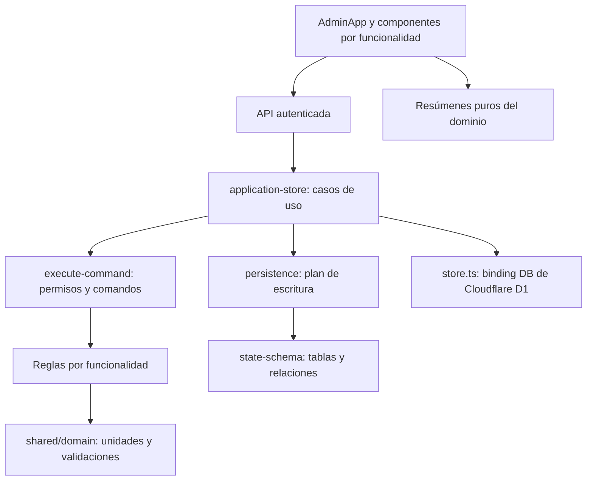

# Arquitectura de Nutrequine Pro

La aplicación mantiene React 19, TypeScript estricto, Vinext, Cloudflare Workers y
D1. Las rutas siguen siendo `/`, `/api/state` y `/api/command`; la navegación
administrativa utiliza el hash del navegador. Las reglas vigentes se describen en
la [especificación maestra](ESPECIFICACION_MAESTRA_MVP.md), la
[aceptación](ACEPTACION.md) y los cambios comerciales aprobados documentados en el
[README](../README.md).

## Estructura y responsabilidades

```text
app/
├── app/                 Rutas, autenticación y composición administrativa
│   ├── api/             GET state y POST command
│   └── ui/              AdminApp, navegación, filtros, ModalHost y hooks
├── features/
│   ├── ventas/          Ventas, entrega, rectificación y devolución
│   ├── cobranza/        Pagos, aplicaciones de crédito y reversiones
│   ├── produccion/      Fórmulas, lotes, conciliación, cierre y rectificación
│   ├── inventario/      Stock físico, compromisos y ajustes
│   ├── clientes/        Directorio, sedes, deuda y desactivación
│   ├── gastos/          Registro, vinculación a producción y anulación
│   ├── balance/         Resumen financiero y panel
│   └── configuracion/   Maestros, empresa, usuarios y permisos de edición
├── shared/
│   ├── domain/          Validaciones, unidades, precisión y permisos
│   ├── ui/              Campos, tablas, estados, imágenes y métricas
│   ├── lib/             Formato, búsqueda y valores iniciales de formularios
│   └── types/           Entidades y contratos de propiedades
├── lib/                 Casos de uso, persistencia y adaptadores
├── db/                  Esquema Drizzle
├── drizzle/             Migraciones aplicadas, inmutables
├── scripts/             Preparación local, compilación y verificación
└── tests/               Dominio, SQLite, store, interfaz y arquitectura
```

Las funcionalidades tienen `components/`, `domain/` y, cuando hay estado propio,
`hooks/`. No se crean carpetas vacías ni repositorios de datos por entidad:
una operación comercial puede modificar varias entidades en una transacción.

`AdminApp.tsx` compone las vistas. `useAdminNavigation` conserva rutas, filtros y
apariencia; `useAdminOperations` gestiona carga, modal, mensajes y solicitudes.
`ModalHost` resuelve el formulario y conserva el diálogo nativo centrado.
`SimpleForm` coordina campos de distintas funcionalidades y permanece en la capa
de composición. `FormFooter`, campos, tabla, etiquetas y tipos son compartidos.

## Dependencias y flujo



Los módulos de dominio no importan React, navegador, HTTP ni D1. Los componentes
compartidos no importan funcionalidades. Las dependencias entre reglas comerciales
son explícitas: cobranza consulta ventas; clientes consulta pagos y ventas;
balance consolida ventas, pagos y producción. Se importan módulos concretos para
evitar ciclos. Dos pruebas verifican los límites y los ciclos de importaciones
estáticas en ejecución; no analizan imports dinámicos ni código de terceros.

`lib/domain.mjs` conserva la API pública anterior como fachada. `lib/domain-types.ts`
reexporta los contratos canónicos de `shared/types/domain.ts`. Esto permite conservar
consumidores existentes sin duplicar reglas ni tipos. Los archivos `.d.mts`
describen los contratos de los módulos JavaScript usados por TypeScript.

## Ubicación de las reglas

| Responsabilidad                                        | Fuente de verdad                                                         |
| ------------------------------------------------------ | ------------------------------------------------------------------------ |
| Céntimos, gramos, validaciones y redondeo BigInt       | `shared/domain/core.mjs`                                                 |
| Permisos de comandos y estado de usuario               | `shared/domain/permissions.mjs` y comprobaciones específicas del comando |
| Stock físico, compromisos, disponibilidad para entrega | `features/inventario/domain/stock.mjs`                                   |
| Venta, total comercial, saldo, entrega y devolución    | `features/ventas/domain/`                                                |
| Pago, saldo a favor, aplicación y reversión            | `features/cobranza/domain/`                                              |
| Fórmula versionada, snapshots, producción y costos     | `features/produccion/domain/`                                            |
| Deuda y crédito del cliente                            | `features/clientes/domain/summary.mjs`                                   |
| Ingresos, egresos y resultado estimado                 | `features/balance/domain/summary.mjs`                                    |
| Maestros y valores iniciales documentados              | `lib/seed-state.mjs`                                                     |

Los formularios muestran resúmenes usando estas mismas funciones. El servidor
vuelve a calcular las operaciones; los importes enviados por el navegador no son
una autorización para modificar totales derivados. Internamente el dinero usa
céntimos enteros y los pesos gramos enteros. Los snapshots históricos preservan
precio, fórmula, peso comercial y cantidades originales.

## Escritura, concurrencia y trazabilidad

1. La API verifica identidad, origen y tamaño de la petición.
2. `application-store` carga el estado y comprueba el usuario activo. Un
   `request_id` repetido por el mismo actor devuelve el resultado ya auditado.
3. `execute-command` clona el estado, verifica permisos, ejecuta el comando,
   valida enteros, recalcula estados financieros y agrega auditoría y revisión.
4. `writePlan` genera escrituras parametrizadas de filas modificadas. El guard de
   revisión rechaza estados obsoletos antes de actualizar entidades.
5. D1 ejecuta el batch atómico: un fallo revierte todo. El cliente conserva sus
   campos y su identificador para reintentar; un conflicto requiere recargar.

`createStore(bindingGetter)` permite probar el mismo caso de uso con una base
SQLite en memoria. `store.ts` únicamente lo conecta a `env.DB`; no existe una
segunda implementación de negocio en las pruebas.

Las 27 tablas conservan claves de identidad/relación y documentos JSON. No se
reescribió la migración inicial ni se cambió el modelo. Una base con esquema y sin
configuración recibe los maestros iniciales una sola vez; inicializaciones
concurrentes conservan un solo administrador. No se usa inicialización para reparar
un esquema faltante ni para reiniciar operaciones. Anulaciones, reversiones,
devoluciones y rectificaciones conservan registros, compensaciones y motivos.

## D1 local y alojado

`wrangler.local.json` centraliza binding `DB`, identidad local y directorio de
migraciones. `local-bindings.mjs` conserva el contrato incorporado desde main y
reutiliza esa configuración. Vite y la preparación usan la misma ruta, por defecto
`.wrangler/state`; Miniflare conserva SQLite dentro de `v3/d1`. La variable
`NUTREQUINE_LOCAL_STATE_DIR` permite una base de pruebas separada.

Antes de `dev` portable, la preparación inspecciona esquema y ledger. Aplica migraciones
pendientes; reconoce una base antigua con el esquema inicial completo y registra
su migración sin repetir los `CREATE TABLE`. Un esquema parcial o desconocido sin
ledger se bloquea para revisión. El ledger existente se valida como prefijo de las
migraciones versionadas. La verificación de adopción compara definiciones de tablas
e índices; no reconstruye ni modifica el esquema de una base antigua. El perfil
Linux administrado conserva el arranque del helper de Sites, como en main.

Los comandos de preparación son exclusivamente locales. La plataforma alojada
conserva sus bindings y su mecanismo de publicación/migración. La refactorización
no modifica esa base ni despliega la rama.
