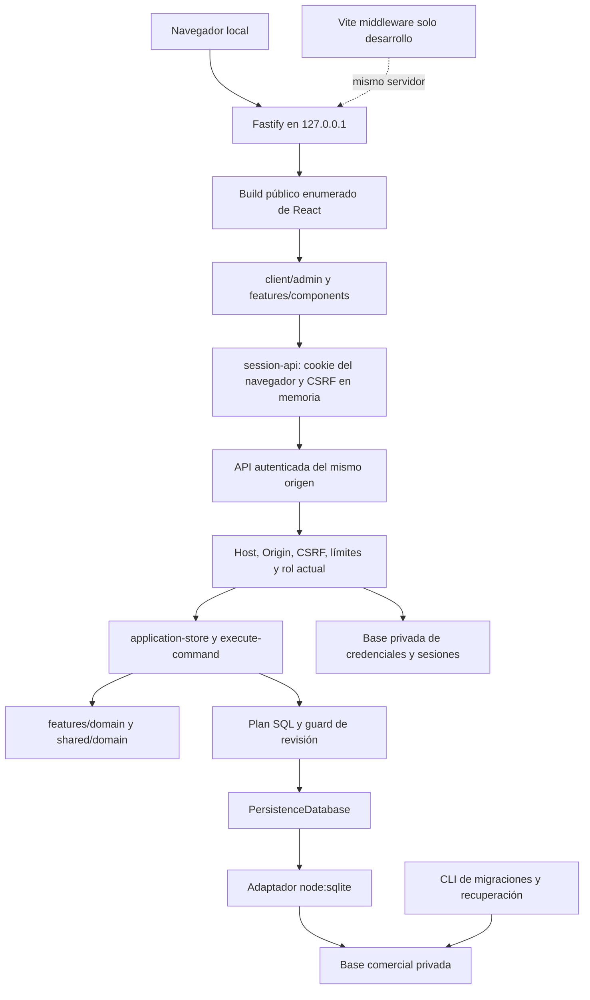

# Arquitectura de Nutrequine Pro

React 19/TypeScript/Vite presenta la interfaz; Fastify/Node autentica y ejecuta
comandos; SQLite conserva negocio y autenticación en archivos privados separados.
Cliente compilado y API comparten un origen loopback. No hay microservicios,
servicios externos ni una segunda implementación de las reglas comerciales.

## Estructura

```text
app/
├── client/             Entrada React, sesión, estilos y composición admin/
├── server/             Fastify, Host/Origin, CSRF, sesiones, provisión y estáticos
├── features/           Componentes, hooks y dominio por funcionalidad
├── shared/             Dominio básico, contratos, formato y UI reutilizable
├── lib/                Casos de uso, contratos, planes SQL y resúmenes puros
│   ├── adapters/       Controlador SQLite encapsulado
│   └── sqlite/         Migraciones, verificación, respaldo y recuperación
├── db/                 Esquema Drizzle para desarrollo
├── drizzle/            SQL histórico y metadatos inmutables
├── public/             Recursos gráficos locales
├── scripts/            Build, desarrollo, administración y verificaciones
├── tests/              Dominio, store, HTTP, SQLite, interfaz y E2E
├── vendor/             Avisos legales preservados
└── docs/               Procedimientos actuales y antecedentes históricos
```

El frontend importa contratos y funciones puras de `lib/domain-preview.mjs`.
No importa store, comandos, SQLite, autenticación privada ni módulos Node.
El backend importa `lib/application-store.mjs`, el dominio y el puerto de
persistencia; `lib/adapters/node-sqlite.mjs` implementa ese contrato sin filtrar
objetos del controlador. `db/schema.ts` no es el acceso comercial en ejecución.



## Integridad y responsabilidades

El dinero se expresa en céntimos enteros y los pesos en gramos enteros; se
conservan redondeos y validaciones del núcleo `shared/domain/core.mjs`.
Los resúmenes puros se reutilizan en previsualizaciones; el backend recalcula
y valida los resultados autoritativos antes de persistir.

Las 27 tablas comerciales mantienen IDs, relaciones y documentos JSON.
`nutrequine_migrations` registra preparación técnica; los metadatos históricos
`d1_migrations` pueden reconocerse sin ejecutar D1 ni importar su runtime.
Los snapshots congelan cantidades, pesos, precios y fórmulas. Rectificaciones,
devoluciones, anulaciones y reversiones conservan motivo e historial.

Un comando conserva `{type,payload,request_id}`. La sesión resuelve un usuario
comercial activo; dominio y store verifican permisos. Un request_id ya auditado
por ese actor devuelve su resultado sin duplicar efectos. El plan parametrizado
se confirma mediante un batch atómico; error SQL o revisión obsoleta revierten
todas las escrituras. El cliente conserva formulario e ID para reintento manual.

El arranque exige bases ya preparadas y acceso privado; no hace bootstrap de
usuarios o maestros. La provisión inicial es una CLI explícita. Los roles
ADMIN/OPERATOR/VIEWER y las validaciones comerciales permanecen sin cambios.

## Perímetro y distribución

Host y Origin exactos, cookies HttpOnly/SameSite, CSRF y límites de peticiones
permanecen activos. El cliente conserva CSRF en memoria y no guarda contraseñas
o tokens de sesión en almacenamiento web. Las identidades en cabeceras del
cliente no autentican. Vite usa middleware bajo ese mismo perímetro.

Los estáticos se enumeran desde un directorio público absoluto; no hay resolvedor
genérico de archivos, fallback de rutas privadas, enlaces o entrega de bases,
configuración privada, fuentes de backend o source maps.
`dist-node/` incluye Node compilado, React, recursos, CLI SQLite, SQL y dependencias
de runtime con sus licencias. Se reconstruye desde directorios generados vacíos
y se audita antes de distribuir.

## Evolución futura

Las fronteras de sesión, HTTP y persistencia permiten integrar una identidad
corporativa posteriormente. No existe aislamiento multiempresa ni company_id;
esa evolución requiere diseño, migraciones y reglas propios. No se implementa
integración corporativa ni contabilidad adicional en esta consolidación.
Consultar [reporte 09](REPORTE_09_CONSOLIDACION.md) para trazabilidad y límites.
