# Arquitectura propuesta para el ERP corporativo

Fecha: 15/10/2026. Estado: **diseño conceptual para evaluación**.
Base inspeccionada: `701ab84ce5c50bc3d9f641727b89e3f1b8f513fb`.
Rama: `codex/reestructuracion-arquitectonica`.

Este documento propone una evolución; no describe componentes corporativos ya
implementados. La aplicación vigente sigue siendo Nutrequine Pro para una empresa,
con React/Vite, Fastify/Node y SQLite local. Su operación se documenta en
[arquitectura actual](ARQUITECTURA.md) e [instalación local](INSTALACION_LOCAL.md).
El [reporte de la Tarea 10](REPORTE_10_PREPARACION_CORPORATIVA.md) registra diagnóstico,
fuentes y verificaciones. No se habilita LAN, Internet ni un nuevo servicio.

## 1. Decisiones y alcance

| ID  | Estado                    | Criterio                                                                                                                                                |
| --- | ------------------------- | ------------------------------------------------------------------------------------------------------------------------------------------------------- |
| C01 | Confirmado por el alcance | Conservar autonomía funcional, reglas, IDs, historia y 27 tablas comerciales de Nutrequine; ninguna modificación de esquema en esta tarea.              |
| C02 | Confirmado por inspección | Existen fronteras de cliente, dominio, HTTP, autenticación y persistencia; no existen empresas, membresías ni autorización corporativa.                 |
| C03 | Confirmado por el alcance | Control Granja está pendiente de auditoría; su tecnología, almacenamiento, reglas y API son desconocidos.                                               |
| P01 | Recomendación             | Iniciar con un monolito modular y almacenamiento híbrido: control corporativo compartido y bases comerciales independientes.                            |
| P02 | Recomendación             | Identidad única centralizable, membresía por empresa y autorización explícita por operación; administración corporativa sin acceso comercial implícito. |
| P03 | Recomendación             | Mantener SQLite para instalaciones locales; decidir otro motor por medidas de concurrencia, disponibilidad y recuperación.                              |
| D01 | Pendiente                 | Aprobar perímetro organizacional, significado legal de empresa/unidad, responsables, cargas y objetivos de continuidad.                                 |
| D02 | Pendiente                 | Seleccionar proveedor de identidad, estrategia offline y política de revocación con operaciones en curso.                                               |
| D03 | Pendiente                 | Confirmar encaje de Control Granja, contratos finales, motor centralizado y topología de despliegue tras su auditoría.                                  |

P01–P03 son propuestas fundamentadas, no decisiones de implementación aprobadas.
No se diseña contabilidad consolidada, sincronización bidireccional ni transacciones
interempresa. No se inicia la Tarea 11.

## 2. Monolito modular y fronteras

Un proceso corporativo podría componer servicios internos de identidad, empresas,
membresías, autorización y auditoría, junto con módulos comerciales con interfaces
explícitas. Compartir un proceso evita inicialmente descubrimiento de servicios,
despliegues distribuidos y propagación de credenciales entre numerosos servidores.
Cada módulo conservaría su dominio y su acceso a persistencia; ningún módulo
consultaría directamente las tablas comerciales de otro.

El diagrama siguiente representa **el destino propuesto**, no el sistema actual.
Las líneas discontinuas indican capacidades pendientes de auditoría o evaluación.
"Empresa" es el ámbito de datos; "módulo" es el conjunto de procesos que opera
para esa empresa. No se presupone una relación universal uno a uno entre ambos.

```mermaid
flowchart TD
  U[Usuarios] --> UI[Portal ERP]
  UI --> API[API corporativa]
  API --> ID[Identidad y sesiones]
  API --> AZ[Membresias y permisos]
  ID --> CORE[(Datos corporativos)]
  AZ --> CORE
  ORG[Organizacion] --> CO[Empresas]
  CO --> CORE
  API --> REG[Contexto autorizado]
  AZ --> REG
  CO --> REG
  REG --> NQ[Modulo Nutrequine]
  REG -. tras auditoria .-> CG[Control Granja]
  REG -. incorporacion futura .-> OT[Otros modulos]
  NQ --> DN[(Negocio Nutrequine)]
  CG -. contrato pendiente .-> DG[(Almacen propio por auditar)]
  OT -. aislado por empresa .-> DO[(Almacen empresarial)]
  API --> AU[Auditoria corporativa]
  AU --> CORE
  NQ --> AN[Auditoria comercial]
  AN --> DN
```

| Frontera propuesta    | Responsabilidad                                                                                    | Exclusiones                                                                                 |
| --------------------- | -------------------------------------------------------------------------------------------------- | ------------------------------------------------------------------------------------------- |
| Identidad y sesiones  | Verificar identidad, ciclo de sesión, recuperación y revocación.                                   | No decidir precios, inventario ni permisos comerciales mediante un rol global.              |
| Empresas y membresías | Catálogo de ámbitos, estado y vínculos usuario–empresa.                                            | No contener ventas, clientes ni fórmulas.                                                   |
| Autorización          | Evaluar sujeto, empresa, módulo, acción y recurso con política vigente.                            | No aceptar roles ni rutas de base enviados por el navegador.                                |
| Auditoría corporativa | Cambios administrativos, accesos denegados y correlación entre ámbitos.                            | No reemplazar el historial transaccional de Nutrequine.                                     |
| Nutrequine            | Producción, fórmulas, insumos, inventario, ventas, clientes, cobranza, gastos y balance económico. | No convertir su balance en contabilidad corporativa ni fusionar maestros de otras empresas. |
| Control Granja        | Solo una integración potencial, sin capacidades declaradas.                                        | No asignar entidades, endpoints ni garantías hasta auditar.                                 |

Los módulos actuales de `features/` son divisiones internas de Nutrequine; no son
empresas ni servicios desplegables por separado. Fórmulas e insumos forman parte
del dominio/configuración actual y no requieren inventar carpetas nuevas.
Los resúmenes cruzados entre ventas, cobranza, inventario y balance son relaciones
legítimas dentro de ese negocio.

Un servicio independiente se justificaría por incompatibilidad real de runtime,
ciclo de mantenimiento distinto, propietario operacional diferente, aislamiento
de fallos o carga que no pueda compartir proceso. Si la auditoría encuentra esas
condiciones en Control Granja, se integraría mediante su API aprobada, sin copiar
su negocio al monolito. No se decide esa separación por anticipado.

## 3. Modelo conceptual

Estas entidades son vocabulario de diseño, **no DDL ni tablas añadidas**.

| Entidad               | Datos y relación conceptual                                                          | Invariante                                                                                                    |
| --------------------- | ------------------------------------------------------------------------------------ | ------------------------------------------------------------------------------------------------------------- |
| Organización          | ID estable, nombre, estado; contiene empresas.                                       | Un ámbito corporativo explícito, sin deducirlo de un dominio de correo.                                       |
| Empresa               | ID, organización, estado y módulos habilitados.                                      | Sus datos no se autorizan por conocer su ID.                                                                  |
| Unidad de negocio     | Subdivisión opcional de una empresa.                                                 | No equivale automáticamente a empresa ni a una sede existente; definir antes si necesita aislamiento propio.  |
| Usuario corporativo   | ID estable, identidad de origen y estado.                                            | Identidad independiente de sus funciones en empresas.                                                         |
| Membresía             | Usuario, empresa, estado, vigencia y versión de autorización.                        | Única relación activa por usuario–empresa; suspensión o vencimiento deniega acceso.                           |
| Rol corporativo       | Facultades administrativas o de auditoría de organización.                           | No se hereda como ADMIN comercial.                                                                            |
| Rol de empresa        | Rol asignado a una membresía para un módulo habilitado.                              | Alcance limitado a esa empresa y módulo; conservar inicialmente ADMIN/OPERATOR/VIEWER de Nutrequine.          |
| Permiso               | Acción y recurso con ámbito corporativo o empresarial.                               | Denegación por defecto; no hay comodín implícito para módulos nuevos.                                         |
| Sesión                | Sujeto autenticado, emisión, vencimiento, nivel de autenticación y revocación.       | La sesión identifica; no congela indefinidamente membresías ni permisos.                                      |
| Vínculo de actor      | Usuario corporativo, empresa, módulo e ID comercial histórico.                       | Vinculación comprobada y autorizada; no reescribir autores históricos ni vincular por coincidencia de nombre. |
| Auditoría corporativa | Actor, ámbito, acción, destino, resultado, fecha, correlación y versión de política. | No registrar secretos; una revocación no borra la identidad histórica.                                        |

Relaciones: organización 1:N empresas; usuario N:M empresas mediante membresías;
empresa N:M módulos habilitados; membresía 1:N asignaciones de rol de módulo;
roles 1:N permisos; usuario 1:N sesiones y eventos de auditoría. Las asignaciones
de rol corporativo se limitan a una organización. Una unidad pertenecería a una
sola empresa; no se exige modelarla mientras no exista necesidad comprobada.

Ejemplo sintético: A tiene ADMIN en Nutrequine, VIEWER en Control Granja y ninguna
membresía en C. Su identidad y sesión pueden ser únicas; una petición a C se deniega.
El rol VIEWER en Control Granja es una intención de acceso conceptual: su equivalencia
real deberá acordarse tras auditar sus permisos, no se presupone que ya lo admita.

### Identidad central y actores históricos

Autenticación responde quién es el sujeto; autorización determina si puede realizar
una acción concreta en una empresa. Una sesión válida no resuelve la segunda pregunta.
La propuesta sigue denegación por defecto y comprobación en cada petición descritas
por [OWASP Authorization](https://cheatsheetseries.owasp.org/cheatsheets/Authorization_Cheat_Sheet.html).

Evaluar un proveedor de identidad compatible con OpenID Connect para evitar contraseñas
y sesiones centrales duplicadas en cada módulo. El proveedor, alojamiento y flujo
final no se seleccionan aquí. Si se adopta OIDC, identificar al sujeto por el par
verificado `iss`/`sub`, no por correo o nombre, conforme a
[OpenID Connect Core, sección 5.7](https://openid.net/specs/openid-connect-core-1_0.html#ClaimStability).
En un flujo web, preferir intercambio y validación de credenciales del proveedor
en backend, con sesión de aplicación por cookie; no trasladar tokens a almacenamiento
web. Diseñar validación de emisor, audiencia, expiración, nonce y estado antes de
implementar federación. Ninguna cabecera arbitraria del cliente autentica.

Un vínculo explícito preservaría el `user_id` comercial de Nutrequine para comandos
y auditoría. No se compartirían hashes de contraseña ni se crearían credenciales
comerciales duplicadas para simular SSO. Durante una transición, el modo local seguiría
siendo una opción delimitada y autorizada; no un fallback automático cuando falle
la identidad central. Está pendiente resolver si una instalación corporativa deberá
operar desconectada y cómo limitaría accesos sin conocer revocaciones centrales.

## 4. Aislamiento y persistencia

Se distinguen las alternativas: A decide separar bases comerciales sin resolver
por sí sola servicios comunes; B comparte filas comerciales; C añade un control
corporativo común a almacenamiento comercial independiente. A y C comparten una
técnica de aislamiento, pero C define además quién administra identidad y acceso.

| Criterio           | A: base por empresa                                                         | B: base comercial compartida                                                                  | C: control común y negocio separado                                                                           |
| ------------------ | --------------------------------------------------------------------------- | --------------------------------------------------------------------------------------------- | ------------------------------------------------------------------------------------------------------------- |
| Implementación     | Catálogo y ciclo de vida por base; identidad común aún por resolver.        | Rehacer consultas, claves, índices, restricciones y migraciones para acotar cada fila.        | Catálogo corporativo, membresías y resolución de conexiones; conserva dominio comercial.                      |
| Seguridad          | Limita cruces accidentales de consultas; exige elegir la base correcta.     | Cada consulta, join, exportación y tarea debe aplicar el ámbito.                              | Autorización central más selección de base validada; separa errores administrativos de los comerciales.       |
| Riesgo de fuga     | Error del catálogo o acceso privilegiado a archivos sigue siendo crítico.   | Omitir un filtro puede exponer varias empresas; SQL directo y tareas son riesgos adicionales. | Error de autorización/catálogo puede cruzar datos; compromiso del proceso común afecta a varias empresas.     |
| Transacción        | Atómica dentro de una base; no entre empresas.                              | Puede abarcar varias empresas en una transacción, con autorización de cada una.               | Negocio atómico por base; identidad, auditoría central y negocio no forman una transacción única.             |
| Respaldo           | Copia y recuperación por empresa; inventario de muchas bases.               | Copia global sencilla; extracción y restauración parcial complejas.                           | Respaldo por empresa y del control corporativo; exige compatibilidad de vínculos y secuencia de recuperación. |
| Restauración       | Menor alcance de interrupción; verificar identidad y vínculos al recuperar. | Restaurar todo puede retroceder datos de empresas ajenas; recuperación selectiva delicada.    | Permite recuperar un negocio aisladamente, manteniendo revocaciones y administración central.                 |
| Migraciones        | Versiones por empresa; riesgo de desfase, exige registro de compatibilidad. | Despliegue común; mayor radio de impacto y necesidad de compatibilidad simultánea.            | Catálogos separados para control y módulos, con matriz de versiones y bloqueos por incompatibilidad.          |
| Operación local    | Natural con SQLite por instalación.                                         | Posible, pero introduce aislamiento lógico que el MVP no posee.                               | Puede mantener Nutrequine local autónomo; conexión corporativa será un modo explícito.                        |
| Despliegue central | Muchas bases y permisos operativos.                                         | Menos bases, mayor dependencia de controles de filas y del motor compartido.                  | Monolito inicial con almacenes registrados; centralizar despliegue no obliga a fusionar datos.                |
| Escalabilidad      | Distribuir bases y carga por empresa; más conexiones y mantenimiento.       | Compartir recursos facilita gestión, pero hay vecinos ruidosos y contención común.            | Evolucionar un módulo o empresa por separado; medir límites del proceso compartido.                           |
| Mantenimiento      | Automatizar inventario, copias, migraciones y diagnóstico de cada base.     | Mantener invariantes de ámbito en todas las rutas; pruebas negativas extensas.                | Mantener dos ciclos: control corporativo y negocio; costo de coordinación explícito.                          |
| Integración futura | Acepta modelos diferentes, requiere contratos comunes de acceso.            | Acopla estructuras y calendarios; no apropiada para un sistema desconocido sin auditoría.     | Acepta módulos auditados con datos propios y servicios comunes; no exige un modelo comercial universal.       |

**Recomendación P01: C**, con bases comerciales independientes como en A. Su razón
principal es conservar reglas e historia heterogéneas y permitir recuperación por
empresa sin una transformación invasiva de las 27 tablas. B no se descarta para
un futuro módulo nuevo que demuestre necesitarla, pero no es una adaptación segura
por defecto del modelo actual, que carece de separación de filas por empresa.

Separar archivos no crea una barrera contra un proceso con acceso a todos ellos.
El registro de empresas y almacenes debe ser privado, no editable por petición ni
construido concatenando un ID en una ruta. Aplicar permisos del SO, mínimos accesos,
control de copias, cachés y exportaciones. Cuando se requiera aislamiento frente al
compromiso de un módulo, evaluar procesos/cuentas o servicios separados; el monolito
no ofrece ese aislamiento por sí mismo.

El registro privado asignaría almacenes a pares empresa–módulo, con validación de
su identidad y ruta canónica. Rechazaría que dos empresas distintas apunten por
error a la misma base comercial. Cambiar una asignación o restaurar un almacén
requeriría un procedimiento administrativo auditado; no bastaría modificar un
nombre en configuración. Este registro también está pendiente de implementación.

### Evolución SQLite y posible PostgreSQL

Conservar SQLite en disco local y el adaptador actual mientras la carga y continuidad
lo permitan. SQLite admite un escritor por archivo a la vez; un servidor cliente/servidor
se justifica si las escrituras concurrentes no pueden serializarse o el almacenamiento
debe residir en otro equipo. Véase [criterios oficiales de SQLite](https://www.sqlite.org/whentouse.html).
No montar la base activa en una carpeta de red para simular un servidor de datos.

Medir duración de carga de estado, memoria, cola, bloqueos, latencia, volumen,
restauración y objetivos RPO/RTO antes de seleccionar un motor administrado.
PostgreSQL es una posibilidad para centralización o alta concurrencia, no una
dependencia inicial. El puerto actual acepta SQL y batches: desacopla el driver,
pero no convierte el dialecto SQLite, sus guardas y datos JSON en SQL portable.
Su eventual sustitución requeriría diseño de equivalencias, mapeo de errores,
revisiones, aislamiento transaccional y la misma batería comercial sobre ambos motores.

Si en otro alcance se elige B con PostgreSQL, evaluar claves/relaciones compuestas
y RLS como defensa adicional, con rol de aplicación sin privilegios de bypass y
contexto transaccional que no se filtre entre conexiones del pool. Los propietarios
de tablas normalmente eluden RLS; los superusuarios y `BYPASSRLS` lo eluden siempre.
No basta activar una política y asumir aislamiento, según la
[documentación oficial de PostgreSQL](https://www.postgresql.org/docs/current/ddl-rowsecurity.html).
No se crean políticas ni adaptadores en esta tarea.

Preservar migraciones históricas y mantener catálogos versionados separados para
futuro control corporativo y cada módulo. Una empresa no se habilitaría con un
esquema incompatible; no se migraría silenciosamente al servir una petición.
Los enteros monetarios, gramos, snapshots, referencias, auditoría y reglas
transaccionales seguirían perteneciendo al dominio Nutrequine.

### Transacciones, auditoría e idempotencia

Una venta con pago y movimiento de stock debe continuar confirmándose junto con
su auditoría comercial en la base de esa empresa. La auditoría corporativa registraría
administración y correlación; no sustituiría esa garantía. No prometer atomicidad
entre el registro corporativo, dos empresas y sus almacenes. Tampoco asumir que
`ATTACH` resolvería todos los casos: la atomicidad entre archivos adjuntos depende
de condiciones de journal y del archivo principal descritas por
[SQLite ATTACH](https://sqlite.org/lang_attach.html).

Para notificaciones corporativas posteriores a un commit, definir entrega durable,
deduplicación y conciliación antes de implementar, por ejemplo mediante una salida
transaccional versionada cuando se autoricen cambios de esquema. Hoy no existe tal
salida. Un fallo de entrega después de confirmar negocio no debe anunciar un rollback
inexistente ni repetir la venta. Los cambios administrativos corporativos sí deberían
confirmarse con su auditoría en su propio almacén. Una operación interempresa futura
necesitaría reglas y compensaciones explícitas; no se habilita como SQL cruzado.

La deduplicación vigente es por actor y `request_id` dentro de una base. Preservar sus
IDs y resultados históricos. La futura capa corporativa deberá acotar operaciones
por organización, empresa, módulo, actor y clave; definir detección de reutilización
con payload distinto para operaciones nuevas, sin reinterpretar registros históricos
que no guardan ese hash. Un reintento a otra empresa nunca sería continuación del
comando original. El usuario debe recargar y resolver revisiones obsoletas manteniendo
el contrato comercial actual.

### Respaldo y recuperación

Inventariar negocio, identidad, membresías, auditoría, configuración y secretos con
propietario y versión. Mantener datos fuera de Git y del directorio reemplazable
de instalación. Copias protegidas, retención, cifrado y custodia de claves requerirán
una política corporativa aprobada; no asumir que permisos de archivo cifran datos.

Ensayar recuperación aislada por empresa y del control corporativo. En recuperación
de negocio no reactivar membresías o sesiones revocadas ni restaurar todo el directorio
de identidad a una fecha antigua por conveniencia. Validar consistencia de vínculos,
esquemas e IDs antes de habilitar accesos. Definir RPO/RTO medidos, secuencia, responsables
y puntos de recuperación compatibles; hoy no hay recuperación coordinada corporativa.

El procedimiento actual de Nutrequine verifica manifiesto e integridad y restaura
únicamente a un destino nuevo. Su CLI comercial no respalda el esquema de autenticación.
El acceso actual está ligado a la ruta comercial canónica: una copia en otra ruta no
puede reutilizar sin más el archivo de autenticación anterior. El ensayo L15 usa una
vinculación autorizada de un ADMIN histórico a un archivo de acceso nuevo; no resuelve
la recuperación de todas las credenciales. Conservar esa protección y consultar
[respaldo y restauración](RESPALDO_RESTAURACION.md) antes de cualquier evolución.

## 5. Contexto seguro y contratos de API propuestos

Todas las rutas `/corp/api/v1` siguientes son **propuestas inexistentes**. No se
registran handlers ni se modifica ninguna ruta actual. El contrato de Nutrequine
`GET /api/state`, `POST /api/command` y `/api/auth/*` sigue siendo local y de una
empresa. Nunca debería quedar como acceso alternativo sin controles en un futuro
despliegue corporativo.

| Contrato conceptual       | Entrada y salida propuestas                                                                                                        | Control obligatorio                                                                                                       |
| ------------------------- | ---------------------------------------------------------------------------------------------------------------------------------- | ------------------------------------------------------------------------------------------------------------------------- |
| Inicio de autenticación   | `POST /corp/api/v1/auth/login`: iniciar el flujo del proveedor elegido; resultado y posible redirección por concretar.             | Origin/CSRF según flujo, límites, validación del proveedor; no reenviar contraseñas entre módulos.                        |
| Sesión                    | `GET /corp/api/v1/auth/session`: sujeto público, expiración y CSRF. `POST /corp/api/v1/auth/logout`: revocar sesión de aplicación. | Cookie segura, identidad activa; definir por separado logout del proveedor y de todas las sesiones.                       |
| Empresas autorizadas      | `GET /corp/api/v1/companies`: IDs y nombres autorizados, módulos y versión de acceso del propio sujeto.                            | Consultar membresías vigentes; no listar empresas ajenas.                                                                 |
| Selección para navegación | `POST /corp/api/v1/company-selection`, `{company_id}`: contexto público validado.                                                  | No otorga permisos ni establece una empresa global implícita para posteriores comandos.                                   |
| Membresía propia          | `GET /corp/api/v1/companies/{company}/membership`: estado y capacidades efectivas propias.                                         | Comprobar organización y membresía; administración de otros usuarios requeriría permiso específico.                       |
| Acceso Nutrequine         | `GET /corp/api/v1/companies/{company}/modules/nutrequine/state`; `POST .../command` con `{type,payload,request_id}`.               | Resolver contexto antes del store; adaptar al actor histórico y aplicar permisos comerciales vigentes.                    |
| Autorización              | Contrato interno `authorize(subject, company, module, action, resource)`: decisión y versión de política.                          | Valores derivados del backend; no endpoint de consulta que otorgue credenciales ni confianza en un `allowed` del cliente. |
| Auditoría                 | `GET /corp/api/v1/audit?company=...`: eventos filtrados y paginados según facultades.                                              | Permiso de auditoría y alcance explícitos; proteger exportación y datos personales. Escritura solo interna.               |

Los IDs mostrados son identificadores públicos opacos, nunca rutas, DSN, claves ni
handles de conexión. Las respuestas públicas no incluyen secretos, SQL o configuración.
El contrato de acceso a Control Granja **no está diseñado**: solo se registra la
necesidad de inventariarlo tras la auditoría.

### Resolución de una petición

1. Verificar perímetro HTTP y sesión; obtener identidad desde el servidor, no desde
   un `user_id`, rol o cabecera afirmado por el cliente.
2. Tomar la empresa de la ruta como selector no confiable. Consultar su registro
   canónico y la organización del sujeto; comprobar estados y membresía vigente.
3. Verificar módulo habilitado, acción y recurso. Un recurso se busca dentro del
   almacén autorizado; un ID comercial coincidente en otra base no concede acceso.
4. Construir contexto inmutable por petición con empresa, módulo, vínculo de actor,
   versión de acceso y conexión obtenida de un registro privado. Prohibir rutas o
   URLs de almacenamiento aportadas por el cliente. No reutilizar contextos globales
   mutables, conexiones de otra empresa ni cachés sin ámbito.
5. Traducir al actor comercial existente y ejecutar dominio, revisión y transacción
   propios. El rol efectivo no puede exceder la membresía ni los permisos comerciales;
   un desacuerdo con el actor local se deniega hasta reconciliación autorizada.
6. Correlacionar resultado y auditoría sin filtrar datos de otra empresa. Las respuestas,
   claves de caché, tareas en cola y exportaciones llevan ámbito validado por servidor.

La selección visual no reemplaza los pasos anteriores. Cada pestaña enviaría empresa
explícita en su ruta; cambiar empresa no modificaría silenciosamente el destino de un
formulario abierto en otra pestaña. Descartar/confirmar formularios y limpiar cachés
al cambiar de ámbito; nunca reasignar un comando pendiente a la nueva empresa.

Comprobar membresía en cada petición y denegar si no puede verificarse. La política
de autorización de operaciones en curso necesita una decisión explícita: revocar
impide nuevas autorizaciones, pero una transacción ya autorizada puede haber confirmado.
Si se exige impedir commits posteriores a una revocación, diseñar coordinación o
fencing comprobable en persistencia y probar sus carreras. Un TTL o una afirmación
del proveedor no garantiza revocación instantánea entre almacenes. Esa garantía no
está implementada ni se atribuye al sistema actual.

### Errores, versiones y compatibilidad

Para la API corporativa nueva, proponer envoltorio
`{error:{code,message,correlation_id}}`, con códigos estables y mensajes públicos.
401: sin sesión; 403: acción denegada en empresa autorizada; 404 uniforme: empresa
o recurso desconocido/no visible; 400: solicitud malformada; 413/415: límites/formato;
422: validación comercial; 429: límite; 503: indisponibilidad o acceso no verificable.
La política 404 debe evitar enumeración mediante cuerpos o diferencias deliberadas
de respuesta; registrar el motivo real solo en auditoría protegida.

Un 409 podría representar conflicto de versión **en el contrato corporativo nuevo**.
No se cambia el tratamiento comercial actual: una revisión obsoleta se expresa como
`DomainError` y llega como 422 desde Node. No reinterpretar errores ambiguos como
permiso para reenviar comandos; conservar `request_id` y consultar/recargar estado.

Versionar el borde corporativo como v1; fijar esquemas de entrada/salida y pruebas
de contrato antes de implementarlo. Cambios incompatibles exigen versión nueva,
periodo de coexistencia y retirada anunciada. Los módulos exponen sus capacidades
auditadas y versiones compatibles desde un registro controlado por servidor, sin
descubrimiento arbitrario de URLs o ejecución de plugins subidos por el cliente.
Mantener la API local compatible mediante un adaptador de entrada futuro con ámbito
fijo y explícito, sin duplicar comandos ni reglas comerciales.

## 6. Matriz inicial de permisos

La parte corporativa es **una propuesta**. Los roles de Nutrequine se derivan del
[control vigente](../shared/domain/permissions.mjs); no se amplían en esta tarea.
Los nombres de permisos corporativos son orientativos y deberán aprobarse.

| Acción                                                          | Admin. corporativo                                        | Auditor corporativo                 | ADMIN de empresa                                      | OPERATOR de empresa                | VIEWER de empresa        |
| --------------------------------------------------------------- | --------------------------------------------------------- | ----------------------------------- | ----------------------------------------------------- | ---------------------------------- | ------------------------ |
| Administrar catálogo corporativo                                | Propuesto, con auditoría                                  | No                                  | No                                                    | No                                 | No                       |
| Gestionar identidad/membresías                                  | Propuesto; asignaciones sensibles con aprobación separada | No                                  | Solo si se le delega un permiso corporativo explícito | No                                 | No                       |
| Leer auditoría corporativa                                      | Solo con permiso adicional                                | Propuesto, alcance concedido        | No por su rol comercial                               | No                                 | No                       |
| Ver empresas propias                                            | Solo membresías explícitas                                | Solo membresías explícitas          | Sí, empresa autorizada                                | Sí, empresa autorizada             | Sí, empresa autorizada   |
| Consultar negocio Nutrequine                                    | Requiere membresía y rol de empresa                       | Requiere membresía y rol de empresa | Sí                                                    | Sí                                 | Sí                       |
| Registrar venta, pago, gasto o borrador de producción           | No por rol corporativo                                    | No por rol corporativo              | Sí                                                    | Sí, sujeto a validaciones vigentes | No                       |
| Confirmar/cerrar/corregir/anular producción; ajustar inventario | No por rol corporativo                                    | No por rol corporativo              | Sí                                                    | No                                 | No                       |
| Rectificar/anular venta, revertir pago, anular gasto            | No por rol corporativo                                    | No por rol corporativo              | Sí                                                    | No                                 | No                       |
| Configuración y usuarios comerciales actuales                   | No por rol corporativo                                    | No por rol corporativo              | Sí, bajo controles actuales                           | No                                 | No                       |
| Operaciones Control Granja                                      | Pendiente de auditoría y membresía                        | Pendiente de auditoría y membresía  | No inferir equivalencias                              | No inferir equivalencias           | No inferir equivalencias |

El control actual reserva a ADMIN `CONFIG_SAVE`, `USER_SAVE`, `SALE_CORRECT`,
`SALE_CANCEL`, `PAYMENT_REVERSE`, `PRODUCTION_CONFIRM`, `PRODUCTION_CLOSE`,
`PRODUCTION_CANCEL`, `PRODUCTION_CORRECT`, `PRODUCTION_CORRECT_QUANTITIES`,
`INVENTORY_ADJUST` y `EXPENSE_CANCEL`. VIEWER no ejecuta comandos. Los demás comandos
conservan sus validaciones particulares; esta matriz agrupa acciones y no sustituye
el catálogo real. La identidad futura central no permitirá a un administrador de
empresa crear accesos globales a través de `USER_SAVE`; esa transición deberá separar
administración de membresías de los actores históricos antes de habilitarse.

Quien concede membresías puede elevar su propio acceso si no hay separación de
funciones. Proponer prohibición de autoasignación sensible, aprobación por otro
responsable, motivo y auditoría; el acceso de emergencia debe ser acotado, temporal
y revisable. No existe actualmente este procedimiento corporativo.

## 7. Evolución del backend y frontend

| Componente actual                                | Reutilización posible                                                  | Trabajo futuro necesario                                                                                                                   |
| ------------------------------------------------ | ---------------------------------------------------------------------- | ------------------------------------------------------------------------------------------------------------------------------------------ |
| `server/application.mts`                         | Composición HTTP y separación de dependencias.                         | Hoy fija una pareja negocio/acceso, un store y una cola; añadir contexto por petición solo tras diseñar límites de recursos y aislamiento. |
| `server/authentication.mts`, `auth-database.mts` | Experiencia de sesión, revocación y controles locales como referencia. | El esquema vincula credenciales con actor y ruta de negocio; no es directorio corporativo reutilizable sin adaptación.                     |
| `server/http-security.mts`, `frontend.mts`       | Host/Origin, CSRF, límites y entrega pública estricta.                 | Su perímetro es loopback; una exposición remota requiere otro diseño y validación, no cambiar simplemente host de escucha.                 |
| `lib/application-store.mjs`                      | Casos de uso y contrato neutral de conexión.                           | Estado completo y revisión global de una empresa; no pasarle una mezcla de empresas ni conexiones intercambiables entre batches.           |
| `lib/persistence-port.ts`, `persistence.mjs`     | Puerto pequeño y plan parametrizado con atomicidad.                    | Generalizar solo ante otro consumidor real; el SQL y el plan siguen siendo propios del modelo Nutrequine.                                  |
| `lib/adapters/node-sqlite.mjs`, `lib/sqlite/`    | Disco, transacciones, verificación y recuperación local.               | Ciclo de vida por almacén, catálogo y medición de concurrencia; las herramientas de esquema siguen siendo específicas de Nutrequine.       |
| `features/*/domain`, `shared/domain`             | Reglas, cálculos y permisos del negocio sin HTTP.                      | Conservar como módulo Nutrequine; no convertir fórmulas, crédito o balances en un dominio corporativo universal.                           |
| `client/`, componentes y previsualizaciones      | Interfaz autónoma, formularios, sesión y transporte separados.         | En una fase autorizada, conectar el contexto explícito sin reconstruir el negocio ni mover cálculo autoritativo al cliente.                |

La carga global de estado, revisión única, `settings` de una sola empresa, catálogo
de comandos y rol comercial ligado a `users` son acoplamientos concretos. El adaptador
síncrono y la cola local pueden bloquear el proceso compartido bajo carga. No se
resuelven con repositorios por entidad ni renombrando carpetas; medir y adaptar
únicamente lo que la integración necesite.

La navegación futura podría mostrar Panel corporativo, Empresas autorizadas,
Nutrequine, Control Granja cuando esté auditado, Usuarios y Configuración corporativa
según permisos. La empresa activa debe figurar junto al módulo, también en móvil,
formularios y exportaciones. Cambiar empresa invalidaría datos visibles del ámbito
anterior; el servidor seguiría verificando cada acceso aunque el menú oculte opciones.
No se proponen pantallas definitivas ni se modifica la UI actual.

Un panel general necesitaría permisos de lectura sobre cada fuente y definiciones
compatibles de moneda, periodo y métricas. No sumar balances heterogéneos ni deduplicar
clientes, inventarios o pagos entre empresas por similitud de nombres. Esas reglas
no pertenecen al MVP ni quedan autorizadas por esta arquitectura.

## 8. Seguridad: garantías y requisitos pendientes

| Tema                | Garantía actual local                                                                                            | Requisito corporativo pendiente                                                                                                                               |
| ------------------- | ---------------------------------------------------------------------------------------------------------------- | ------------------------------------------------------------------------------------------------------------------------------------------------------------- |
| Identidad           | Contraseñas scrypt, sesiones persistentes con hash, caducidad y revocación; usuario comercial activo comprobado. | Directorio único, vinculación comprobada, recuperación, MFA y ciclo de altas/bajas.                                                                           |
| Acceso              | Roles comerciales aplicados en backend y dominio.                                                                | Membresías, ámbito de empresa/recurso, separación de administración y pruebas de acceso cruzado.                                                              |
| Sesiones            | Cookie HttpOnly/SameSite, Secure con HTTPS real; CSRF en memoria.                                                | Política central, cierre global, audiencia y revocación; aislamiento de aplicaciones según dominios de confianza. Los puertos no aíslan cookies por sí solos. |
| Red                 | Loopback, Host/Origin exactos, sin CORS abierto ni confianza en proxy.                                           | HTTPS, certificados, topología, proxy explícitamente confiable si procede, segmentación, límites y revisión externa antes de cualquier acceso remoto.         |
| Archivos y secretos | Datos fuera de instalación/Git, permisos privados, estáticos enumerados.                                         | Custodia y rotación central de secretos, cifrado en reposo según riesgo y recuperación de claves; registro privado de almacenes.                              |
| Auditoría           | Historia comercial e incidentes de autenticación locales.                                                        | Cambios de membresía/rol, motivos, correlación, retención, acceso a auditoría y protección frente a manipulación privilegiada.                                |
| Continuidad         | Verificación de esquema, copias comerciales y restauración aislada ensayada.                                     | Recuperación conjunta de identidad/negocio, RPO/RTO, ejercicios de incidente y responsables por empresa.                                                      |
| Disponibilidad      | Cola y límites locales; errores de bloqueo sin repetir automáticamente escrituras.                               | Medir vecinos ruidosos, fallos del control común, mantenimiento por módulo y recuperación; no hay alta disponibilidad corporativa.                            |

El servidor actual **no está listo para exposición pública**. Esta tarea no cambia
interfaces de red, TLS, cookies ni controles. La prueba previa de tráfico externo
bloqueado por instrumentación no certifica firewall del SO ni seguridad corporativa.
Se mantienen pendientes pruebas de carga, auditoría externa, otros navegadores y
validación dinámica multiplataforma descritas en el reporte 09.

## 9. Integración gradual y condiciones de avance

Cada etapa es trabajo futuro, sujeto a autorización propia. Las dependencias evitan
conectar sistemas antes de conocer sus garantías.

| Etapa                              | Depende de                                                   | Entrega y condición para avanzar                                                                                                                                                                              |
| ---------------------------------- | ------------------------------------------------------------ | ------------------------------------------------------------------------------------------------------------------------------------------------------------------------------------------------------------- |
| 1. Auditar Control Granja          | Acceso autorizado a código y documentación, datos sintéticos | Inventario de entradas, dependencias, despliegue, autenticación, permisos, esquema/migraciones, API real, reglas, unidades, auditoría, integridad, copias y pruebas. Sin información suficiente, no conectar. |
| 2. Definir servicios compartidos   | 1 y responsables de organización                             | Glosario aprobado de empresa/unidad/módulo, propietarios y catálogo de necesidades compartidas; preservar particularidades comerciales.                                                                       |
| 3. Seleccionar arquitectura        | 1–2, cargas y continuidad                                    | Decisión registrada sobre monolito o integración de un servicio existente; reevaluar P01 y justificar excepciones por medidas/restricciones.                                                                  |
| 4. Diseñar identidad y permisos    | 2–3                                                          | Proveedor, vínculos históricos, matriz aprobada, recuperación, offline, revocación y separación de funciones definidos.                                                                                       |
| 5. Fijar contratos API             | 3–4, inventario real de 1                                    | Esquemas versionados, contexto, errores, compatibilidad e idempotencia; contratos de Control Granja basados en capacidades observadas.                                                                        |
| 6. Definir almacenamiento          | 3–5                                                          | Motor y límites medidos, catálogo, migraciones y plan de copias/restauración, rollback técnico y criterios RPO/RTO aprobados.                                                                                 |
| 7. Adaptar Nutrequine gradualmente | 4–6                                                          | Entrada corporativa y vínculo de actor en entorno sintético, sin duplicar reglas; regresión comercial/local y aislamiento aprobados antes de habilitarla.                                                     |
| 8. Integrar Control Granja         | 1 y 4–7                                                      | Adaptación específica auditada, contratos reales verificados y recuperación propia probada; no copiar tablas sin semántica acordada.                                                                          |
| 9. Probar aislamiento              | 7–8; diseño de pruebas desde 4                               | Dos empresas sintéticas con IDs comerciales coincidentes; pruebas negativas, revocación, errores, tareas, cachés, copias y fallos sin fuga ni duplicados.                                                     |
| 10. Desplegar y validar            | 9, auditoría de seguridad y plan operativo                   | Ensayo de recuperación y reversión, acceso remoto revisado si se autoriza, aceptación de responsables; posterior aprobación separada para producción.                                                         |

La auditoría de Control Granja deberá localizar contratos desde rutas y consumidores,
capturar solicitudes/respuestas sanitizadas, comprobar efectos con fixtures sintéticas
y entrevistar al responsable de reglas no codificadas. Registrar evidencia por commit,
capacidad y limitación; no deducir garantías del nombre de una función. Diferencias
de roles, unidades o estados se resuelven con mapas explícitos aprobados. Si no hay
API estable, evaluar una entrada de aplicación propia en una tarea posterior; nunca
acoplar la integración al SQL privado como atajo.

### Pruebas futuras necesarias, todavía no ejecutables

Preparar criterios, sin crear mocks que aparenten un ERP implementado: acceso de A
a su empresa permitido y a C denegado; ADMIN en A no escribe en B donde es VIEWER;
cambio de ID en ruta/payload/cabeceras no cambia autoridad; recurso de otra empresa,
exportación, tareas y caché no filtran datos; dos pestañas no cambian el destino de
comandos; un mismo request_id en empresas distintas no colisiona ni cruza resultados;
revocación y restauración no reactivan accesos; fallo del control corporativo deniega
autorizaciones nuevas; auditoría central caída no duplica una operación confirmada;
migración incompatible bloquea solo ámbitos previstos y recuperación conserva historia.

Comparar las operaciones Nutrequine con [matriz de regresión](MATRIZ_REGRESION.md),
sus escenarios R01–R24 y recorridos locales L01–L15 del reporte 09. Las pruebas de
aislamiento corporativo, OIDC, PostgreSQL y Control Granja permanecen pendientes
porque esos componentes no existen. Esta documentación no certifica su seguridad.
