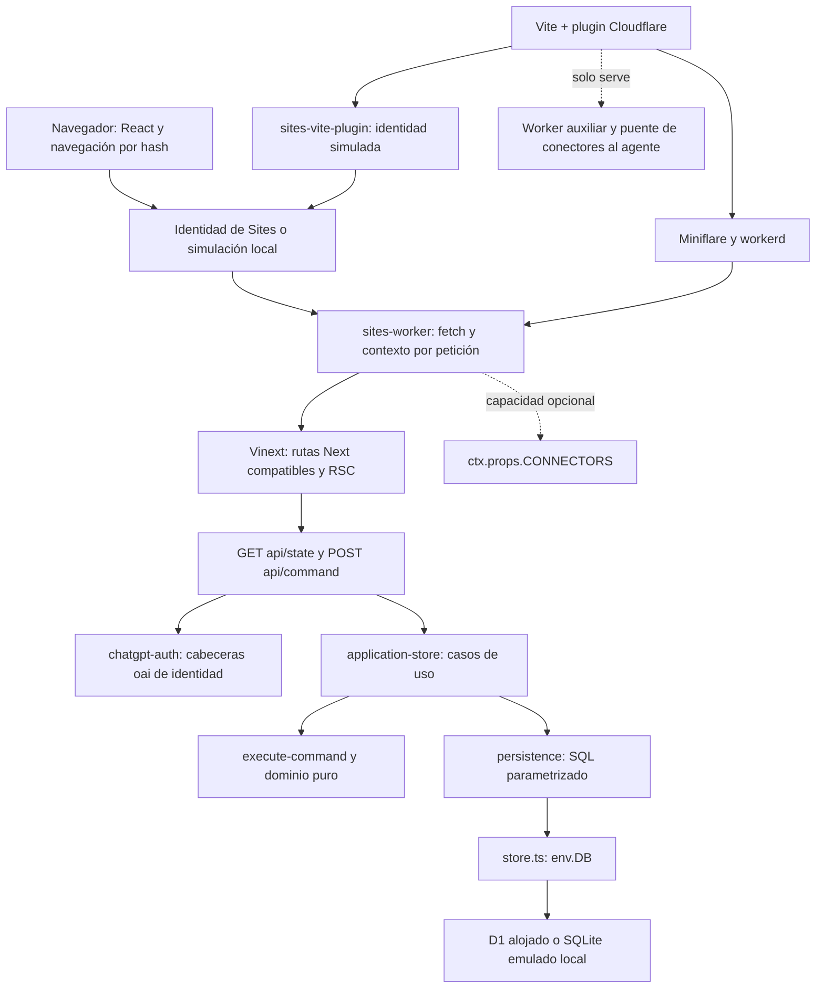

# Tarea 01 — Auditoría arquitectónica

Fecha: 14/10/2026, America/Bogota. Rama: `codex/reestructuracion-arquitectonica`.
Base inspeccionada: `a832579f2afa87594c37e35d2b4d9d363789bb9a`.

## Dictamen

Nutrequine Pro puede migrar a una aplicación local conservando su dominio y su
modelo SQLite. Hoy la vista previa portable sigue ejecutando Cloudflare Workers
mediante workerd/Miniflare, Vinext y D1 local; no es un servidor Node independiente.
La autenticación real depende de Sites y la local simula su contrato. Los puntos
principales a sustituir son identidad/sesión, entrada HTTP, adaptador de base de
datos, migraciones y compilación. No hace falta reescribir las reglas comerciales.

No se encontraron llamadas comerciales activas a conectores de ChatGPT, R2,
APIs de IA, correo, pagos bancarios, almacenamiento externo o analítica en el
código operativo examinado. Los pagos de la aplicación son registros internos;
no se detectó integración con una pasarela. Hay infraestructura de conectores y
R2 heredada del starter: presencia no equivale a consumo.

Esta auditoría solo añade documentos. No modifica código, funcionalidades,
configuración ejecutable, paquetes, migraciones, datos ni el sitio alojado.
La eliminación previa del vídeo de showcase permanece fuera de esta tarea.

## Alcance y método

Se inventariaron los 313 archivos versionados de la base, con barrido de imports,
URLs y referencias a plataforma en 248 archivos de fuente/configuración. Se
analizaron por separado los tres paquetes y lockfiles, las rutas operativas,
autenticación, store, SQL, esquema Drizzle, preparación de D1, plugins, scripts,
tipos, CSS, recursos locales, pruebas, CI, ejemplos, demo y showcase. El
[inventario completo](INVENTARIO_DEPENDENCIAS_01.md) enumera paquetes directos,
versiones resueltas e imports con sus archivos de origen.

Un recorrido de imports y reexports estáticos de ejecución, excluyendo imports
de tipos, parte de `app/page.tsx`, `app/layout.tsx`, las dos rutas API y
`build/sites-worker.ts`: alcanza 104 módulos fuente. Sus imports externos son
`react`, `lucide-react`, `next/image`, `next/headers`, `next/navigation`,
`cloudflare:workers`, `node:async_hooks` y `vinext/server/fetch-handler`.
Se revisaron adicionalmente imports dinámicos, configuración, scripts y módulos
virtuales que ese recorrido no representa. El número no equivale al bundle final.

No se inspeccionaron valores de `.env`, credenciales, registros de clientes,
bases privadas ni configuración real del control plane. No se ejecutaron
instalaciones, publicación, llamadas a proveedores ni migraciones. No se afirma
ausencia de tráfico en bibliotecas a partir del análisis estático: la prueba
de independencia con red bloqueada corresponde a la migración.

## Mapa actual de ejecución

Las flechas de capacidad opcional representan infraestructura disponible, no
acciones usadas por ventas o producción. En alojamiento, la identidad es
suministrada por la plataforma; en portable, el middleware de desarrollo la
inyecta después del inicio de sesión local.

## Dependencias de plataforma y puntos de acoplamiento

| Dependencia          | Evidencia dentro de `app/`                                                                         | Uso y consecuencia                                                                          | Sustitución propuesta                                                 |
| -------------------- | -------------------------------------------------------------------------------------------------- | ------------------------------------------------------------------------------------------- | --------------------------------------------------------------------- |
| ChatGPT Sites        | `.openai/hosting.json`; `build/sites-vite-plugin.ts`; `scripts/local-bindings.mjs`                 | Configuración de proyecto, binding D1, empaquetado de metadatos y migraciones               | Configuración local propia; distribución Node y assets                |
| Identidad ChatGPT    | `app/chatgpt-auth.ts`; página y rutas API                                                          | Cabeceras `oai-authenticated-user-*`, redirecciones de entrada/salida y autorización por ID | Sesiones y credenciales locales asociadas a IDs históricos            |
| Worker de Sites      | `build/sites-worker.ts`                                                                            | `fetch(request, env, ctx)` y `ctx.props.CONNECTORS` alrededor del handler Vinext            | Entrada HTTP Node; contexto de identidad por petición                 |
| Cloudflare Workers   | `lib/store.ts`; `db/index.ts`; `build/connector-preview-worker.mjs`                                | Import especial `cloudflare:workers`, `env.DB`, `WorkerEntrypoint` y tipos                  | Adaptador SQLite y servicios Node sin bindings                        |
| Vinext               | `vite.config.ts`; `scripts/run-framework.mjs`; worker                                              | Enruta App Router y compila cliente, servidor y RSC; no se ejecuta `next build`             | React SPA con Vite y API Node                                         |
| D1                   | `application-store.mjs`; `persistence.mjs`; `wrangler.local.json`                                  | Contrato `prepare().bind()` y `batch()` atómico; ledger Wrangler                            | Puerto de persistencia propio y transacciones SQLite                  |
| Drizzle D1           | `db/index.ts`; `examples/d1/`                                                                      | `drizzle-orm/d1`, pero no es el store comercial activo                                      | Mantener esquema/generador SQLite; no exigir ORM al store             |
| Conectores Sites     | `lib/connectors.ts`, contratos/contexto, `build/connector-preview-*`, `scripts/connector-preview/` | Invocación y políticas del host, puente JSON-RPC al agente en desarrollo                    | Desactivar y desacoplar; no reemplazar con servicios innecesarios     |
| R2                   | Tipo `BUCKET` en `cloudflare-env.d.ts`; campo `r2` en hosting                                      | Capacidad opcional; `r2: null` y sin consumo operativo encontrado                           | Ningún storage adicional requerido por los flujos actuales            |
| Toolchain Cloudflare | `@cloudflare/vite-plugin`, Wrangler, Miniflare, workerd                                            | Emulación, compilación y arranque incluso portable                                          | Scripts Node/Vite y runner de migraciones propio                      |
| Next compatible      | `next/headers`, `next/navigation`, cuatro `next/image`; tipos/configuración                        | Identidad, redirect, imágenes, metadata y soporte TS/ESLint                                 | HTTP local, HTML/React para imágenes y metadata; ESLint independiente |

### Sites e identidad

`getChatGPTUser()` confía en las cabeceras de identidad; no verifica un token
de proveedor dentro de la aplicación. La confianza corresponde al perímetro
administrado por Sites. No copiar ese mecanismo a un servidor Node expuesto:
un cliente podría suministrar cabeceras por sí mismo.

En portable, `sites-vite-plugin.ts` elimina cabeceras de identidad recibidas y
solo simula autenticación para hosts/direcciones loopback. Usa cookie local,
un usuario fijo y rutas `/signin-with-chatgpt`, `/signout-with-chatgpt` y
`/callback` (callback local responde 501). Es una simulación de desarrollo,
no cuentas locales independientes. La primera identidad en base sin estado se
convierte en ADMIN en `ensureState`; la migración deberá cambiar el bootstrap,
sin convertir una base importada en un estado inicial.

El plugin vendorizado declara origen `@openai/sites-vite-plugin` 0.2.0 y licencia
MIT. Durante build copia hosting y `drizzle/` a `dist/.openai/`. Ese paquete de
hosting no forma parte de un instalador local autónomo. No reproducir el
identificador del proyecto alojado en la documentación de migración.

### Runtime, compilación y arranque

`vite.config.ts` combina `vinext()`, `sites()`, `connectorPreview()` y plugin
Cloudflare. El entorno servidor es `rsc` con hijo `ssr`; la entrada es
`build/sites-worker.ts`. En `serve` añade binding `CONNECTORS` y Worker auxiliar.
La compatibilidad `nodejs_compat` no convierte el Worker en un proceso Node.

`npm run dev` portable prepara D1 y ejecuta CLI Vinext, puerto 5173.
El perfil `managed-linux` ejecuta Vite en desarrollo y un helper Bash para build,
con `0.0.0.0` y host permitido `terminal.local`. La selección se lee de
`.sites-runtime/execution-profile.json`; en checkout limpio el default es portable.
`npm start` ejecuta Wrangler sobre `dist/server/wrangler.json`, con persistencia
default y loopback: sigue dependiendo del runtime Cloudflare. El middleware de
autenticación simulada es `configureServer` de Vite; no se debe asumir que ese
inicio de sesión existe en el Worker compilado de forma independiente.

Los helpers de instalación administrada usan cachés/variables `SITES_*`, seeds,
pnpm opcional, Bash, GNU timeout, flock, curl y sha256sum. Hay rutas de instalación
portable con npm, pero la dependencia del toolchain permanece. Esos helpers son
operacionales, no reglas de negocio. `scripts/sites-env.sh` redefine HOME y
directorios temporales para el entorno administrado; no trasladarlo al instalador
local. `CODEX_SANDBOX` solo ajusta polling HMR en macOS.

El lockfile fija Wrangler 4.92.0, Miniflare 4.20260515.0 y workerd
1.20260515.1. El plugin Cloudflare depende de Wrangler/Miniflare; estos incorporan
workerd. Miniflare añade `sharp`, con override a 0.35.4 en el proyecto. Por tanto,
retirar solo el comando de publicación deja dependencias binarias en desarrollo
y arranque. Vinext añade bibliotecas de imagen/OG y el proyecto incluye soporte
RSC; la migración SPA deberá revisar también esas dependencias transitivas.

React, React DOM, Lucide, TypeScript, Vite, plugin React y Tailwind pueden
conservarse como bibliotecas/herramientas locales. Muchas dependencias de UI
(Radix, Recharts, calendarios, formularios y shadcn) solo aparecen en componentes
vendorizados fuera del grafo operativo descrito. No calificarlas como servicios
externos ni quitarlas automáticamente: confirmar uso y requisitos futuros antes
de cualquier reducción del manifest. `next-themes` es una biblioteca distinta de
Next; el tema del panel actual usa su propio estado de navegador.

### Datos y transacciones

El esquema contiene 25 tablas de entidades en `state-schema.mjs`, más `settings`
y `transaction_guards`: 27 tablas de aplicación. D1/SQLite puede añadir tablas
de infraestructura y `d1_migrations`; no contarlas como entidades comerciales.
La migración histórica y metadatos Drizzle son la referencia de esquema.

Los registros conservan `id`, `data` JSON y columnas relacionales. El store carga
el estado completo con un batch de consultas; no utiliza `getDb()` ni Drizzle
para ejecutar comandos comerciales. `writePlan()` emite upserts parametrizados,
un guard de revisión con restricción CHECK, actualización de settings y limpieza
del guard. D1 ejecuta el conjunto atómicamente. En un puerto SQLite deben
mantenerse rollback, lectura coherente, orden de escrituras y manejo de conflictos.
Una secuencia de sentencias sin transacción cambiaría el comportamiento.

`tests/helpers/d1-memory.mjs` ya ejecuta el store real con SQLite en memoria y
transacciones BEGIN/COMMIT/ROLLBACK. Esto demuestra una vía de adaptación; no es
un adaptador de producción listo: faltan archivo persistente, lifecycle,
busy timeout, exclusión de migraciones, backups y pruebas en disco.

La preparación actual ejecuta Wrangler local por proceso hijo. Inspecciona
esquema/índices y ledger, reconoce bases históricas completas y aplica pendientes.
No puede utilizarse sin Wrangler. La nueva preparación deberá conservar esos
casos y detenerse ante esquema parcial, sin repetir el SQL inicial.

### Conectores y recursos

`connectorsForRequest()`, `db/index.ts` y `components/connector-error.tsx` no son
alcanzados desde las raíces operativas del grafo estático analizado. El worker
sí instala contexto de conectores, y Vite sí instala su preview, aunque los
casos de uso no invoquen esos servicios. El puente del preview transmite
solicitudes por archivos privados y JSON-RPC al agente; no tiene credenciales
de proveedores incorporadas. No inferir Gmail, Drive u otros servicios activos
a partir de este starter genérico.

Las imágenes operativas son locales (`public/brand/` y CSS); no se encontraron
fuentes remotas o CDN usados por el panel. `next/image` introduce la capa de
framework aun con imágenes locales. Tema y navegación usan navegador/localStorage;
no son persistencia comercial. Las APIs activas usan `fetch` de mismo origen:
`/api/state` y `/api/command`. `https://app.local`, `http://localhost` y
`http://preview` son bases de parsing o solicitudes internas, no proveedores.

## Servicios externos y dependencias de entrega

| Servicio o recurso                 | Dónde aparece                                                            | Momento necesario                                     | Tratamiento para independencia                                                              |
| ---------------------------------- | ------------------------------------------------------------------------ | ----------------------------------------------------- | ------------------------------------------------------------------------------------------- |
| ChatGPT Sites y D1 alojado         | Auth, binding, hosting y documentación                                   | Uso alojado/publicación                               | Sustituir por identidad y datos locales; acceso administrativo solo para extracción final   |
| Registro npm                       | Tres lockfiles; 888 resoluciones HTTP del lockfile principal             | Instalación/reinstalación; no implica red al operar   | Artefacto distribuido con dependencias de runtime y assets; preparación offline verificable |
| GitHub y Actions                   | Remoto y `.github/workflows/quality.yml`                                 | Colaboración y CI opcional                            | Mantener opcional; aplicación operativa no debe consultarlo                                 |
| shadcn                             | `components.json` y componentes vendorizados                             | Generación de componentes, no API comercial           | Conservar recursos locales y licencias; sin generación remota en ejecución                  |
| gyan.dev / FFmpeg                  | `showcase/scripts/prepare-tools.mjs` y `demo-linkedin/prepare_tools.mjs` | Preparación de vídeos                                 | Separar herramientas multimedia del producto; binarios locales opcionales                   |
| Playwright, Chrome y FFmpeg        | Dos paquetes multimedia y scripts de captura                             | QA/captura/render; descarga de herramientas si faltan | Dependencias de desarrollo separadas; no requeridas para operar ventas                      |
| Runtime Codex local                | Fallback en `showcase/scripts/runtime.mjs` y scripts de demo             | Resolución de Playwright/herramientas                 | Hacer instalaciones autónomas explícitas; no depender de cachés del agente                  |
| Fuentes del equipo para vídeo      | Render de demo/showcase                                                  | Producción audiovisual                                | Portabilidad de herramientas separada; no afecta al panel                                   |
| Vercel/OG y web-vitals transitivos | Dependencias de Vinext en lockfile                                       | Bibliotecas del framework                             | No acreditan hosting Vercel o telemetría activa; revisar desaparición al desacoplar Vinext  |

GitHub Actions instala Node 24, ejecuta `npm ci` y `npm run verify`; no contiene
un paso de publicación de Sites. La publicación alojada está fuera del workflow
inspeccionado. Los flags locales desactivan métricas Wrangler y fetch de datos
Cloudflare por default; esto reduce tráfico, pero no sustituye una prueba sin red.
`.npmrc` desactiva audit/fund/update-notifier; no certifica seguridad de paquetes.

## Riesgos ordenados y límites de la auditoría

| Prioridad | Riesgo de migración                                                    | Comprobación necesaria                                                      |
| --------- | ---------------------------------------------------------------------- | --------------------------------------------------------------------------- |
| Alta      | Confiar en cabeceras o usuario fijo al salir de Sites                  | Sesiones locales; rechazo de identidad enviada por cliente                  |
| Alta      | Perder atomicidad, revisión o idempotencia al reemplazar batch         | Tests del mismo store con SQLite real; concurrencia y rollback              |
| Alta      | Reasignar IDs y romper autoría histórica                               | Credenciales vinculadas a IDs existentes, sin reescritura masiva de JSON    |
| Alta      | Reejecutar migración inicial o inicializar maestros sobre importación  | Inspección de esquema y ledger; bootstrap explícito                         |
| Alta      | Cortar alojamiento sin export validado o escribir en ambos sistemas    | Ensayo, ventana sin escrituras, comparación y plan de retorno               |
| Media     | Confundir UI fingerprint con prueba de login, API o disco              | Añadir integración HTTP, reinicio persistente y ensayo offline              |
| Media     | Reemplazar next/image y alterar HTML/estilo                            | Comparación visual e imágenes; hashes nuevos solo tras revisión justificada |
| Media     | Dependencias binarias y cachés del agente impiden instalación autónoma | Paquetes por plataforma en equipo limpio sin Codex                          |
| Media     | Estado completo crece y bloquea UI/servidor                            | Medir tiempos/tamaño con datos representativos antes de optimizar           |

Los 55 tests y check/lint/build aprobados en la preparación anterior corresponden
al mismo código de aplicación de esta base. Esta tarea documental no vuelve a
ejecutar esos checks de código ni modifica sus resultados. Se revisa formato de
los documentos, enlaces internos y `git diff --check`. La limitación de formato
global por archivos locales FFmpeg ya está registrada en el estado base.

No se realizó auditoría de vulnerabilidades, licencias transitivas exhaustiva,
permisos efectivos de producción ni pruebas dinámicas de egress. La configuración
de cuenta/retención/export de la base alojada debe verificarse antes de extraerla.
El [plan técnico](PLAN_MIGRACION_LOCAL.md) convierte estos hallazgos en fases y
criterios verificables; no constituye autorización para ejecutarlas en esta tarea.
