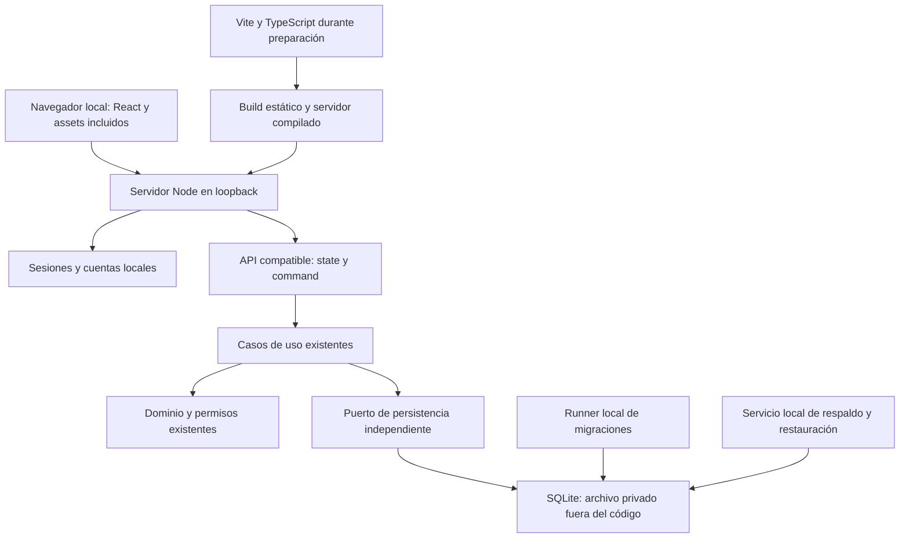

# Plan técnico de migración a aplicación local

Estado actual: la [Tarea 09](REPORTE_09_CONSOLIDACION.md) consolida React/Vite,
Fastify/Node y SQLite como entradas principales y retira la infraestructura
reemplazada. Los pasos siguientes conservan la propuesta histórica. La transferencia
real de datos, la integración corporativa y los límites indicados en el reporte
siguen pendientes; no son parte de esta consolidación.

Estado de implementación: [Tarea 05](REPORTE_05_PERSISTENCIA.md) aporta el puerto
neutral y adaptador SQLite Node; [Tarea 06](REPORTE_06_MIGRACIONES_SQLITE.md)
aporta administración, migraciones, respaldo y recuperación independientes.
[Tarea 07](REPORTE_07_BACKEND_NODE.md) incorpora el backend Node y sesiones locales,
conservando el sistema anterior. [Tarea 08](REPORTE_08_FRONTEND_INDEPENDIENTE.md)
aporta React/Vite conectado a Node bajo el mismo origen. Permanecen pendientes
la eliminación final de infraestructura heredada y la transferencia real de datos.
El plan siguiente conserva la propuesta original como referencia.

Propuesta del 14/10/2026 sobre la base `a832579`. No implementada en Tarea 01.
Se apoya en la [auditoría arquitectónica](AUDITORIA_01_ARQUITECTONICA.md),
el [inventario](INVENTARIO_DEPENDENCIAS_01.md) y los
[procedimientos de respaldo](RESPALDO_RESTAURACION.md).

## Objetivo y alcance de independencia

Operar Nutrequine Pro en el equipo del usuario sin ChatGPT, Sites, cuenta
Cloudflare, Workers, Vinext, D1 administrado ni conexión a Internet. Conservar
interfaz, módulos, reglas comerciales, permisos, IDs, auditoría, snapshots y
persistencia. La preparación de paquetes puede usar Internet; la instalación del
artefacto distribuido, el inicio y todos los flujos comerciales deben funcionar
offline. GitHub/CI y herramientas de vídeos seguirían siendo opcionales de desarrollo.

La propuesta inicial es un servidor local en loopback y navegador, con soporte de
múltiples cuentas y roles en ese equipo. No propone acceso LAN, sincronización
entre equipos ni aplicación Electron/Tauri todavía. Esas extensiones requieren
decisiones propias y no son necesarias para la independencia solicitada.

## Arquitectura recomendada

React + TypeScript + Vite para un cliente SPA; servidor Node 24 con Fastify y
SQLite en archivo mediante un adaptador aislado. Mantener Tailwind y los recursos
locales. Preservar `/api/state`, `/api/command` y navegación por hash para reducir
el impacto en componentes y formularios. Servir el build y la API desde el mismo
origen en operación. Vite será herramienta de desarrollo/compilación, no requisito
del servidor operativo. Su servidor preview no es servidor de producción según
[documentación de Vite](https://vite.dev/guide/static-deploy.html).

Fastify es una nueva dependencia propuesta, no instalada. Proporciona entrada
HTTP, límites y hooks de petición en Node; seleccionar y fijar versiones de
framework y plugins compatibles en la fase técnica, sin copiar un número de
versión de este documento. Véase [referencia oficial de servidor](https://fastify.dev/docs/latest/Reference/Server/).
Una implementación directa con `node:http` es posible, pero obliga a mantener
manualmente routing, parsing, límites y manejo de errores; no es la opción inicial.

Para SQLite, evaluar primero `node:sqlite` de Node 24.18.0, ya disponible en las
pruebas actuales y sin instalar un driver nativo adicional. La API es release
candidate en esa versión y `DatabaseSync` es síncrona: fijar runtime, encapsular
el driver y medir bloqueo del event loop antes de adoptarlo definitivamente.
Su API incluye respaldo SQLite; véase [documentación de esa versión](https://nodejs.org/download/release/v24.18.0/docs/api/sqlite.html).
Si no supera estabilidad/rendimiento requeridos, elegir otro driver SQLite y
validar sus binarios por plataforma. El dominio no debe depender de esa elección.

## Contratos que se conservarán

| Contrato                 | Requisito                                                                              |
| ------------------------ | -------------------------------------------------------------------------------------- |
| `GET /api/state`         | Estado y actor; sin caché; errores de sesión/acceso/disponibilidad diferenciados       |
| `POST /api/command`      | `type`, `payload`, `request_id`; mismo resultado, validaciones y permisos del servidor |
| Identidad de caso de uso | `{ userId, displayName }` resuelto por sesión del servidor                             |
| Escritura                | Sentencias parametrizadas y batch completo transaccional; no escrituras parciales      |
| Lectura                  | Snapshot coherente de settings y entidades, incluyendo revisión                        |
| Conflicto                | Conservar detección de revisión y mensaje de recarga; no reintentar sobrescribiendo    |
| Idempotencia             | Conservar request_id y actor histórico en auditoría                                    |
| Dinero/pesos             | Céntimos y gramos enteros, redondeo y límites actuales                                 |
| Historia                 | IDs, claves relacionales, JSON, fórmulas, pagos, compensaciones y autoría intactos     |
| Base existente           | Nunca reinicializar por faltar credenciales locales o ledger propio                    |

Primero usar un puerto pequeño equivalente a lo que consume el store:
`prepare(sql).bind(...args)` y `batch(statements)` con resultados `results`.
Definir tipos propios en lugar de `D1Database`; la compatibilidad inicial es
una técnica de transición, no una obligación de conservar nombres D1 para siempre.
No introducir repositorios por entidad ni normalizar todos los documentos JSON
durante esta migración: ampliaría innecesariamente la superficie de cambios.

## Fases, entregables y condiciones de avance

### Fase 0 — Decisiones y baseline recuperable

Confirmar sistema operativo objetivo, distribución offline y responsables de
credenciales/respaldo. Registrar un baseline funcional y visual reproducible con
datos sintéticos. Conservar rama y commit de origen y export/copia protegida del
entorno a migrar. No capturar datos de clientes en Git. Las dudas de acceso a la
base alojada no bloquean un prototipo con fixtures, pero sí la transferencia real.

Salida: alcance local definido, datos de prueba aislados, respaldo probado y
lista de operaciones/roles para comparación. La Tarea 01 entrega el diagnóstico;
no satisface por sí sola el respaldo real de producción.

### Fase 1 — Persistencia SQLite independiente

Crear un adaptador de archivo persistente y sustituir únicamente la conexión del
store en una ejecución alternativa. Desacoplar el tipo de `D1Database` en
`lib/application-store.d.mts` y la fuente `env.DB` de `lib/store.ts` sin alterar
`writePlan`, dominio o comandos. Mantener preparado/bind y normalizar resultados
de SELECT y escritura, sin exponer particularidades del driver a los casos de uso.

Ejecutar cada batch en una transacción real, con rollback ante cualquier fallo,
incluida la restricción del guard. Activar foreign keys en cada conexión, definir
busy timeout y política de bloqueo. Inicialmente un único proceso propietario
del archivo; rechazar un segundo arranque sobre la misma base o asegurar su
coordinación. Evitar un `await` intermedio que permita otra operación dentro del
batch. Medir si DatabaseSync y carga completa son adecuados antes de elegir WAL
o un worker de base de datos. WAL, si se adopta, exige backup consistente.

Salida: suite del store, persistencia y crédito ejecutada contra ambos adaptadores
con el mismo resultado; tests de archivo/reinicio, rollback, dos conexiones con
revisión obsoleta y error de bloqueo. Nunca considerar suficiente la prueba en
memoria para persistencia real.

### Fase 2 — Migraciones y recuperación sin Wrangler

Separar inspección de esquema/plan de migración de la ejecución Wrangler de
`scripts/prepare-local-db.mjs` y `local-database.mjs`. Nuevo runner SQLite aplica
únicamente pendientes, bajo exclusión y transacciones revisadas. Preservar el
archivo `drizzle/0000_nervous_silver_fox.sql`; usar su SQL como referencia, sin
regenerarlo para aparentar un proyecto nuevo.

Mantener las cuatro situaciones actuales: base vacía, base histórica completa sin
ledger, ledger conocido y esquema/historial ajeno que debe bloquearse. Diseñar
equivalencia explícita entre ledger D1 y ledger local; no copiar tablas internas
`_cf_*` ni ejecutar comandos privados D1 sobre SQLite. Registrar hash del SQL
para migraciones locales nuevas; decidir cómo adoptar la migración histórica sin
inventar un hash previo. Separar migraciones de credenciales de tablas comerciales.

Usar directorio de datos configurable y privado, fuera de instalación/Git,
resuelto a una ruta absoluta. Backups por API SQLite o copia completa con proceso
detenido; manifiesto, fecha, versión/esquema y hash. Restaurar a ruta nueva,
verificar integridad/relaciones/recuentos y seleccionar la copia. El primer
arranque no puede crear otra base silenciosamente cuando falta la elegida.

Salida: ensayo de preparación idempotente, adopción sin pérdida, rechazo de
esquema ajeno y restore de base en disco, sin Wrangler/workerd instalados.

### Fase 3 — API y autenticación local

Trasladar la lógica de las dos rutas a handlers Node con el store independiente.
Reemplazar `getChatGPTUser`, `next/headers` y redirects de plataforma por un
servicio de sesión. Crear credenciales locales separadas de `users`, vinculadas
a sus IDs existentes; no reescribir `created_by`, auditoría ni IDs en JSON.
Mantener ADMIN/OPERATOR/VIEWER y el último administrador. Si cambia el nombre
visible local, conservar los snapshots históricos existentes.

Configurar alta inicial explícita solo en una base nueva. En una importación,
permitir que el responsable verificado vincule una cuenta a un administrador
histórico, sin privilegios automáticos para el primer visitante. Contraseñas con
hash y salt, sesiones aleatorias con expiración/revocación y cookie HttpOnly/
SameSite; no confiar en roles ni cabeceras oai enviados por el navegador.

Bind a loopback; validar Host para evitar DNS rebinding y Origin/CSRF para
escrituras, incluidas peticiones sin Origin. Aplicar tamaño límite por bytes antes
de materializar el cuerpo, validar JSON y devolver errores compatibles. No
introducir CORS abierto. Login/salida no dependen de proveedor ni de cookie mock.
Las tablas y requisitos de credenciales son una decisión nueva de infraestructura;
no alterar el significado de usuarios comerciales.

Salida: pruebas HTTP de sesión, cabeceras falsificadas, roles, CSRF, límites,
JSON malformado, no caché y errores; operación end-to-end con API real local.

### Fase 4 — Cliente React/Vite sin Vinext ni Next

Crear entry HTML y bootstrap `createRoot` para `AdminApp`; conservar módulos de
UI, hooks, CSS, tipos y dominio compartido. La navegación por hash permite
evitar un router nuevo. Pasar metadata e iconos de `app/layout.tsx` a HTML local.
Sustituir las cuatro importaciones `next/image` por componentes HTML/React con
dimensiones, alt, carga y estilos equivalentes. Revisar salida y acceso a assets.

Sustituir enlaces de entrada/salida y mensajes relativos a ID autenticado de
ChatGPT por sesión/cuentas locales, manteniendo la capacidad de autorizar usuarios.
Esa adaptación de autenticación es necesaria y explícita; los formularios
comerciales no deben cambiar. En desarrollo, proxy Vite al servidor Node y cookie
de mismo origen; en operación el servidor sirve cliente compilado y API juntos.

Salida: rutas/hashes, responsive, tema y todos los formularios conservados;
comparación visual y pruebas de interacción. Mantener fingerprints anteriores de
componentes que no cambien. Un cambio justificado de markup por retirar Next
requiere revisión y un baseline nuevo trazable, no actualización ciega de hashes.

### Fase 5 — Toolchain y distribución autónoma

Reconfigurar `vite.config.ts` para React/Vite, y TS/ESLint sin Next/Workers.
Desconectar `sites()`, `connectorPreview()`, worker auxiliar y configuración
hosting del camino operativo. Retirar dependencias de plataforma del manifest
solo después de comprobar que no son requeridas por el destino. Revisar lockfile
y deps transitivas; no borrar archivos ni ejemplos por deducir que están sin uso
en esta auditoría. Cualquier limpieza posterior debe ser una tarea separada.

Reemplazar scripts dev/build/start/db y helpers SITES por comandos multiplataforma.
Mantener test/check/lint/format y build del cliente y servidor. Resolver exclusiones
de artefactos locales multimedia mediante un cambio explícito posterior, no
desactivando controles de fuentes. Drizzle puede seguir como generador del esquema
SQLite; `db/index.ts` de D1 no debe importarse en el nuevo servidor.

Preparar un artefacto con runtime Node por plataforma, servidor compilado,
dependencias de runtime, assets y migraciones, inventario/licencias y hashes.
Datos y credenciales se conservan fuera del directorio reemplazable del programa.
El instalador no ejecuta npm contra Internet ni consulta cachés Codex. Documentar
arranque, cierre ordenado, recuperación, actualización y diagnóstico sin datos
sensibles. Los paquetes de vídeo quedan opcionales y sus scripts se adaptan a la
nueva sesión solo cuando se necesiten como QA.

Salida: instalar y operar en equipo limpio sin Codex, Cloudflare o Docker;
repetir build/test con dependencias fijadas. CI puede seguir en GitHub, pero no
ser requisito de operación o licencia de acceso al programa.

### Fase 6 — Transferencia de datos y cambio de uso

Ensayar antes con una copia: export completo del entorno origen mediante acceso
autorizado; importar tablas comerciales y relaciones en destino aislado; adaptar
ledger por reglas explícitas; vincular cuentas locales a IDs históricos. Comparar
esquema, índices, recuentos por tabla, revisión y contenidos JSON canónicos o
hashes deterministas por ID. Comprobar además inventario físico/comprometido,
deuda y crédito separados, pagos/caja, costos y auditoría. No basta contar filas.

Para cambio real, suspender escrituras del origen, tomar export final, repetir
comparación y acordar el instante de uso del destino. No admitir escrituras en
ambos sistemas ni implementar dual write. Conservar origen y backups intactos.
Si el destino aún no recibió operaciones, retornar al origen con verificación.
Si recibió operaciones nuevas, no descartar esa base: detener ambos y conciliar
esas operaciones antes de reabrir origen. No hay rollback automático entre dos
sistemas divergentes. El esquema inicial debe permanecer compatible durante
la transición; migraciones posteriores tendrán su propio plan de recuperación.

Salida: datos preservados, sesión local operativa, ensayo offline y procedimiento
de retorno aceptado por el responsable. Esta fase requiere acceso a la fuente
real; no se puede certificar con fixtures.

## Pruebas de aceptación de independencia

| Área          | Evidencia exigida antes de cerrar la migración                                                                   |
| ------------- | ---------------------------------------------------------------------------------------------------------------- |
| Reglas        | Suite existente y escenarios A–F; crédito, precisión, stock, snapshots y permisos sin diferencias                |
| Base en disco | Reinicio conserva estado; rollback deja todas las tablas intactas; revisión obsoleta rechazada                   |
| Auth          | Usuarios/roles locales; login/logout y expiración; cabeceras de plataforma no conceden identidad                 |
| API/UI        | HTTP real, formularios y navegación; 66 escenarios existentes revisados más interacción                          |
| Offline       | Equipo limpio con red externa bloqueada: arranque, login, operación, reinicio y restore; solo loopback permitido |
| Recursos      | Sin CDN, fuentes remotas, endpoints Sites o descargas al iniciar; inspección de tráfico cliente/servidor         |
| Plataforma    | Binario operativo no carga Vinext, Wrangler, workerd, Miniflare ni `cloudflare:workers`                          |
| Datos         | Comparación por ID/JSON, revisión, relaciones, ledger y balances contra snapshot final                           |
| Recuperación  | Copia restaurada verificada y seleccionable sin sobrescribir el original; respaldo de credenciales incluido      |
| Distribución  | Instalación offline reproducible, actualización conserva datos, licencias/versions documentadas                  |

Medir duración de carga completa, comandos y backup con volumen representativo
en el equipo objetivo. Establecer los umbrales a partir de esa medición; no prometer
capacidad multiusuario o un SLA con las pruebas unitarias actuales. No cambiar
el modelo de estado ni paginar durante el desacoplamiento inicial sin necesidad
demostrada, porque eso cambia contratos y multiplica riesgos.

## Decisiones pendientes antes de implementar

Confirmar OS/arquitectura de distribución, políticas de cuentas y recuperación
de contraseña, ruta/permisos/cifrado de datos, frecuencia/retención de respaldo,
necesidad de datos alojados y acceso administrativo para obtenerlos. La opción
por defecto es navegador y loopback en un equipo, preservando varias cuentas;
LAN, sincronización o instalador de escritorio son ampliaciones separadas.
No se necesitan respuestas a estas decisiones para completar esta auditoría.

Complejidad relativa: persistencia/migraciones, identidad y transferencia tienen
riesgo alto; extracción HTTP y empaquetado riesgo medio; entrada SPA e imágenes
riesgo medio con QA visual. No se fija calendario sin prueba del driver, volumen
y alcance de distribución. Cada fase debe tener commit propio y checks relevantes,
con la versión alojada preservada hasta que el destino supere aceptación.
