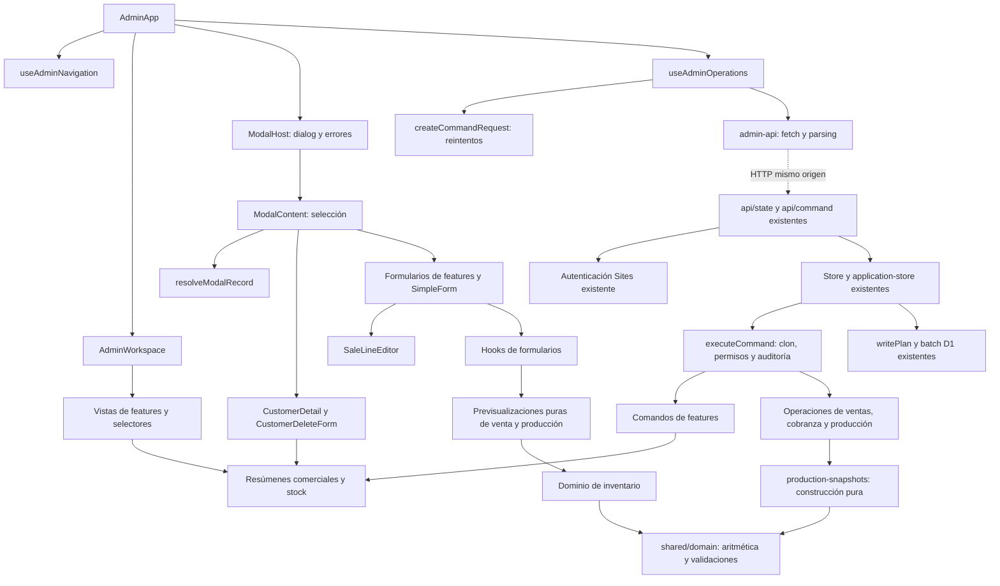

# Tarea 04 — Refactorización estructural y modularización

Fecha: 14/10/2026, America/Bogota.
Rama: `codex/reestructuracion-arquitectonica`. Base: `0258fcb`.

## Plan previo por módulos

Plan registrado antes de editar fuentes, después de consultar la auditoría 01,
el plan de migración, el reporte 03, la matriz de regresión y la especificación
maestra del MVP; se aplica la skill `programacion-clara`.

1. **Modales y clientes:** separar ciclo de vida del diálogo, resolución de registros,
   selección de contenido, detalle de cliente y formulario de retirada. Mantener
   prioridades de resolución y el uso del registro original en crédito, fórmula,
   motivo y retirada.
2. **Composición administrativa:** mantener el contenedor, navegación y operaciones
   en `AdminApp`; concentrar composición de vistas, filtros y selectores en un
   componente de workspace sin estado adicional ni wrappers HTML nuevos.
3. **HTTP y formularios:** extraer transporte y parsing HTTP del hook administrativo;
   separar previsualizaciones puras de ventas y producción del estado React.
   Revisar componentes y formularios compartidos sin fragmentar los pequeños.
4. **Producción:** separar construcción y validación de snapshots de productos e
   insumos de su registro, costos y movimientos. Preservar orden de cálculos,
   validaciones, asignación de IDs y efectos. Revisar ventas, cobranza, inventario,
   clientes y balance; conservar módulos que ya sean cohesivos.

Cada grupo requiere diff, pruebas, tipos, lint y formato. Al terminar: 89 pruebas
existentes, 12 pasos E2E, compilación y detección de ciclos. No se modificarán
fixtures para ocultar diferencias. Las verificaciones y resultados se completarán
con evidencia de ejecución.

## Arquitectura anterior y criterio de intervención

La aplicación ya distribuía presentación y dominio en `features`, utilidades y
tipos en `shared`, y coordinación/persistencia en `lib`. No se sustituye esa
estructura. Los problemas estaban en responsabilidades concretas:

- `ModalHost` administraba el diálogo nativo, resolvía registros, seleccionaba
  formularios y contenía detalle y retirada de clientes.
- `AdminApp` administraba el contenedor y componía todas las vistas, filtros,
  selectores y resúmenes.
- `useAdminOperations` mezclaba estado React, coordinación de reintentos y
  modales con transporte y parsing de respuestas HTTP.
- Los hooks de formularios mezclaban estado editable y cálculos derivados.
- `productionRows` mezclaba construcción de snapshots, registro de filas,
  acumulación de cantidades y costos.
- `SaleForm` contenía el editor completo de líneas, además de cliente/sede,
  creación rápida, condiciones comerciales, pago inicial y rectificación.

Cada extracción conserva una responsabilidad reconocible. No se añaden servicios,
repositorios por entidad, contenedores de dependencias ni registro dinámico de
componentes. No hay nuevas dependencias ni cambios en la configuración de
TypeScript, ESLint o Prettier.

## Componentes y funciones resultantes

Rutas relativas a `app/`:

| Archivo                                                        | Responsabilidad resultante y justificación                                                                                                               |
| -------------------------------------------------------------- | -------------------------------------------------------------------------------------------------------------------------------------------------------- |
| `app/ui/AdminApp.tsx`                                          | Contenedor general, carga inicial, conexión de hooks, navegación, avisos y modal.                                                                        |
| `app/ui/AdminWorkspace.tsx` (nuevo)                            | Composición explícita de vistas, filtros y selectores. Permite leer el contenedor sin atravesar todas las pantallas; no añade estado ni wrappers al DOM. |
| `app/ui/ModalHost.tsx`                                         | Ciclo de vida de `dialog`, título, cierre y presentación de errores.                                                                                     |
| `app/ui/resolve-modal-record.ts` (nuevo)                       | `resolveModalRecord` consulta el registro actual y conserva fallback, prioridad de tablas y ausencia de ID. No depende de React.                         |
| `app/ui/ModalContent.tsx` (nuevo)                              | Selección ordenada del formulario o detalle; adapta props explícitas a los contratos existentes.                                                         |
| `features/clientes/components/CustomerDetail.tsx` (nuevo)      | Información del cliente, deuda/crédito, edición según permisos y sus ventas.                                                                             |
| `features/clientes/components/CustomerDeleteForm.tsx` (nuevo)  | Confirmación de retirada y envío de `CUSTOMER_DELETE`, conservando historial.                                                                            |
| `app/ui/admin-api.ts` (nuevo)                                  | `fetchAdminState`, `submitAdminCommand` y `StateRequestError`: transporte HTTP y errores, sin estado React ni selección de modales.                      |
| `app/ui/hooks/useAdminOperations.ts`                           | Coordina carga, estado, bloqueo, reintentos, avisos y selección de detalle posterior; delega HTTP.                                                       |
| `features/ventas/components/SaleForm.tsx`                      | Compone datos de venta, creación rápida, editor, pago y motivo de rectificación.                                                                         |
| `features/ventas/components/SaleLineEditor.tsx` (nuevo)        | Edición de productos, sacos, peso, precio, subtotales y adición/retirada de líneas. Recibe estado y callbacks; no duplica estado React.                  |
| `features/ventas/hooks/sale-form-preview.ts` (nuevo)           | `saleFormPreview`: agrupación de cantidades/pesos, faltantes y total del formulario; contempla restitución de la entrega original al rectificar.         |
| `features/ventas/hooks/useSaleFormState.ts`                    | Conserva el estado y los eventos del formulario; delega la previsualización.                                                                             |
| `features/produccion/hooks/production-form-preview.ts` (nuevo) | `productionFormPreview`: consumo consolidado, sacos, peso comercial, estimación y cobro parcial del formulario.                                          |
| `features/produccion/hooks/useProductionFormState.ts`          | Conserva estado editable, ajustes y callbacks; delega cálculos derivados.                                                                                |
| `features/produccion/domain/production-snapshots.mjs` (nuevo)  | `buildProductionProduct` y `buildProductionIngredient`: validan y construyen snapshots sin registrar filas ni emitir movimientos.                        |
| `features/produccion/domain/operations.mjs`                    | Coordina registro de snapshots, acumulación, costos y confirmación/movimientos.                                                                          |

Los diez archivos fuente nuevos corresponden a estas responsabilidades; siete
fuentes existentes se modifican. Se añade además un archivo de pruebas con cuatro
casos y este reporte. No se trasladan directorios ni se borran fuentes.

### Dependencias principales

El diagrama representa dependencias de responsabilidad. La conexión HTTP es un
límite de ejecución, no un import desde el navegador al servidor.

### Dependencias simplificadas y módulos conservados

El contenedor de diálogo deja de importar directamente los formularios
comerciales y el resumen de clientes. `AdminApp` deja de importar cada vista y
sus selectores. Los hooks de formularios ya no usan el barrel de componentes
`shared/ui` para obtener fecha y búsqueda; usan las utilidades correspondientes.
El hook de ventas importa resumen y normalización directamente de sus módulos,
sin pasar por la fachada que también exporta ejecución de comandos.

Se revisaron `SaleForm`, `ProductionForm`, sus hooks, `SimpleForm`, `FormProps`
y los módulos de dominio de ventas, producción, cobranza, inventario, clientes
y balance. `ProductionForm` ya delega costos a `CostRows` y queda como composición
del formulario con un hook más acotado. `SimpleForm` ya delega campos a módulos
especializados; dividirlo otra vez añadiría navegación sin aislar una
responsabilidad nueva. No se fragmentaron estos componentes ni los comandos
pequeños, validación de aplicaciones, stock y resúmenes que ya son cohesivos.

## Contratos e invariantes conservados

- Se mantienen `FormProps.s`, los retornos `v` y `s` de hooks y el contexto de
  comandos `s`/`p`. Las interfaces nuevas usan `state` y parámetros descriptivos;
  `ModalContent` adapta a `{ s: state }`. No se renombra simultáneamente toda la
  cadena de consumidores ni se introduce `any` explícito.
- `AdminWorkspace` recibe el resultado tipado del hook de navegación mediante
  `ReturnType`; el import es exclusivamente de tipos, sin ciclo en ejecución.
  `SaleLineEditor` recibe `SaleLine[]`, un setter React tipado y un callback con
  `keyof SaleLine`. Los nuevos componentes carecen de estado duplicado.
- `resolveModalRecord` mantiene el orden de elección y el fallback al objeto
  original. Crédito, fórmula, motivo y retirada siguen recibiendo deliberadamente
  el registro original en los puntos que ya lo usaban.
- GET continúa usando `/api/state` con `cache: no-store`. POST conserva
  `/api/command`, JSON, `type`, `payload` y `request_id`. El hook sigue retirando
  `_keep_open` antes del transporte, conservando reintento, bloqueo y errores.
  `authenticated_id` solo se conserva en errores 403, con los mismos mensajes.
- Las previsualizaciones conservan exactamente las expresiones de redondeo del
  formulario. No sustituyen validaciones autoritativas del dominio ni se unifican
  con la aritmética de confirmación para reinterpretar diferencias preexistentes.
- Los snapshots conservan campos, precios, fórmula clonada, céntimos y gramos.
  Las validaciones de cabecera y costos unitarios permanecen antes del bucle;
  cada snapshot se construye y registra en el mismo orden. Los constructores
  nuevos no generan IDs, mutaciones, auditoría ni movimientos.
- `executeCommand`, permisos, historial, revisión, idempotencia, `writePlan`, batch,
  autenticación, endpoints, esquema y migraciones permanecen sin cambios.

## Verificaciones

Se revisaron diffs por responsabilidad, los archivos extraídos y sus consumidores.
Antes de extraer transporte y previsualizaciones, la suite de modales/composición
pasó las 89 pruebas existentes, tipos y lint. La comprobación global de formato
coincidió con archivos del siguiente conjunto todavía en edición; se formatearon
y se repitió la comprobación con el árbol estabilizado.

Después de extraer snapshots y previsualizaciones, una ejecución dirigida pasó
50 pruebas: aceptación, regresión comercial, arquitectura, HTML y los cuatro
casos nuevos. La posterior extracción del editor de líneas se verificó de nuevo
con la suite completa.

| Verificación final                  | Resultado                                                                                                                                                               |
| ----------------------------------- | ----------------------------------------------------------------------------------------------------------------------------------------------------------------------- |
| `npm.cmd test`                      | 93 aprobadas: 89 existentes y 4 nuevas; cero fallos u omisiones.                                                                                                        |
| Regresión HTML incluida en la suite | 66 fingerprints iguales al baseline, sin actualizar fixtures.                                                                                                           |
| `npm.cmd run check`                 | TypeScript aprobado.                                                                                                                                                    |
| `npm.cmd run lint`                  | ESLint aprobado con `--max-warnings 0`.                                                                                                                                 |
| `npm.cmd run format:check`          | Prettier global aprobado.                                                                                                                                               |
| `npm.cmd run build`                 | Compilación de los cinco entornos aprobada; conserva `/`, `/api/state` y `/api/command`.                                                                                |
| Dependencias circulares             | Los dos controles de `architecture.test.mjs`, incluidos en las 93 pruebas, aprueban el grafo de imports/reexports locales en ejecución y los límites de dominio/shared. |
| Exports y diff                      | Nombres de exports declarados de las siete fuentes existentes conservados frente a `0258fcb`; `git diff --check` aprobado.                                              |
| `npm.cmd run test:e2e`              | 12 pasos aprobados: 4 HTTP y 8 de navegador; cero errores JavaScript, fallos u omisiones. Node informa 13 tests incluyendo el contenedor.                               |

`npm.cmd run verify` ejecutó secuencialmente tests, tipos, lint, formato y build,
con salida final 0. La compilación emitió avisos informativos de tiempo de plugins,
sin errores. El análisis de ciclos considera los imports/reexports estáticos
propios y excluye dependencias exclusivamente de tipos; no audita internamente
paquetes externos ni pretende descubrir imports dinámicos arbitrarios.

Los cuatro casos nuevos en `tests/modularization.test.mjs` verifican:

1. Rutas, política de caché, método, JSON y conservación del ID de reintento del
   cliente HTTP, ejecutando sus funciones reales con `fetch` controlado.
2. Errores 403/503/422, identidad autenticada solo en 403, mensaje de fallback y
   fallo de parsing JSON. No convierten errores de transporte en éxitos.
3. Agrupación de sacos y gramos, total en céntimos, restitución del stock de una
   entrega rectificada y detección de faltante ante un gramo adicional por saco.
4. Previsualización de producción con peso de fórmula distinto del comercial,
   descuentos de un céntimo y cobro parcial; ninguna previsualización muta el
   estado recibido.

En verificaciones intermedias se corrigieron dos diferencias, sin cambiar
expectativas: un espacio JSX adicional antes del editor de productos, detectado
por el fingerprint `modal:sale`, y una inferencia implícita al importar directamente
el resumen de ventas, resuelta con el tipo existente `SaleItem[]`. Las pruebas
posteriores aprueban ambas correcciones. No se actualizó ningún snapshot ni fixture.

Log local de la verificación: `outputs/modularizacion-04/verify.log`, ignorado por
Git. Los escenarios con base de datos utilizan los harness y datos sintéticos
existentes; no se aplican migraciones a bases operativas ni se transfieren datos.

La ejecución E2E final duró aproximadamente 92 segundos, usando el perfil portable
existente, Chrome y un directorio D1 sintético nuevo. Aprobó creación de cliente
y recarga, borrador/confirmación de producción, contado con céntimos/gramos y
excedente, entrega futura, aplicación de crédito, rectificación, devolución,
reversión, anulación, gasto, balance, tema, navegación móvil y salida de sesión.
Los controles HTTP incluyen rechazo de identidad falsificada y contratos de error.

Evidencia de esta tarea:
`outputs/regression-02/2026-10-15T01-18-13-026Z-8952/`. El prefijo `regression-02`
pertenece al runner reutilizado sin modificaciones; esta ejecución corresponde a
la Tarea 04 (14/10 local, 15/10 UTC). Contiene `results.json`, nueve PNG,
`trace.zip` y `server.log`. Se revisaron visualmente `B03.png` (ventas) y `B08.png`
(inventario móvil), además de las comprobaciones funcionales del runner.
Estos artefactos, los logs y la persistencia sintética permanecen ignorados por
Git y no se incluyen en el commit.

## Problemas estructurales y límites pendientes

- `ModalContent` y `AdminWorkspace` son puntos explícitos de composición; deben
  conocer las pantallas y formularios. No se intenta eliminar ese acoplamiento
  necesario mediante registros dinámicos o abstracciones.
- Los contratos heredados `s`, `p`, `v` continúan por compatibilidad. Su evolución
  podrá hacerse por consumidores, manteniendo pruebas, cuando aporte una mejora
  suficiente para justificar el cambio.
- La rectificación de cantidades de producción sigue siendo un caso de uso
  extenso: coordina snapshots históricos, stock, costos y compensaciones. No se
  reparte esa transacción entre servicios; los nuevos constructores corresponden
  a altas, no reemplazan las reglas particulares de rectificación histórica.
- El store todavía lee el estado completo y depende del contrato D1. La fachada
  pública de dominio conserva sus exports; no se realiza un rediseño del grafo
  completo del cliente ni se promete una reducción de bundle medida.
- Persisten las dependencias de Sites, Workers, Vinext, D1 y autenticación
  documentadas en la auditoría. El transporte está localizado para facilitar un
  cambio posterior, pero no hay servidor, adaptador SQLite o autenticación local
  nuevos. Tampoco existen contratos multiempresa implementados.
- Permanecen los escenarios pendientes de la matriz de regresión: disco/reinicio
  independiente, autenticación local, operación offline, otros navegadores,
  accesibilidad completa y datos reales. Una suite aprobada no certifica esos
  escenarios ni prueba equivalencia para todas las entradas posibles.

No se toca producción, no se ejecutan migraciones ni se inicia la Tarea 05. La
eliminación local previa del vídeo de showcase queda fuera de esta entrega.
