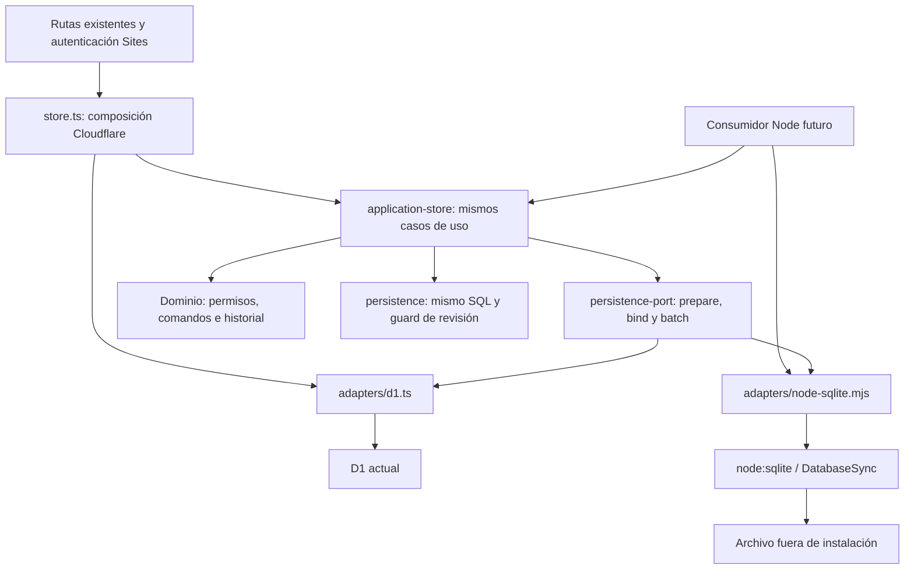

# Tarea 05 — Independización de la persistencia

> Documento histórico: describe el estado de su tarea y commit de origen. Para operar la aplicación actual, consultar [instalación local](INSTALACION_LOCAL.md) y [arquitectura consolidada](ARQUITECTURA.md).

Fecha: 14/10/2026, America/Bogota. Rama: `codex/reestructuracion-arquitectonica`.
Base: `5f950fd`.

## Alcance y arquitectura

Se consultaron la auditoría 01, el plan de migración local, el reporte 04 y la
matriz de regresión, aplicando la skill `programacion-clara`. Se inspeccionaron
`store.ts`, `application-store.mjs`, `persistence.mjs`, sus declaraciones, el
esquema Drizzle, SQL histórico y harness existentes.

Antes, el store ya recibía una conexión, pero su contrato TypeScript exigía
`D1Database`. Ahora consume una interfaz propia. La aplicación existente sigue
conectando exclusivamente a D1; el adaptador Node se utiliza como alternativa
desde los casos de uso y pruebas, sin cambiar endpoints ni autenticación.



No cambian `application-store.mjs`, `persistence.mjs`, reglas comerciales,
esquema, migraciones, frontend, fixtures visuales, manifest ni lockfile. No se
añaden repositorios por entidad ni una nueva capa de casos de uso.

## Interfaz y adaptadores

`lib/persistence-port.ts` define `SqlValue` (`string | number | null`), filas,
resultados y dos interfaces pequeñas:

- `PersistenceStatement`: texto SQL de solo lectura y `bind(...values)` que
  devuelve otra sentencia sin cambiar la anterior.
- `PersistenceDatabase`: `prepare(sql)` y `batch(statements)` asíncrono, con un
  resultado `{ results }` por sentencia, en el mismo orden. El batch debe ser
  atómico y sus lecturas coherentes. Las sentencias pertenecen a una conexión.

El texto SQL está disponible para inspección del plan y pruebas de inyección de
fallos. Los objetos nativos y sus parámetros quedan encapsulados mediante
`WeakMap`; una sentencia ajena se rechaza antes de ejecutar escrituras.

`lib/application-store.d.mts` depende de este contrato. `lib/adapters/d1.ts`
traduce sentencias a `D1PreparedStatement`, delega la transacción a D1 y entrega
solo las filas que consume el store. `store.ts` conserva `env.DB` como punto de
composición específico de plataforma. Los tipos D1 quedan en esa frontera;
no se propagan al contrato neutral ni al dominio. `db/index.ts`, heredado y ajeno
al camino comercial actual, conserva su integración Drizzle/D1.

`lib/adapters/node-sqlite.mjs` implementa el mismo contrato y añade únicamente
`filename` y `close()`. Su declaración pública tampoco expone `DatabaseSync`.
No importa Cloudflare, Vinext, Drizzle ni autenticación. El grafo de Workers
no alcanza este driver; no se exporta desde la fachada usada por el cliente.

## Selección técnica de SQLite

Se selecciona `node:sqlite`, disponible en el runtime probado Node **24.18.0**
sobre Windows, con SQLite **3.53.1**. Evita instalar otro controlador nativo.
La API es release candidate y `DatabaseSync` ejecuta operaciones síncronas;
por ello el adaptador exige Node 24.18 o superior y la distribución futura debe
fijar y validar su runtime. No se cambia el mínimo del proyecto Cloudflare actual.
La API admite claves foráneas, parámetros y espera de bloqueo por conexión.
[Documentación oficial de la versión evaluada](https://nodejs.org/download/release/v24.18.0/docs/api/sqlite.html).

La apertura usa una URI de archivo con `mode=rw`: aunque el archivo desaparezca
después de verificar su ruta, SQLite no debe recrearlo. Se comprobó el rechazo
de una ruta ausente y se revisó el uso de `SQLITE_OPEN_URI` en la
[implementación oficial de Node 24.18.0](https://github.com/nodejs/node/blob/v24.18.0/src/node_sqlite.cc).
El adaptador construye la URI desde una ruta local, sin aceptar parámetros URI
del consumidor. No se habilitan extensiones ni literales SQL con comillas dobles.

## Apertura, archivos y ciclo de vida

- Es obligatoria una ruta absoluta. Se resuelve el directorio padre real y se
  rechazan ubicaciones dentro de la instalación, archivos no regulares y enlaces
  simbólicos en la entrada de archivo.
- El modo predeterminado `open` exige un archivo existente. `create` es explícito
  y reserva un archivo mediante `wx`: si existe, falla sin truncarlo ni sobrescribirlo.
- No hay ruta por defecto, creación de directorios, inicialización de esquema,
  migraciones ni carga de maestros dentro del adaptador.
- `close()` libera la conexión y es idempotente; usarla después de cerrar produce
  un error. No se expone el controlador nativo al código comercial.
- Las pruebas del adaptador Node usan directorios temporales nuevos fuera del repositorio. Sus
  archivos reciben el SQL histórico intacto solo después de reservarse de forma
  exclusiva. La limpieza verifica su ruta y cierra recursos antes de retirarlos.
  No se abren bases operativas ni se importan datos reales.

Ejemplo de composición para un consumidor Node sobre un archivo ya preparado:

```js
import { openSqliteDatabase } from "./lib/adapters/node-sqlite.mjs";
import { createStore } from "./lib/application-store.mjs";

const database = openSqliteDatabase(absoluteDatabaseFilename);
const store = createStore(() => database);
try {
  const state = await store.loadState();
  // El consumidor decide cómo presentar este estado y resolver una identidad confiable.
} finally {
  database.close();
}
```

No se conecta este ejemplo a las rutas actuales. El bootstrap de usuarios de
`ensureState` conserva su comportamiento anterior; el futuro servidor deberá
limitar su uso a un alta explícita y no convertir una importación en una base nueva.

## Garantías transaccionales y concurrencia

Cada batch ejecuta `BEGIN`, todas sus sentencias, y `COMMIT` en un único tramo
síncrono, sin `await` intermedio. Ante error revierte la transacción activa;
si el rollback también falla, cierra la conexión y devuelve ambos errores.
Un authorizer de SQLite impide que las sentencias del consumidor ejecuten
`COMMIT`, savepoints, PRAGMA o attach/detach, evitando eludir el límite transaccional
y desactivar las claves foráneas. Se rechazan instrucciones adicionales tras la
sentencia preparada en lugar de ignorarlas silenciosamente.

Las claves foráneas están activas en cada conexión y `synchronous=FULL` queda
configurado. No se cambia el modo de journal de la base ni se activa WAL.
SQLite arbitra los locks entre conexiones/procesos; la espera predeterminada es
1000 ms, configurable. BUSY/LOCKED se traducen a `PersistenceBusyError`, con código
`PERSISTENCE_BUSY` y causa nativa para diagnóstico. No hay reintentos automáticos.
La espera síncrona bloquea ese proceso durante el límite configurado; todavía
debe medirse con volumen representativo antes de decidir sobre un worker.

El control de revisión, la auditoría y la idempotencia continúan en el mismo
store y SQL. El guard CHECK rechaza un snapshot obsoleto y revierte todo el batch.
El reintento debe volver a cargar el estado. Una solicitud ya confirmada y
repetida con el mismo actor/request_id devuelve su resultado sin duplicar filas.

## Pruebas comparativas

Las expectativas comerciales existentes no se cambian. `persistenceTest` registra
las mismas pruebas R01–R24 para el adaptador D1 sobre el harness SQLite existente
y para el adaptador Node sobre archivos reales: **48 ejecuciones**. Incluyen
ventas, producción, insumos, inventario, clientes, pagos, crédito, rectificaciones,
devoluciones, anulaciones, precisión, rollback, revisión e idempotencia; R21–R24
comprueban permisos administrativos, operadores, consulta y autoría.

El harness D1 no equivale por sí solo a workerd. Por eso se añade una prueba
contra **D1 real aislado de Miniflare**, usando la dependencia ya instalada del
toolchain. Ejecuta contra ambos adaptadores una secuencia común de contado,
crédito, entrega, producción, conciliación/cierre, cambio de fórmula, rectificación,
devolución, reversión, gastos, ajustes, anulación y retirada de cliente.
Compara el estado comercial completo, balance y stock, y comprueba recargas exactas.

Entre dos ejecuciones independientes se normalizan exclusivamente UUID generados
(incluidos source_id de ajustes) y timestamps de creación/actualización, también
cuando aparecen serializados en campos de corrección. Se mantienen exactos
IDs iniciales, autoría, request_id, fechas comerciales, relaciones, números y
snapshots. Esta normalización solo afecta a la comparación en memoria; no reescribe
archivos ni datos. Dentro de cada base, reapertura y reinicio comparan JSON e IDs
sin normalización. El primer intento comparativo señaló precisamente timestamps
serializados y UUID de ajustes pendientes de normalizar; no mostró diferencias
monetarias ni se modificaron reglas o fixtures para aprobarlo.

## Pruebas específicas del adaptador

`tests/node-sqlite.test.mjs` incorpora diez casos:

1. Apertura ausente rechazada, creación exclusiva, parámetros de espera y ruta
   fuera de instalación.
2. Las 27 tablas, índice comercial, integridad del archivo y claves foráneas del
   SQL histórico, sin regeneración de esquema.
3. Consultas parametrizadas con texto parecido a SQL, bind independiente,
   NULL, entero seguro máximo y rechazo de un entero SQL fuera del rango seguro.
4. Rollback de un cliente antes de una FK inválida y de una inserción antes
   de un CHECK inválido, conservando el estado previo.
5. Rechazo de controles de transacción/PRAGMA/attach, SQL múltiple y columna
   inexistente; recuperación de la conexión después del fallo.
6. Rechazo de sentencias de otra conexión/adaptador sin efectos.
7. Cierre y reapertura, ruta con espacios/caracteres especiales, JSON e historial
   exactos e idempotencia del crédito después de reabrir.
8. Lectura exacta del estado confirmado desde un proceso Node nuevo.
9. Dos procesos con la misma revisión: solo uno persiste; el otro recibe conflicto,
   puede recargar/reintentar y no deja guards ni auditoría duplicada.
10. Otro proceso mantiene un lock de escritura: el intento devuelve error BUSY,
    conserva el estado, y tras liberar el lock puede reintentarse una sola vez.

Se añade además un control arquitectónico: contrato neutral sin tipos Cloudflare
y driver Node fuera del grafo de ejecución de la aplicación Workers.

## Verificación final

`npm.cmd run verify` terminó con salida 0, ejecutando secuencialmente:

| Control                               | Resultado                                                                                                                                                                                                               |
| ------------------------------------- | ----------------------------------------------------------------------------------------------------------------------------------------------------------------------------------------------------------------------- |
| Pruebas automatizadas                 | **129 aprobadas**, cero fallos, omisiones o cancelaciones. Conserva las 93 anteriores y añade 24 ejecuciones SQLite de los mismos casos, diez pruebas específicas, una comparativa D1 real y un control arquitectónico. |
| TypeScript (`npm.cmd run check`)      | Aprobado.                                                                                                                                                                                                               |
| ESLint (`npm.cmd run lint`)           | Aprobado, cero warnings permitidos.                                                                                                                                                                                     |
| Prettier (`npm.cmd run format:check`) | Aprobado.                                                                                                                                                                                                               |
| Compilación (`npm.cmd run build`)     | Aprobada; conserva las rutas existentes. Avisos informativos de tiempo de plugins.                                                                                                                                      |
| Ciclos y límites                      | Pasan los controles de imports/reexports estáticos en ejecución, dominio/shared y ausencia del driver Node en el grafo Workers.                                                                                         |
| Regresión visual estructural          | Los 66 fingerprints HTML coinciden; no se actualiza la fixture.                                                                                                                                                         |
| E2E (`npm.cmd run test:e2e`)          | **12 pasos aprobados**, 4 HTTP y 8 de navegador, sin errores JavaScript. Node cuenta 13 tests incluyendo el contenedor; aproximadamente 71 segundos.                                                                    |
| Esquema, dependencias y diff          | No hay cambios en `drizzle/`, `db/schema.ts`, paquetes, lockfile, SQL de persistencia ni dominio. `git diff --check` aprobado.                                                                                          |

Logs locales: `outputs/persistencia-05/verify.log` y `e2e.log`, ignorados por Git.
La evidencia E2E nueva está en
`outputs/regression-02/2026-10-15T02-08-10-519Z-25196/`: doce checks aprobados,
`pageErrors` vacío, nueve PNG con hashes SHA-256 comprobados, trace y log del
servidor. Se inspeccionó visualmente la captura de ventas `B03.png`. El prefijo
`regression-02` corresponde al runner reutilizado; esta ejecución pertenece a
Tarea 05, el 14/10 local y 15/10 UTC.

E2E conserva su D1 sintético aislado bajo `.wrangler/regression-02-*`; las pruebas
Node y la comparación directa con Miniflare usan temporales externos al repositorio.
Los archivos de datos, capturas y logs no se incluyen en el commit. La eliminación
local preexistente del vídeo de showcase también queda fuera de esta tarea.

## Diferencias y trabajo pendiente

| Aspecto               | D1                                                                                        | SQLite Node                                                                             |
| --------------------- | ----------------------------------------------------------------------------------------- | --------------------------------------------------------------------------------------- |
| Entrega de resultados | Promesas del runtime D1; se oculta metadata no consumida.                                 | Promesas compatibles; ejecución interna síncrona y filas convertidas a objetos simples. |
| Lifecycle             | Lo administra Cloudflare.                                                                 | Ruta explícita, apertura/cierre y reserva exclusiva bajo control del consumidor.        |
| Bloqueo               | Errores propios de D1 conservados; no se simula una equivalencia de códigos de proveedor. | Espera configurable y error neutral BUSY/LOCKED, sin sobrescritura ni retry automático. |
| Operación actual      | Continúa atendiendo la aplicación y sus rutas.                                            | Alternativa funcional de persistencia; aún sin servidor HTTP o login local.             |

No se detectan diferencias comerciales en las verificaciones aprobadas. Eso no
certifica volumen, cortes de energía, corrupción física, varios equipos, sistemas
de archivos de red ni acceso hostil al directorio de datos. No hay cifrado ni
gestión nueva de ACL; el despliegue Windows debe preparar un directorio privado.

Antes del servidor Node hacen falta un runner de preparación/adopción de esquema
con exclusión e historial, política de ubicación/permisos y respaldo/restore,
lifecycle de cierre, tratamiento HTTP del conflicto/BUSY y una identidad confiable.
También debe fijarse el runtime y acotarse la compilación del servidor al código
neutral/Node, dejando el wiring D1 en el entorno Cloudflare actual.
Las credenciales locales y su bootstrap pertenecen a otra tarea. La prueba entre
procesos cubre locks y revisión, no una certificación de alta carga multiproceso.

Respecto a la matriz anterior, `SQLITE-DISK-01` dispone ahora de pruebas de archivo,
reapertura y lectura desde proceso nuevo. P06 tiene pruebas de locks y revisión
entre procesos, con carga representativa aún pendiente. `LOCAL-AUTH-01/02`,
`NODE-OFFLINE-01`, reinicio completo del servidor futuro, transferencia real y
recuperación operativa continúan pendientes: no se presentan como implementados.

Las 27 tablas y el SQL histórico permanecen intactos. No se migra producción,
no se eliminan Cloudflare/Vinext, no se separa físicamente frontend/backend,
no se implementa multiempresa ni se inicia la siguiente tarea.
