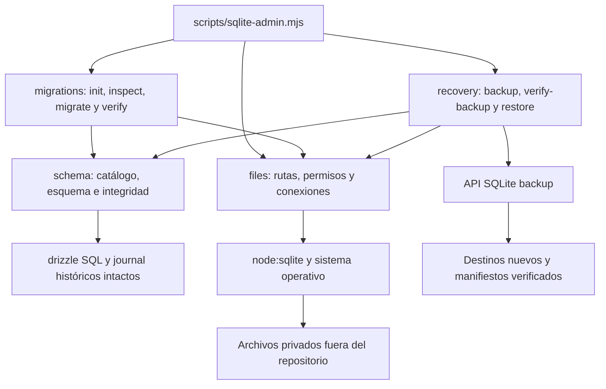

# Tarea 06 — Migraciones y recuperación SQLite autónomas

Fecha: 14/10/2026, America/Bogota. Rama: `codex/reestructuracion-arquitectonica`.
Base: `de51f25`.

## Alcance y arquitectura

Se consultaron la auditoría 01, el plan local, el reporte 05, el procedimiento de
respaldo y la matriz de regresión, aplicando `programacion-clara`. Se revisaron
`prepare-local-db.mjs`, `local-database.mjs` y `local-migration-plan.mjs`.
Esos scripts y la infraestructura D1 permanecen intactos. Los nuevos comandos no
se conectan a la base de desarrollo ni se incorporan al arranque de Vinext.



Son cuatro módulos en `lib/sqlite/`, una CLI y un archivo de pruebas. No hay
paquetes nuevos, servicio HTTP, interfaz gráfica, autenticación, cambios de
frontend, contratos HTTP, esquema comercial o adaptadores D1. El SQL histórico
no se regenera. El administrador no llama a `ensureState`: prepara tablas sin
dar de alta usuarios, clientes, productos ni operaciones.

## Catálogo y administrador de migraciones

El catálogo procede de `drizzle/meta/_journal.json` y sus archivos SQL. Deben
coincidir nombres, orden y posiciones; se rechazan archivos adicionales sin
entrada en el journal. El hash SHA-256 se calcula sobre el SQL con finales LF,
para mantener compatibilidad entre checkouts Windows y Linux. Cualquier otra
modificación de un archivo aplicado, incluidos comentarios, invalida su hash.

El esquema de referencia se construye en memoria con ese SQL, sin regenerarlo,
y conserva la estructura esperada después de cada versión. La base seleccionada
debe coincidir con la versión registrada, incluyendo tablas, índices, vistas y
triggers. La comparación normaliza finales de línea, no convierte SQL diferente
en supuestamente equivalente: variaciones desconocidas requieren revisión.

Las migraciones usan una conexión administrativa separada del puerto comercial.
Un único `BEGIN IMMEDIATE` cubre inspección, adopción, pendientes, comprobaciones
y registro; `COMMIT` ocurre solo después de verificarlas. SQLite serializa los
preparadores y las escrituras concurrentes. La espera predeterminada es 1000 ms;
un bloqueo agotado se informa sin reintento automático. Los tests ejercitan
también la negativa mientras otro escritor mantiene el lock.

Dentro del SQL de migración se prohíben controles de transacción, savepoints,
PRAGMA, attach/detach y DROP TABLE. No hay mecanismos de reconstrucción o borrado
de tablas comerciales. Las migraciones futuras siguen siendo código versionado
que debe revisarse; la CLI no admite SQL arbitrario ni un catálogo alternativo.
Los catálogos ampliados de los tests existen solo en directorios sintéticos.

Un error revierte cambios de esquema, datos y ledger. La revisión posterior
exige versión final conocida, ausencia de pendientes, `integrity_check = ok`,
`foreign_key_check` vacío, JSON válido con IDs/relaciones coherentes y guards
transaccionales vacíos. La salida cero de una sentencia no basta para aprobar.

## Ledger y compatibilidad histórica

Las 27 tablas de aplicación se conservan. Se agrega únicamente el metadato
`nutrequine_migrations`: posición, nombre, SHA-256, fecha y origen
`executed`/`adopted`. No es una entidad comercial. No sustituye ni reescribe
`d1_migrations`; ambos historiales se inspeccionan por separado.

| Base seleccionada                                   | Comportamiento                                                                                                                                  |
| --------------------------------------------------- | ----------------------------------------------------------------------------------------------------------------------------------------------- |
| Ruta ausente                                        | Solo `init` crea un archivo, con reserva exclusiva `wx`. Otros comandos fallan sin crearlo.                                                     |
| Archivo existente vacío                             | `inspect` lo identifica; `migrate --apply --initialize-empty` permite prepararlo explícitamente. `init` rechaza reutilizar su ruta.             |
| Histórico completo sin ledger                       | `inspect` marca `historical` y `adoptionRequired`. `migrate --apply --adopt` registra la primera versión sin repetir CREATE ni cargar maestros. |
| Histórico con ledger D1 conocido                    | Comprueba estructura y prefijo de nombres D1; registra las versiones verificadas como `adopted` en el ledger nuevo y conserva D1 intacto.       |
| Ledger SQLite conocido                              | Verifica posiciones, hashes, origen y fecha. Ejecuta exclusivamente el sufijo pendiente; repetirlo no duplica registros.                        |
| Esquema parcial, índice ausente u objetos extras    | Rechazo antes de modificar registros. No repara ni reconstruye automáticamente.                                                                 |
| Historial ajeno, vacío incoherente o SQL modificado | Rechazo. No se inventan ni se sustituyen hashes para hacerlo coincidir.                                                                         |
| Operaciones comerciales presentes                   | Se verifican y conservan; la adopción sin pendientes compara también digests de todas las tablas originales.                                    |

La adopción registra el hash observado del código y una fecha de reconocimiento
actual; `adopted` no afirma conocer cuándo se ejecutó originalmente ese SQL.
Una base sin ledger y sin historial D1 solo puede reconocerse como esquema inicial
exacto. No se deduce que un esquema posterior desconocido está actualizado.
Tablas internas `_cf_*`, estructuras D1 diferentes o cambios manuales se bloquean
para revisión; no se eliminan ni se importan automáticamente.
Para el ledger D1 conocido se admiten diferencias de espacios y mayúsculas del
DDL de Wrangler y del preparador histórico; sus columnas y restricciones deben
seguir coincidiendo. Esa compatibilidad se comprobó contra el código Wrangler
instalado, sin ejecutarlo sobre ninguna base existente.

Antes de adoptar o actualizar una base histórica: detener el proceso que la usa,
seleccionar explícitamente el archivo, inspeccionar/verificar y generar un
respaldo nuevo. Revisar el resultado y los pendientes antes de ejecutar `--apply`.
Después, volver a verificar con el código compatible. No iniciar el servidor
para que cree una base que falta ni usar esta CLI sobre la persistencia habitual D1.

## Rutas y directorios privados

Se exige Node 24.18 o superior y rutas absolutas fuera del repositorio. No hay
ruta por defecto, lectura de configuración Sites ni creación silenciosa de
directorios. Se resuelve el directorio padre real y se rechazan enlaces simbólicos
en la entrada del archivo. Los destinos existentes nunca se truncan.

`directory` crea un directorio nuevo. En POSIX usa 0700 y los archivos 0600;
se rechazan permisos de grupo/otros. En Windows configura y comprueba ACL para
el usuario actual, SYSTEM y Administradores. Usa Windows PowerShell del sistema
y las API de ACL de .NET, sin módulos descargados. También comprueba archivos
existentes; ACL más amplias bloquean la operación. Si falla la configuración de
permisos, no se continúa creando una base. No hay cifrado ni protección frente
a administradores del sistema, al mismo usuario o a cambios hostiles simultáneos
del sistema de archivos.

## Respaldo y restauración

Se usa `node:sqlite.backup`, no una copia del archivo principal ni de WAL/SHM.
La conexión de origen es de solo lectura y mantiene una transacción de lectura:
el manifiesto y la copia corresponden al mismo snapshot. Se comprueba después
la copia por separado: esquema, columnas, relaciones, recuentos, revisión,
ledger y digest de todas las filas ordenadas, incluidos JSON e historial.
Se sincronizan el archivo final y su manifiesto antes de informar éxito.
[API oficial de respaldo evaluada](https://nodejs.org/download/release/v24.18.0/docs/api/sqlite.html#sqlitebackupsourceDb-path-options).

El manifiesto `<respaldo>.manifest.json` registra formato/versión de herramienta,
fecha, versión de aplicación/Node/SQLite, ruta de origen, SHA-256 del archivo,
versión y hashes de migraciones, revisión y huellas de esquema/tablas. No contiene
filas comerciales en claro, pero es información privada y debe protegerse junto
a la copia. Los hashes detectan cambios accidentales; no son una firma que
autentique a un atacante capaz de reemplazar tanto copia como manifiesto.

| Estado del origen                | Operación admitida                                                                                                                                           |
| -------------------------------- | ------------------------------------------------------------------------------------------------------------------------------------------------------------ |
| Cerrado                          | Respaldo mediante la misma API y verificaciones. El original se conserva.                                                                                    |
| Abierto en WAL                   | Snapshot de lectura y backup API; se probó una escritura comercial confirmada durante la copia sin contaminar ese snapshot.                                  |
| Abierto con journal convencional | La lectura puede bloquear commits de escritores hasta terminar. Para evitar errores BUSY del servidor, suspender escrituras o detenerlo durante el respaldo. |
| Migración/adopción               | Detener el servidor antes de operar; el lock SQLite sigue siendo obligatorio para impedir preparaciones incompatibles.                                       |

`verify-backup` exige manifiesto válido, hash correcto e integridad/contenido
coincidentes. `restore` usa esa copia verificada para crear otro archivo mediante
la API SQLite, sin reemplazar ni mover original o respaldo. Verifica de nuevo y
genera `<destino>.restore.json`. No aplica migraciones al restaurar. Un catálogo
más reciente puede reconocer y restaurar una versión anterior conocida; sus
pendientes se muestran al inspeccionar el destino, sin invalidar el respaldo.

Si falla una copia, se conservan los archivos nuevos para diagnóstico y no se
certifican con un manifiesto/recibo completo. No se borran bases ni hay limpieza
automática de originales, respaldos o intentos parciales. Elegir otra ruta para
reintentar; no interpretar un archivo existente como respaldo válido sin verificarlo.

## Comandos operativos

Ejecutar desde `app/`; los ejemplos usan rutas de ejemplo que deben seleccionarse
explícitamente. El padre `D:\NutrequinePrivado` debe existir y ser un disco local
administrado por el responsable. En POSIX usar rutas absolutas equivalentes.

```powershell
node scripts/sqlite-admin.mjs directory --directory "D:\NutrequinePrivado\Datos"
node scripts/sqlite-admin.mjs directory --directory "D:\NutrequinePrivado\Copias"

node scripts/sqlite-admin.mjs init --database "D:\NutrequinePrivado\Datos\nueva.sqlite"
node scripts/sqlite-admin.mjs inspect --database "D:\NutrequinePrivado\Datos\nueva.sqlite"
node scripts/sqlite-admin.mjs verify --database "D:\NutrequinePrivado\Datos\nueva.sqlite"

# Tras inspección y respaldo de una base histórica completa seleccionada:
node scripts/sqlite-admin.mjs migrate --database "D:\NutrequinePrivado\Datos\historica.sqlite" --apply --adopt

# Base administrada: solo migraciones versionadas pendientes.
node scripts/sqlite-admin.mjs migrate --database "D:\NutrequinePrivado\Datos\nueva.sqlite" --apply

node scripts/sqlite-admin.mjs backup --database "D:\NutrequinePrivado\Datos\nueva.sqlite" --destination "D:\NutrequinePrivado\Copias\copia-01.sqlite"
node scripts/sqlite-admin.mjs verify-backup --backup "D:\NutrequinePrivado\Copias\copia-01.sqlite"
node scripts/sqlite-admin.mjs restore --backup "D:\NutrequinePrivado\Copias\copia-01.sqlite" --destination "D:\NutrequinePrivado\Datos\recuperada-01.sqlite"
node scripts/sqlite-admin.mjs verify --database "D:\NutrequinePrivado\Datos\recuperada-01.sqlite"
```

Los comandos devuelven JSON con resultado, operación, fecha, UUID del intento y
rutas seleccionadas. Ante fallo devuelven salida 1 y diagnóstico por stderr,
incluidos código SQLite cuando existe y stack para trazabilidad. No imprimen
filas comerciales. Conservar el diagnóstico en almacenamiento privado, fuera de
Git. Opciones repetidas/desconocidas y destinos omitidos se rechazan.

La copia restaurada no se selecciona automáticamente. El futuro servidor tendrá
que recibir la ruta explícita y abrirla en modo existente después de verificarla;
no hay servidor Node implementado en esta tarea.
La recuperación devuelve el snapshot registrado, no escrituras posteriores del
origen. Si hubo operaciones después del respaldo, conservar ambas bases y
conciliar esa diferencia antes de cambiar la selección del archivo en uso.

## Pruebas y resultados

La verificación final aprobó el 14/10/2026 en Windows, con Node 24.18.0 y
SQLite 3.53.1. El archivo `tests/sqlite-administration.test.mjs` reúne 18 pruebas
nuevas de comportamiento:

- Inicialización vacía y exclusiva, ausencia de bootstrap, apertura ausente y
  archivo vacío con confirmación explícita.
- Adopción histórica con operaciones, preservación de IDs/JSON y distinción de
  metadatos D1/SQLite.
- Parciales, índices ausentes, objetos ajenos, hashes/historial incompatibles y
  SQL aplicado alterado.
- Pendientes ejecutadas una sola vez, rollback tras cambios de revisión/esquema
  seguidos de FK inválida, y rechazo de controles que eluden la transacción.
- Integridad referencial, coherencia de IDs/relaciones JSON y negativa a respaldar
  una base inválida.
- Respaldo/restauración exactos con ventas, producción, crédito, reversión,
  rectificación y auditoría; idempotencia y operaciones nuevas en la copia.
- Copia activa WAL con una escritura simultánea, fallo de copia sin certificación,
  destinos existentes y manifiestos/hashes alterados.
- Preparación concurrente entre procesos, creación exclusiva, bloqueo y reintento
  explícito; rechazo de permisos amplios.
- CLI copiada con sus módulos, SQL/journal y versión a una distribución sintética
  sin `node_modules`: inicialización, inspección, migración, verificación, backup,
  verificación de backup, restauración y reapertura en procesos Node separados.
  No se copian Wrangler, Miniflare, Sites ni conectores.

Todas las bases son sintéticas y externas al repositorio. Las nuevas pruebas
conservan sus archivos bajo temporales `nutrequine-06-test-*`, además de los
ensayos iniciales `nutrequine-06-probe-*`; no eliminan bases para ocultar fallos.
Los 129 tests previos conservan sus harness y limpieza de fixtures anteriores.

| Verificación                      | Resultado final                                                                                                                                      |
| --------------------------------- | ---------------------------------------------------------------------------------------------------------------------------------------------------- |
| `npm.cmd run verify`: pruebas     | 147 aprobadas: las 129 anteriores y 18 nuevas; cero fallos, omitidas o pendientes en esa suite. Duración de pruebas: 167,79 s.                       |
| TypeScript: `check`               | Aprobado.                                                                                                                                            |
| ESLint: `lint`                    | Aprobado con cero warnings permitidos.                                                                                                               |
| Prettier: `format:check`          | Aprobado, incluyendo la documentación final.                                                                                                         |
| Compilación: `build`              | Aprobada; conserva `/`, `/api/state` y `/api/command`.                                                                                               |
| Dependencias circulares y límites | Las tres comprobaciones de `tests/architecture.test.mjs` aprobaron; incluyen los nuevos módulos en `lib/`.                                           |
| `npm.cmd run test:e2e`            | 12 pasos aprobados: cuatro HTTP y ocho de navegador; Node informa 13 tests al contar también el contenedor. Cero errores de página; 63,97 s totales. |
| Administración sin Cloudflare     | Distribución sintética sin `node_modules`, Wrangler, Miniflare ni Sites; ciclo completo aprobado mediante procesos Node nuevos.                      |
| Revisión de cambios               | Sin modificaciones en SQL histórico, esquema comercial, adaptadores, reglas comerciales, dependencias o contratos HTTP.                              |

Logs locales ignorados: `outputs/migraciones-06/verify-final.log` y
`outputs/migraciones-06/e2e.log`. Las evidencias E2E quedaron en
`outputs/regression-02/2026-10-15T02-46-39-491Z-15192/`: `results.json`, nueve
capturas con SHA-256, traza y diagnóstico del servidor. La fecha UTC corresponde
al 14/10 en Bogotá. Las capturas y bases sintéticas no se incluyen en Git.
La suite E2E comprueba la aplicación D1 actual; la independencia SQLite se prueba
por separado mediante la distribución sin dependencias.

## Problemas encontrados y límites

Durante el ensayo se sustituyó la carga de módulos ACL de PowerShell por llamadas
.NET del sistema, evitando una incompatibilidad del entorno. Se corrigió el
helper que pasaba `undefined` como opciones a `DatabaseSync` y se distinguió el
rechazo de un manifiesto existente del EEXIST del archivo. No se alteraron
expectativas comerciales ni fixtures históricos. También se corrigió la comparación
de pendientes: pertenecen al catálogo instalado, no al contenido de un backup viejo.

No se certifican cortes eléctricos, daño de hardware, cargas grandes, discos de
red, Linux/macOS dinámicamente ni accesos hostiles al sistema de archivos. Las
comprobaciones completas y los hashes recorren el contenido y pueden ser costosos;
deben medirse con volumen representativo. No hay retención automática, cifrado,
firma de respaldos o restauración de producción. Un bloqueo agotado exige revisar
el otro proceso y reintentar conscientemente, nunca romper locks a ciegas.

El futuro servidor debe fijar el runtime, seleccionar un directorio y archivo,
verificar preparación antes de abrir el store, separar preparación de bootstrap
de usuarios, gestionar cierre y errores BUSY, y coordinar mantenimiento/respaldo
con sus escrituras. Continúan pendientes autenticación local, frontend independiente,
operación HTTP offline y transferencia real. No se inicia la siguiente tarea.
