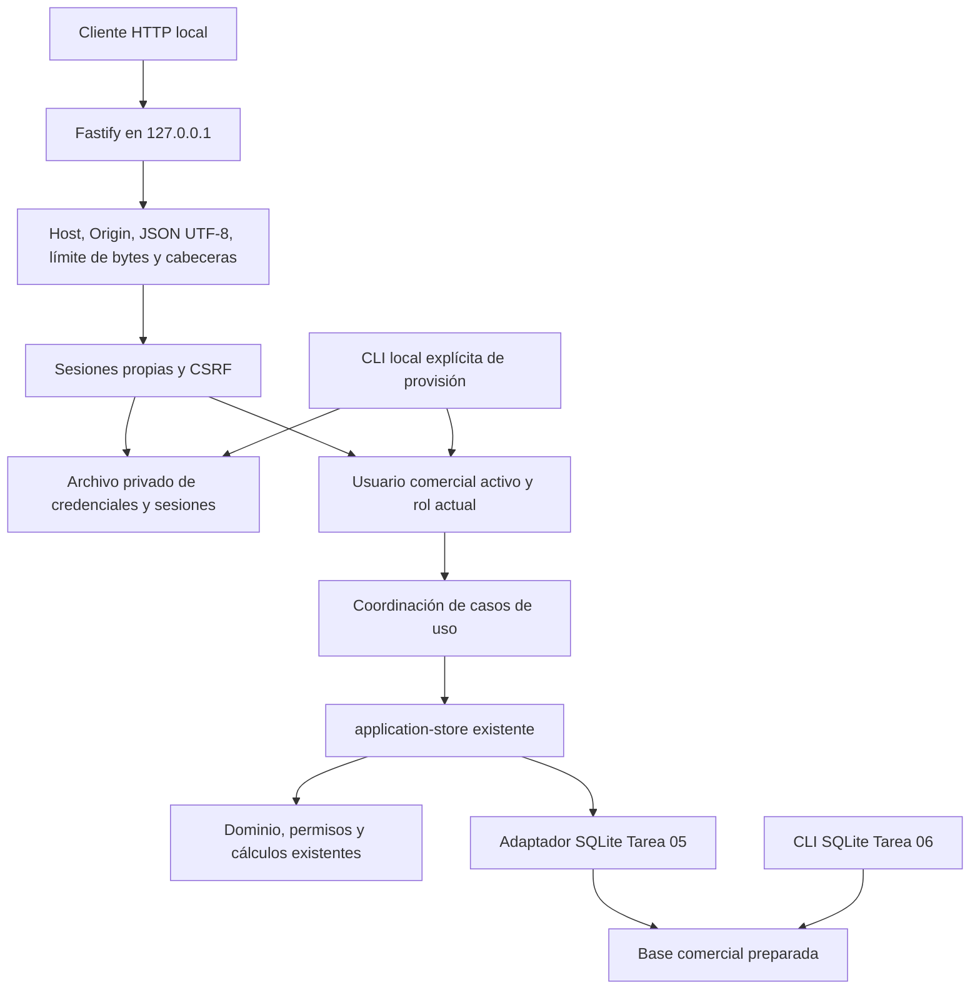

# Tarea 07 — Backend Node y autenticación local

> Documento histórico: describe el estado de su tarea y commit de origen. Para operar la aplicación actual, consultar [instalación local](INSTALACION_LOCAL.md) y [arquitectura consolidada](ARQUITECTURA.md).

Fecha: 15/10/2026, America/Bogota. Rama: `codex/reestructuracion-arquitectonica`.
Base: `7153060`.

## Arquitectura y alcance

Se consultaron la auditoría 01, el plan local, los reportes 05 y 06, la matriz
de regresión y la especificación maestra MVP. Se aplicó `programacion-clara`.
La aplicación D1/Vinext/Sites permanece disponible; el frontend no se migra aquí.



Se evaluó Fastify y se fijó **5.12.7**: aporta routing, límites, cierre y hooks
sin incorporar un framework de frontend. Se conserva el driver `node:sqlite`
del adaptador existente. No se instala otro ORM ni se crean repositorios por
entidad. La composición recibe rutas y puerto; no recibe identidades del cliente.
Referencias: [servidor Fastify](https://fastify.dev/docs/latest/Reference/Server/),
[TypeScript en Node 24.18](https://nodejs.org/download/release/v24.18.0/docs/api/typescript.html).

| Módulo                               | Responsabilidad                                                                        |
| ------------------------------------ | -------------------------------------------------------------------------------------- |
| `server/application.mts`             | Composición, endpoints, cola de casos de uso, integración con store y errores HTTP.    |
| `server/http-security.mts`           | Perímetro, parser JSON UTF-8, cookie y CSRF.                                           |
| `server/authentication.mts`          | Login, sesiones, límites de intentos, revocación y gestión autorizada de credenciales. |
| `server/auth-database.mts`           | Esquema privado de autenticación y comprobación de integridad/vinculación.             |
| `server/passwords.mts`               | Scrypt, salts, tokens y nombres de acceso.                                             |
| `server/provision.mts` / `admin.mts` | Provisión local explícita, nunca una ruta web de bootstrap.                            |
| `server/config.mts` / `main.mts`     | Configuración privada, arranque y señales de cierre.                                   |
| `scripts/build-node.mjs`             | Compilación TypeScript y distribución con dependencias de runtime necesarias.          |

## Persistencia e inicio

Node **24.18 o superior**. El servidor exige rutas absolutas de archivos existentes,
directorios privados fuera del repositorio y un puerto explícito. Solo escucha
en `127.0.0.1`; no admite `host`, LAN, CORS abierto ni proxy de confianza.

Antes de abrir el adaptador, ejecuta la verificación de Tarea 06: esquema exacto,
ledger local administrado, hashes, integridad, JSON y relaciones; rechaza pendientes
o adopción pendiente. No aplica migraciones, crea archivos ni llama a bootstrap
durante el arranque. Una barrera en el puerto de persistencia también impide el
INSERT inicial de settings del store heredado si desaparece externamente.

Las peticiones comerciales se coordinan mediante una cola local acotada a 64.
Cada batch sigue siendo atómico y conserva el CAS por revisión. Entre procesos
deciden los locks y la revisión SQLite: no hay reintentos automáticos de comandos.
Un lock agotado produce 503; el conflicto de revisión conserva el mensaje comercial
y 422. El cliente debe recargar o reintentar conscientemente con el mismo request_id.
El cierre espera trabajo en curso y cierra Fastify y ambas conexiones. El CLI
atiende SIGINT/SIGTERM y limita el cierre a 15 segundos; un cierre forzado del SO
depende de la recuperación transaccional SQLite.

Las 27 tablas comerciales y el SQL histórico permanecen intactos. La autenticación
usa **otro archivo** con cinco tablas: metadata versión 1, credentials, sessions,
attempts y security_events. Se verifica su estructura, integridad y vínculo con
la ruta comercial canónica; no puede seleccionarse accidentalmente para otra base.
Los dos archivos no constituyen una transacción distribuida para operaciones
HTTP: la autorización vuelve a leer usuario/rol y el dominio comprueba permisos.
Cambiar un usuario revoca sus sesiones después del commit comercial. Si falla
esa revocación, el rol/actividad actual sigue siendo obligatorio y el request_id
permite repetir sin duplicar el cambio comercial.

## Credenciales y sesiones

Scrypt asíncrono de Node con N=131072, r=8, p=1, salt aleatorio de 16 bytes y
derivación de 64 bytes; límite de memoria 192 MiB. La contraseña admite espacios,
exige 15 caracteres y un máximo de 1024 bytes UTF-8. Los parámetros se identifican
en cada credencial; no se guardan contraseñas en claro ni se incluyen en auditoría.
La elección evita binarios adicionales y sigue una configuración documentada por
[OWASP](https://cheatsheetseries.owasp.org/cheatsheets/Password_Storage_Cheat_Sheet.html).
La comparación usa `timingSafeEqual`; usuarios desconocidos ejecutan el mismo
coste de derivación y reciben el mismo error genérico de credenciales.

Los tokens de sesión tienen 32 bytes criptográficos. SQLite guarda solo su SHA-256,
usuario, versión de credencial, rol y expiración absoluta de ocho horas; máximo
diez sesiones por usuario. La cookie tiene nombre derivado de la instalación,
Path=/api, HttpOnly, SameSite=Strict, sin Domain y Secure cuando se sirve HTTPS.
No se devuelven tokens de sesión en JSON. La recarga recupera actor y token CSRF
mediante `/api/auth/session`. Logout elimina la sesión y expira la cookie.

Cada petición valida usuario activo, rol actual y versión de credencial. Los
cambios de rol/desactivación y los resets invalidan sesiones. Los permisos
comerciales y la protección del último ADMIN siguen en el dominio existente.
El transporte local exige además que otro ADMIN tenga credenciales antes de
retirar el último acceso administrativo local, aunque quede un ADMIN comercial
sin credencial. Se conserva la respuesta idempotente de operaciones ya aplicadas
por el mismo actor; un cambio de rol no permite ejecutar comandos nuevos prohibidos.
La API de credenciales solo vincula usuarios comerciales existentes y activos;
no crea administradores ni cambia created_by, roles o auditoría comercial.

La protección de intentos persiste entre reinicios: cinco por nombre de acceso
en 15 minutos y treinta globales en un minuto. Los nombres de buckets se hashean,
hay limpieza de expirados y límite de buckets. Los intentos se reservan antes de
scrypt y se serializan; las respuestas son 429 al agotar el límite. La ventana
por usuario se limpia tras login correcto. Esto puede permitir denegación temporal
de acceso por un proceso local hostil; no pretende defender contra un administrador
del SO o contra quien ya puede leer/escribir ambos archivos privados.

## Contratos HTTP

| Ruta                         | Autorización y respuesta                                                                                          |
| ---------------------------- | ----------------------------------------------------------------------------------------------------------------- |
| `POST /api/auth/login`       | JSON `{login,password}`, Origin exacto; cookie y `{actor,csrf_token,expires_at}`.                                 |
| `GET /api/auth/session`      | Cookie válida; mismo JSON de sesión sin token secreto.                                                            |
| `POST /api/auth/logout`      | Cookie, Origin y CSRF; `{ok:true}`.                                                                               |
| `GET /api/state`             | Cookie válida; `{state,actor}` comercial sin cambio de estructura.                                                |
| `POST /api/command`          | Cookie, Origin y CSRF; `{type,payload,request_id}` y `{state,result}` existentes.                                 |
| `POST /api/auth/credentials` | ADMIN, Origin y CSRF; `{user_id,login,password}`, crea o reemplaza credencial y revoca sesiones del destinatario. |
| `POST /api/auth/revoke`      | ADMIN, Origin y CSRF; `{user_id}`, revoca sus sesiones.                                                           |

Todos los POST exigen `Content-Type: application/json` (opcional charset=utf-8),
sin compresión. El token CSRF debe ir en `X-CSRF-Token`; se deriva del secreto de
sesión y se comprueba en tiempo constante. Login usa Origin exacto y JSON para
proteger también frente a login CSRF. Se rechazan Origin null/ajeno y Fetch
Metadata cross-site. Host debe ser exactamente `127.0.0.1:puerto_real`, incluso
para GET; no basta que DNS resuelva a loopback. No se confía en X-Forwarded-_.
Cabeceras oai-authenticated-user-_, X-User-Id y X-Authenticated-User-Id se rechazan.

Límite de cuerpo **250000 bytes**, comprobado por Fastify también con transferencia
chunked. JSON sintácticamente malformado o UTF-8 inválido devuelve **400**, frente
al antiguo 503 accidental; cuerpo excesivo 413, formato no admitido 415.
Ausencia/expiración de sesión devuelve 401, permisos insuficientes 403, validación
comercial 422 y falta de disponibilidad 503. El nuevo 403 para permiso denegado
separa autorización de validación comercial; el sistema anterior no se modifica.
El servidor Node también exige Origin en POST de clientes CLI que antes podían
omitirlo: deben enviar el origen exacto del puerto seleccionado. Son cambios del
perímetro de seguridad; las solicitudes y respuestas comerciales válidas mantienen
sus estructuras, cálculos e identificadores.
No se devuelven SQL, rutas, stack, hashes de credenciales o errores internos.
Los diagnósticos del servidor contienen ID de petición y categoría, sin cuerpos,
cookies ni contraseñas. Las respuestas usan no-store, nosniff, DENY, CSP restrictiva,
no-referrer y políticas de capacidades; no se habilitan cabeceras CORS abiertas.

## Instalación nueva y primer administrador

El responsable debe autorizar la provisión desde una cuenta del SO con acceso a
los directorios privados. Ejemplos desde `app/`, con rutas seleccionadas por él;
el padre D:\NutrequinePrivado debe existir. Usar solo archivos nuevos:

```powershell
node scripts/sqlite-admin.mjs directory --directory "D:\NutrequinePrivado\Instalacion"
node scripts/sqlite-admin.mjs init --database "D:\NutrequinePrivado\Instalacion\negocio.sqlite"

# Solicitar la contraseña sin eco; no escribirla en argumentos ni en el historial.
$claveLocal = Read-Host "Contraseña nueva (mínimo 15 caracteres)" -AsSecureString
$altaLocal = @{
  user_id = [guid]::NewGuid().ToString()
  name = "Nombre del administrador responsable"
  login = "nombre.elegido"
  password = [Net.NetworkCredential]::new("", $claveLocal).Password
}
try {
  $altaLocal | ConvertTo-Json -Compress | node server/admin.mts --database "D:\NutrequinePrivado\Instalacion\negocio.sqlite" --auth-database "D:\NutrequinePrivado\Instalacion\acceso.sqlite" --mode new
} finally {
  Remove-Variable altaLocal, claveLocal
}
```

La entrada JSON llega por stdin, limitada a 8192 bytes; no hay contraseña por
argumento, credencial predeterminada ni ruta de alta pública. Se crean únicamente
configuración vacía y un ADMIN identificado; no se cargan maestros sintéticos.
La provisión usa ATTACH y una transacción de dos archivos con journals DELETE;
rechaza WAL para esta operación y exige el servidor detenido. Los fallos no
certifican credenciales ni borran intentos parciales. Guardar sus archivos para
diagnóstico y escoger otro destino nuevo; no sobrescribirlos a ciegas.

## Vinculación autorizada de una base histórica

Detener la aplicación, generar y verificar respaldo según Tarea 06, inspeccionar
y adoptar/migrar explícitamente la base sintética o la copia seleccionada.
Identificar un **ADMIN histórico activo** autorizado por el responsable. Utilizar
el mismo JSON por stdin con ese `user_id` exacto, login y contraseña nuevos:

```powershell
node server/admin.mts --database "D:\NutrequinePrivado\Instalacion\historica.sqlite" --auth-database "D:\NutrequinePrivado\Instalacion\acceso-historico.sqlite" --mode link --authorize-link
```

El comando anterior debe recibir el JSON por stdin, como el ejemplo de alta.
`--authorize-link` expresa una acción del responsable local que controla los
archivos; no es una comprobación de identidad corporativa ni reemplaza su
autorización organizacional. Rechaza usuarios inexistentes, inactivos u operadores,
y bases con registros usando `--mode new`. Compara el snapshot comercial antes y
después de vincular, sin alterar registros ni añadir un administrador comercial.
Otros usuarios se crean o actualizan mediante USER_SAVE y después un ADMIN
vincula sus credenciales por `/api/auth/credentials`.

Si se pierden las credenciales, la recuperación requiere intervención del
responsable del SO: conservar ambos archivos, respaldar, detener el servidor,
vincular de nuevo un ADMIN histórico a **otro archivo de autenticación nuevo** y
seleccionarlo explícitamente. No hay bypass web. Las sesiones anteriores dejan
de pertenecer a la instalación seleccionada y los demás accesos deben vincularse
de nuevo. Restaurar negocio a otra ruta también exige vinculación nueva, porque
el vínculo de autenticación contiene la ruta comercial original. El backup de
Tarea 06 cubre negocio, no el esquema privado de autenticación; conservar ambos
archivos cerrados como material privado si se necesita recuperar las credenciales.

## Configuración y ejecución

Guardar un JSON privado fuera del repositorio, protegido como los datos:

```json
{
  "database": "D:\\NutrequinePrivado\\Instalacion\\negocio.sqlite",
  "auth_database": "D:\\NutrequinePrivado\\Instalacion\\acceso.sqlite",
  "port": 4317
}
```

```powershell
npm.cmd run check:node
npm.cmd run build:node
node dist-node/server/main.mjs --config "D:\NutrequinePrivado\Instalacion\servidor.json"
# Desarrollo con TypeScript nativo, sin Vinext:
npm.cmd run start:node -- --config "D:\NutrequinePrivado\Instalacion\servidor.json"
```

La distribución compilada incluye módulos comerciales alcanzables, SQL/journal,
versión y las dependencias transitivas de Fastify, preservando versiones anidadas.
No incluye tests de la aplicación, runtime Cloudflare, frontend, bases ni secretos.
Puede trasladarse con Node ya instalado, sin npm en ejecución. La instalación
de herramientas de desarrollo usa el registro npm; eso no es dependencia operativa.

Para HTTPS se admiten `tls_certificate` y `tls_key` como rutas privadas explícitas.
Se usa TLS real, sin confiar en cabeceras de proxy; el navegador debe confiar en
el certificado seleccionado. HTTP se admite exclusivamente en loopback y omite
Secure para que la cookie pueda funcionar allí. No se habilita acceso LAN por TLS.

## Pruebas, evidencias y verificación

Las pruebas nuevas utilizan exclusivamente datos
sintéticos en temporales privados `nutrequine-07-test-*` y no eliminan bases.
Reutilizan el escenario portable de contado/crédito/entrega con sus aserciones
originales de céntimos, gramos, caja, crédito, stock e idempotencia.

La prueba de independencia compila y copia la distribución a un directorio
aislado sin paquetes Cloudflare; inicia procesos nuevos con un preload **solo de
tests**, que deniega conexiones TCP externas, DNS externo, UDP y fetch externo.
Prueba denegaciones reales de esas API antes de iniciar, luego login, operaciones
y reapertura. No se distribuye el preload ni un usuario ficticio o bypass de auth.
Es un bloqueo dentro del proceso Node instrumentado, no una certificación de
firewall del SO ni del aislamiento de procesos hijos arbitrarios.

Validación del 15/10/2026 en Windows, Node 24.18.0 y SQLite 3.53.1:

| Comprobación                                                 | Resultado                                                                                                                                                      |
| ------------------------------------------------------------ | -------------------------------------------------------------------------------------------------------------------------------------------------------------- |
| `npm.cmd run verify`: pruebas                                | **168 aprobadas**, sin fallos, canceladas, omitidas ni TODO: 147 previas y 21 nuevas. 238,57 s de pruebas.                                                     |
| TypeScript general: `check`                                  | Aprobado.                                                                                                                                                      |
| TypeScript backend aislado de tipos Cloudflare: `check:node` | Aprobado.                                                                                                                                                      |
| ESLint                                                       | Aprobado, cero advertencias permitidas.                                                                                                                        |
| Prettier global                                              | Aprobado; se vuelve a comprobar tras completar este reporte.                                                                                                   |
| Compilación anterior: `build`                                | Aprobada; conserva las tres rutas originales.                                                                                                                  |
| Compilación independiente: `build:node`                      | Aprobada; incluye 50 paquetes de runtime con sus versiones anidadas, sin runtime Cloudflare.                                                                   |
| Controles arquitectónicos                                    | Tres controles previos más un nuevo recorrido ejecutable Node: sin ciclos ni imports de frameworks de frontend/plataforma.                                     |
| HTTP/HTTPS Node                                              | Login, permisos, logout/revocación, TLS real, errores, bytes/chunked, concurrencia, idempotencia y reinicio aprobados en la suite.                             |
| Independencia                                                | Procesos nuevos desde distribución copiada; denegación TCP/DNS/fetch externa probada y operaciones comerciales correctas bajo ese bloqueo.                     |
| Lockfile                                                     | 42 paquetes añadidos; cero paquetes previos eliminados o con cambio de versión. Cambian flags dev en transitivas compartidas que ahora también son de runtime. |
| E2E del sistema anterior                                     | Los 12 pasos aprobaron: cuatro HTTP y ocho de navegador; Node cuenta 13 tests al incluir el contenedor. Cero errores de página; 55,89 s totales.               |

Log de verificación: `outputs/node-07-verify.log`, ignorado por Git. Los ensayos
intermedios están en `outputs/node-07-*.log`; el resultado final prevalece sobre
los fallos corregidos de esos ensayos. Las bases y claves TLS sintéticas permanecen
en temporales privados y no se versionan. OpenSSL se utilizó solo para generar
el certificado del test HTTPS; el backend no lo requiere. En un entorno sin
OpenSSL ese test marca la carencia explícitamente y no debe presentarse como
TLS verificado allí.

E2E: `outputs/node-07-e2e.log` y
`outputs/regression-02/2026-10-15T05-34-05-541Z-11972/`, con results.json, nueve
capturas, sus SHA-256 comprobados, trace.zip y diagnóstico del servidor. Estos
artefactos permanecen locales y no se incluyen en el commit. No se modificaron
el store, adaptadores, dominio, SQL histórico, esquema comercial ni frontend.

Durante los ensayos se corrigieron el conteo de parámetros del INSERT de
credenciales y el empaquetado: TypeScript puede resolver declaraciones .d.mts
sin copiar el .mjs adyacente, y algunas dependencias tienen varias versiones o
no exportan package.json. El build recorre los módulos de runtime y conserva
la estructura de dependencias instalada. Se ajustaron la URL file: del preload
en Windows y la URL HTTPS informada por el serverFactory. La prueba de Host
usa node:http porque fetch reemplaza esa cabecera. No se debilitaron expectativas
comerciales ni se cambiaron fixtures históricos para corregir esos problemas.

## Preparación de frontend y límites pendientes

El futuro cliente usará un mismo origen: login, cookie gestionada por navegador,
GET session al recargar, X-CSRF-Token en POST y logout; debe tratar 401/403/429 y
503 sin duplicar comandos, conservar request_id y refrescar ante conflicto.
El backend no sirve aún React ni habilita CORS para un origen de desarrollo ajeno.
La independencia del frontend y el flujo completo de navegador local siguen
pendientes; no se declara autonomía completa de Nutrequine Pro.

La composición y los tipos comerciales pueden conectarse posteriormente a otro
resolutor de sesiones corporativo sin introducir company_id, microservicios o
dependencias de Control Granja. No se implementa esa integración ahora.

Pendientes: revisión externa de seguridad, carga sostenida, coste de scrypt y
lectura global de estado con volumen representativo, soporte dinámico Linux/macOS,
pruebas de firewall del SO, distribución firmada y recuperación operacional de
credenciales con procesos organizacionales. SQLite sigue siendo síncrono durante
los batches; no se certifica escalabilidad empresarial. El límite de conexiones
y la cola no sustituyen una defensa frente a procesos hostiles con acceso local.
Las cookies se aíslan por host y ruta, no por puerto. No se deben tratar otros
servidores del mismo host loopback como dominios de confianza separados; un servicio
local hostil puede recibir cookies si se navega a ese host y ruta. El modelo de
confianza exige controlar los procesos y servicios locales de esa cuenta del SO.
Una revocación no cancela retrospectivamente operaciones ya autorizadas en curso.
No se tocaron datos reales, producción ni la siguiente tarea.
