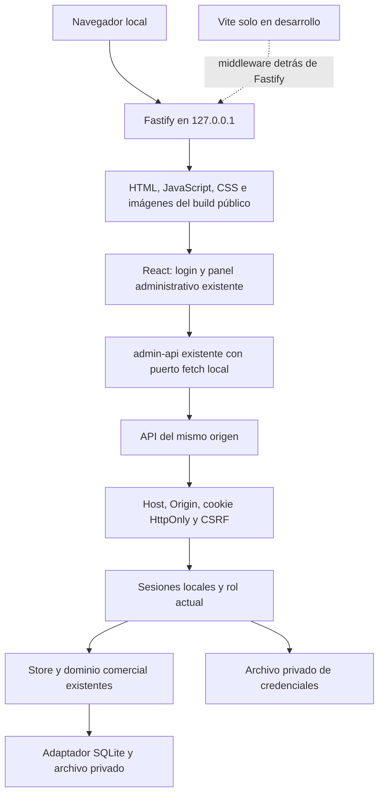

# Tarea 08 — Frontend React independiente

Fecha: 15/10/2026, America/Bogota. Rama: `codex/reestructuracion-arquitectonica`.
Base: `f29f8d4`.

## Arquitectura y alcance

Se consultaron auditoría 01, plan local, reportes 04–07, matriz de regresión y
especificación maestra MVP; se aplicó `programacion-clara`. La aplicación anterior
usaba entrada App Router/RSC, Vinext, identidad Sites y persistencia D1. Se
conservan sus archivos, comandos, rutas y fixtures para comparación.

La nueva entrada usa React 19.2.6, TypeScript y Vite 8.0.13 existentes. Fastify
sirve cliente compilado y API bajo **el mismo origen loopback**. SQLite y sesiones
son los componentes reales de Tareas 05–07. No se agregaron paquetes ni servicios.



Frontend: interacción, navegación por hash, formularios, estado de interfaz y
previsualizaciones. Backend: autenticación, autorización, validaciones, comandos,
cálculos autoritativos, auditoría y persistencia. Las funciones puras de resumen
son las mismas fuentes compartidas; no se duplican reglas comerciales.

## Organización y reutilización

| Archivo o conjunto                                         | Función                                                                                             |
| ---------------------------------------------------------- | --------------------------------------------------------------------------------------------------- |
| `client/index.html`, `main.tsx`, `App.tsx`                 | Entrada CSR, recuperación de sesión y pantalla propia de login.                                     |
| `client/session-api.ts`                                    | Cookies del navegador, CSRF en memoria, clasificación de errores y notificación de reautenticación. |
| `client/Topbar.tsx`, `LoadingScreen.tsx`, `LocalImage.tsx` | Límites de plataforma: logout local, carga y elementos img nativos.                                 |
| `client/domain.mjs`, `domain.d.mts`                        | Exportaciones de lectura/previsualización y reutilización de los contratos de tipos existentes.     |
| `client/vite.config.mts`, `tsconfig.json`                  | Compilación independiente, sustituciones explícitas y controles de frontera/ciclos.                 |
| `server/frontend.mts`                                      | Registro de recursos públicos concretos y CSP del cliente.                                          |
| `scripts/build-local.mjs`                                  | Build React, build Node y copia de recursos a `dist-node/public-client/`.                           |
| `scripts/dev-local.mts`                                    | Vite middleware/HMR detrás del mismo servidor y controles HTTP.                                     |
| `tests/frontend-*.test.mjs`, `tests/local-e2e/`            | Transporte, estáticos, navegador real, roles, reinicio y desarrollo.                                |

No se copian ventas, producción, cobranza, inventario, clientes, gastos, balance,
configuración, selectores ni formularios. `AdminApp`, `AdminWorkspace`, hooks y
componentes comerciales se importan de sus ubicaciones actuales.

Para preservar íntegramente la entrada anterior, las sustituciones se concentran
en **la configuración Vite independiente**:

- `next/image` se resuelve a `LocalImage`; no se importa ni ejecuta Next.
- Topbar y LoadingScreen se resuelven a componentes locales con el mismo aspecto.
- El barrel comercial se resuelve a un barrel de resúmenes puros, sin executeCommand,
  seed, store o persistencia.
- En el módulo `app/ui/admin-api.ts` se inyecta un import léxico de `adminFetch`.
  Se reutilizan sus funciones, payloads y respuestas, junto al hook que gestiona
  request_id. No se modifica el archivo original ni se parchea fetch global.

Es un puente de compilación explícito y temporal, no una simulación de backend.
La Tarea 09 deberá retirar estas referencias heredadas al consolidar la entrada
independiente. El chequeo TypeScript del cliente también sustituye el tipo de
imagen, sin exigir tipos de Next ni Cloudflare. La compilación rechaza código
de servidor, comandos/operaciones autoritativas, módulos Node o frameworks de
plataforma, y comprueba ciclos entre módulos propios realmente importados.

## Sesión, formularios e idempotencia

Al cargar se consulta GET `/api/auth/session`. Sin sesión se muestra login con
usuario, contraseña, estado de carga y errores del backend. La contraseña se
limpia después de cada intento y no se guarda en almacenamiento web. El navegador
gestiona la cookie HttpOnly/SameSite; el cliente conserva únicamente CSRF en memoria.
Las recargas recuperan sesión y CSRF desde el backend.

GET `/api/state` y POST `/api/command` conservan `{state,actor}` y
`{type,payload,request_id}` / `{state,result}`. Las escrituras añaden
X-CSRF-Token; no hay reenvíos automáticos. Se conserva `createCommandRequest`
original y el mismo ID al reintentar la misma operación fallida.

Los errores 400/413/415/422/429/503 se presentan con su categoría y mensaje.
401 requiere login. Ante 403 se consulta sesión para distinguir permiso
insuficiente de sesión revocada o rol cambiado, **sin repetir el comando**.
Si otra ventana rotó la cookie y el CSRF ya no coincide, se pide reautenticación
antes de un reintento manual; no se adopta silenciosamente otra identidad.
El conflicto conserva el mensaje del backend y las acciones existentes de recarga.

Si expira la sesión con un formulario abierto, se oculta/inactiva el espacio de
trabajo y se abre el diálogo de login por encima del modal nativo. Tras autenticar
al mismo usuario y rol se conserva formulario e ID; otro usuario/rol remonta el
panel para evitar transferir formularios o estado entre identidades. Logout
revoca la sesión y descarta el espacio de trabajo. La expiración/revocación se
detecta al consultar u operar; no se simula un reloj de seguridad en el cliente.

Se preservan las vistas por rol. Crear usuarios comerciales sigue siendo USER_SAVE;
vincular/restablecer sus credenciales se realiza por los procedimientos/API ADMIN
de Tarea 07. No se introduce un módulo comercial ni un bypass de autenticación.

## Mismo origen y seguridad de archivos

El nuevo campo opcional `frontend_directory` selecciona un directorio público
absoluto. Fastify enumera archivos regulares de tipos permitidos, exige index.html
y registra rutas concretas. No hay listado de directorios, comodín de archivos
o fallback SPA que convierta rutas privadas en HTML. La navegación sigue por hash.
No se sirven JSON de configuración, SQLite, fuentes TS/MTS, módulos MJS privados,
source maps ni entradas ocultas. Se rechazan enlaces y rutas no canónicas; el
archivo real se vuelve a comprobar antes de leerlo. El build público es de confianza
y debe contener únicamente recursos distribuibles.

Los controles existentes de Host, Origin, cookies, CSRF y no-store siguen activos.
No se habilita CORS abierto ni se aceptan identidades suministradas por el cliente.
La CSP del HTML permite scripts y conexiones del mismo origen, imágenes locales
y estilos en línea requeridos por la interfaz existente; prohíbe objetos, bases
remotas, frames y formularios a otros orígenes. La API conserva su CSP restrictiva.

Se evaluó servir recursos con Fastify y se eligió un registro pequeño de rutas
enumeradas, sin añadir un plugin de archivos ni un resolvedor genérico de rutas.

En desarrollo, **no se abre un segundo origen Vite con una excepción CORS**.
Vite opera en middleware detrás de Fastify; navegador, cookies, API y HMR usan
la URL del puerto configurado. No se reescriben Host/Origin hacia una API distinta.
El perímetro Fastify valida HTTP antes del middleware; el upgrade WebSocket exige
Host y Origin exactos. Vite conserva CORS desactivado, fs.strict y restricciones
de archivos que excluyen backend, configuración privada y controladores. La CSP
de desarrollo admite el nonce de Vite y el WebSocket exacto local, no scripts
remotos ni unsafe-inline para JavaScript.
Referencia: [opciones oficiales de servidor Vite](https://vite.dev/config/server-options).

## Preparación y ejecución

Requisitos de operación: Node 24.18+ y navegador. Preparar bases sintéticas nuevas
o copias autorizadas con [Tarea 06](REPORTE_06_MIGRACIONES_SQLITE.md) y crear/vincular
credenciales mediante [Tarea 07](REPORTE_07_BACKEND_NODE.md). El arranque no crea
bases, administradores o migraciones. Los archivos privados deben quedar fuera
del repositorio y del árbol reemplazable de instalación.

Desde `app/`:

```powershell
npm.cmd run check:client
npm.cmd run build:local
```

La distribución es `dist-node/`: contiene servidor compilado, los 50 paquetes de
runtime de Fastify, SQL/journal y `public-client/` con React compilado, CSS e imágenes.
No necesita Vite, npm, Vinext, Sites, Workers ni D1 en ejecución. Conservar una
carpeta de instalación contenedora y su subcarpeta app al trasladarla, por ejemplo
`C:\NutrequineLocal\app`; seleccionar datos privados fuera de ese árbol.
El test mueve esa distribución fuera del checkout y utiliza otros archivos
privados para negocio, autenticación y configuración.

Ejemplo de configuración privada (las rutas deben elegirse explícitamente):

```json
{
  "database": "D:\\NutrequinePrivado\\Datos\\negocio.sqlite",
  "auth_database": "D:\\NutrequinePrivado\\Datos\\acceso.sqlite",
  "port": 4317,
  "frontend_directory": "C:\\NutrequineLocal\\app\\public-client"
}
```

```powershell
node C:\NutrequineLocal\app\server\main.mjs --config "D:\NutrequinePrivado\Datos\servidor.json"
```

Acceder a `http://127.0.0.1:4317`, iniciar sesión y operar. Cerrar mediante Ctrl+C,
reiniciar con la misma configuración y comprobar persistencia. Se mantienen
las opciones TLS de Tarea 07; la cookie es Secure en HTTPS real.

Para desarrollo desde el checkout, usar rutas privadas de pruebas y:

```powershell
npm.cmd run dev:local -- --config "D:\NutrequinePrivado\Datos\desarrollo.json"
```

`frontend_directory` se ignora solo en este comando de desarrollo, que sirve la
entrada Vite. La operación distribuida siempre usa el build. No usar `vite preview`
como servidor operativo ni abrir manualmente Vite en LAN.

## Verificación y evidencia

Validación en Windows con Node 24.18.0, SQLite 3.53.1 y Chrome:

| Verificación                        | Resultado                                                                                                                                  |
| ----------------------------------- | ------------------------------------------------------------------------------------------------------------------------------------------ |
| `npm.cmd run verify`: pruebas       | 171 aprobadas: las 168 previas y tres nuevas, sin fallos, omisiones o TODO; 240,95 s de pruebas.                                           |
| TypeScript general / Node / cliente | Las tres comprobaciones aprobaron.                                                                                                         |
| ESLint                              | Aprobado con cero advertencias permitidas. La regla específica de imágenes Next no se aplica al nuevo cliente React; se mantiene alt-text. |
| Prettier global                     | Aprobado, incluida la documentación final.                                                                                                 |
| Build heredado                      | Aprobado; conserva `/`, `/api/state` y `/api/command`.                                                                                     |
| `build:local`                       | Vite React y Node aprobados, más copia de recursos públicos.                                                                               |
| Arquitectura                        | Controles anteriores y rechazo de ciclos/imports privados o de plataforma en el grafo ejecutable del cliente aprobados.                    |
| Ampliación de transporte            | Las tres pruebas frontend se repitieron después de añadir el caso de cookie/CSRF rotados; aprobaron sin reenviar comandos.                 |
| E2E heredado                        | Los 12 pasos aprobaron; Node informa 13 tests al incluir el contenedor, sin omisiones; 50,38 s.                                            |
| E2E independiente                   | L01–L14 y el ensayo adicional de desarrollo aprobaron; Node informa 16 tests al incluir el contenedor, sin omisiones; 49,44 s.             |

Logs locales ignorados: `outputs/frontend-08-verify.log` y
`outputs/frontend-08-transport-final.log`, `outputs/frontend-08-legacy-e2e.log`
y `outputs/frontend-08-local-e2e-final.log`. Los ensayos intermedios no sustituyen
la ejecución final ni se presentan sus pasos no ejecutados como aprobados.

Evidencia final independiente: `outputs/frontend-08/2026-10-15T06-48-22-762Z-fed282b5/`.
Su `results.json` registra los 14 pasos aprobados, cero errores de página y cero
peticiones externas intentadas por la página, junto con hashes SHA-256 de 16
capturas (14 pasos y dos roles). Se conservan traza de navegador y log de servidor.
El ensayo adicional Vite está registrado en
`outputs/frontend-08/2026-10-15T06-48-17-017Z-d4e6850a/` y en el log E2E final.

La distribución de prueba usa SQLite sintético persistente en disco, identidades
comerciales y credenciales creadas por la provisión real. El proceso servidor
ejecuta el preload externo de tests de Tarea 07 que bloquea TCP/DNS/UDP/fetch
externos y comprueba sus negativas antes de arrancar. El navegador bloquea
peticiones de página a otros orígenes; se desactivan servicios de fondo en el
ensayo principal. Esto **no equivale a certificar el firewall del SO**, otros
procesos ni todo el tráfico interno del navegador. No se distribuye ese preload.

Se conservan las 168 pruebas previas y se añaden tres pruebas de transporte y
estáticos con comportamiento real. La suite local verifica login y recarga,
cliente, producción, venta contado/futura, pago, crédito, inventario, rectificación,
devolución, reversión, anulación, gasto, balance, configuración, móvil, tema,
expiración, revocación, roles, logout y reinicio. El escenario portable original
se ejecuta sin cambiar sus aserciones de céntimos, gramos, caja o auditoría.

### Comparación visual y diferencias HTML revisadas

Se inspeccionaron las capturas de ventas anterior e independiente: mantienen
layout, dimensiones, logo, tablas, filtros, iconos, tipografía y valores comerciales.
Cambian la identidad del administrador y el nombre del cliente sintético. No se
actualizan fixtures visuales automáticamente; los 66 fingerprints anteriores
siguen siendo referencia del sistema heredado, con su prueba original intacta.

Capturas **locales e ignoradas por Git**; las imágenes enlazadas están disponibles
en este checkout, no como recursos publicados de GitHub:

| Sistema anterior, B03                                                              | Cliente independiente, L05                                                               |
| ---------------------------------------------------------------------------------- | ---------------------------------------------------------------------------------------- |
|  |  |

Las diferencias HTML intencionales son: entrada CSR con root de React frente a
RSC, img nativo sin atributos/precargas de Next, botón Salir con POST real frente
a enlace Sites, y diálogo de login propio. Se conservan width/height/alt, clases
y CSS originales de los componentes reutilizados. No se aprueba una nueva baseline
por reescribir snapshots; se documentan y revisan estas diferencias y sus capturas.

El ensayo detectó y corrigió la interacción del diálogo modal con el login por
expiración; también se ajustaron selectores de pruebas a las etiquetas reales
existentes. Las pruebas de traversal usan HTTP crudo porque fetch y los helpers
de inyección pueden normalizar segmentos antes de enviarlos. Ninguna corrección
cambia reglas, resultados comerciales o fixtures previos.

## Límites y trabajo reservado para Tarea 09

La operación local React/Node ya tiene una entrada independiente; el repositorio
todavía contiene la aplicación anterior y sus dependencias de desarrollo. No se
declara eliminada esa infraestructura. La instalación de herramientas puede usar
el registro npm; el artefacto preparado no hace llamadas de descarga al arrancar.

La Tarea 09 deberá revisar y retirar: entrada App Router/RSC, next/image y demás
referencias Next, Vinext, plugins/Workers de Sites, ChatGPT auth, bindings D1,
Wrangler/Miniflare/workerd, conectores y scripts específicos heredados, además de
consolidar los puentes de resolución. Deben conservarse Drizzle SQL/journal y los
módulos compartidos que aún use la solución local. Esta tarea no inicia esa limpieza.

Pendientes: Firefox/WebKit, accesibilidad exhaustiva y lectores de pantalla,
navegador con HTTPS de extremo a extremo, Linux/macOS dinámicos, firewall del SO,
cargas representativas, distribución firmada/instalador y transferencia real de
datos. Los directorios de build son artefactos locales y pueden acumular recursos
de ensayos; la distribución definitiva deberá definir limpieza/reproducibilidad.
No se certifica protección frente a un proceso hostil de la misma cuenta ni se
eliminan las limitaciones de cookies por host documentadas en Tarea 07.
No se tocó producción, no se importaron datos reales y no se inició la Tarea 09.
