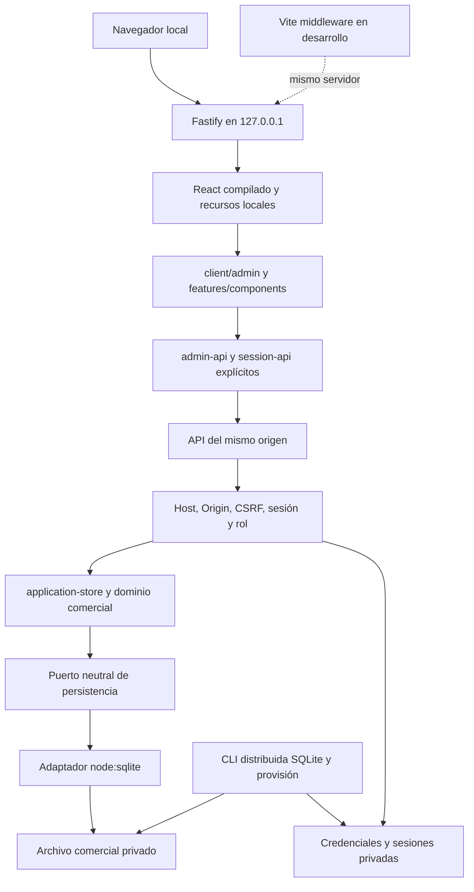

# Tarea 09 — Consolidación de la arquitectura local

Fecha: 15/10/2026. Rama exclusiva: `codex/reestructuracion-arquitectonica`.
Base funcional y remota comprobada: `a229671d745d466c6ddc14293e448a2c3fc06b0a`.
Referencia local de recuperación: etiqueta anotada `respaldo/tarea-08-a229671`;
no se mueve ni se reescribe el historial. El commit base sigue accesible en GitHub.

## Inventario previo y decisiones

Se consultaron auditoría 01, plan local, reportes 04–08 y matriz; se aplicó
`programacion-clara`. La inspección abarca imports de fuentes, configuraciones,
scripts, paquetes y lockfile, pruebas, CI y documentación. No se leen secretos
ni se intervienen bases reales. El borrado previo del vídeo de showcase es ajeno
y permanece fuera de los commits de esta tarea.

| Clase                                | Elementos                                                                                              | Decisión y consumidores comprobados                                                                                                                    |
| ------------------------------------ | ------------------------------------------------------------------------------------------------------ | ------------------------------------------------------------------------------------------------------------------------------------------------------ |
| Arquitectura independiente necesaria | `client/`, `server/`, adaptador SQLite, administración SQLite                                          | Conservar; entradas ejecutables reales de Tareas 06–08.                                                                                                |
| Compartidos activos                  | `features/`, `shared/`, store, persistencia neutral, contratos, `db/schema.ts`, Drizzle SQL/meta       | Conservar reglas, relaciones, IDs y SQL histórico. Componentes importados por el panel; dominio importado por store.                                   |
| Reemplazados                         | App Router, `lib/store.ts`, adaptador D1, `db/index.ts`, Workers, autenticación ChatGPT                | Sus consumidores son exclusivamente las entradas/plataforma retiradas; Node compone store y SQLite directamente.                                       |
| Reemplazados                         | Plugins Sites/Vinext, perfiles y scripts Wrangler, `.openai/`, tipos Cloudflare                        | Ningún consumidor en el grafo Node/React independiente. Sustituir los comandos principales por Vite/Fastify/CLI SQLite.                                |
| Reemplazados sin uso comercial       | Conectores, preview y componentes del starter                                                          | Sin imports desde el panel, funcionalidades o UI compartida activa. Retirar fuentes sin consumidores y paquetes asociados, conservando avisos legales. |
| Desarrollo necesario                 | TypeScript, Vite, React plugin, Tailwind/PostCSS, ESLint, Prettier, generador Drizzle, herramienta E2E | Conservar herramientas usadas; configurar lint sin Next y declarar dependencias directas reales.                                                       |
| Historia documental                  | Auditorías/reportes 01–08, especificación, demo multimedia, referencias visuales previas               | Conservar como antecedentes, sin presentarlos como procedimientos operativos actuales. No publicar capturas o bases.                                   |
| Compatibilidad histórica necesaria   | Lectura del ledger `d1_migrations` en `lib/sqlite/schema.mjs`                                          | Conservar: reconoce metadatos SQLite previos sin cargar D1 ni Cloudflare. No eliminar por su nombre.                                                   |

La referencia `tests/fixtures/ui-independent-08.json` se capturó antes de cambiar
fuentes, aplicando las mismas resoluciones explícitas del cliente Tarea 08 en el
harness SSR. Nueve vistas se compararon con la referencia antigua: únicamente
el header de logout ya aprobado en Tarea 08 cambia; el resto de su HTML coincide.
La referencia histórica `ui-baseline.json` permanece intacta. No se generan
expectativas a partir del código consolidado para ocultar diferencias.

## Arquitectura consolidada y estructura

React 19.2.6, TypeScript y Vite 8.0.13 constituyen la entrada de cliente. Fastify
5.12.7/Node 24.18 sirve los recursos y la API bajo un mismo origen loopback.
SQLite conserva negocio y acceso en archivos privados separados. Las mismas
funcionalidades y funciones de dominio siguen siendo la fuente de verdad.

| Directorio                     | Responsabilidad                                                                      |
| ------------------------------ | ------------------------------------------------------------------------------------ |
| `client/`, `client/admin/`     | Entrada React, login, sesión, composición administrativa, navegación y estilos.      |
| `server/`                      | HTTP, autenticación, roles, seguridad, configuración, provisión y archivos públicos. |
| `features/`                    | Funcionalidades existentes: componentes/hooks y dominio por área.                    |
| `shared/`                      | Contratos, validaciones, unidades, formato y UI reutilizable.                        |
| `lib/`                         | Casos de uso, planes SQL, contratos, resúmenes de previsualización.                  |
| `lib/adapters/`, `lib/sqlite/` | Driver encapsulado y administración/recuperación SQLite.                             |
| `db/`, `drizzle/`              | Esquema de desarrollo y SQL/metadatos históricos inmutables.                         |
| `public/`, `vendor/`           | Recursos gráficos locales y avisos legales.                                          |
| `scripts/`, `tests/`, `docs/`  | Herramientas, verificaciones y procedimientos.                                       |

Se conserva la modularización por funcionalidad de Tarea 04. Los movimientos
concentran la composición del cliente, no fragmentan reglas ni crean capas por
entidad. `AuthenticatedId` se conserva porque Configuración lo consume para el ID
local; su nombre no justifica retirarlo. Se conservan `db/schema.ts`, SQL, journal,
snapshots, relaciones, validaciones y el contrato neutral de persistencia.

## Retiros, paquetes y puentes temporales

El [inventario detallado](INVENTARIO_09_RETIROS.md) enumera rutas, movimientos,
los 30 paquetes directos retirados y los 340 nombres transitivos que dejan de
aparecer. El lockfile pasa de 936 a 510 entradas de paquetes, incluidas variantes
opcionales de plataforma; npm ci instaló 380 paquetes en Windows. No cambia la
versión de ningún paquete que conserva la misma ruta en ambos lockfiles.

| Infraestructura retirada                                     | Sustitución o motivo                                                       |
| ------------------------------------------------------------ | -------------------------------------------------------------------------- |
| App Router, Next y RSC                                       | `client/main.tsx`, React CSR y navegación por hash.                        |
| Vinext y plugin RSC                                          | Vite React y API Fastify ya implementados.                                 |
| Workers, Wrangler, Miniflare, workerd, tipos Cloudflare      | Entrada Node, procesos locales y adaptador SQLite.                         |
| Worker/plugin Sites, hosting y autenticación por cabeceras   | Sesiones locales reales y configuración privada explícita.                 |
| `lib/store.ts`, adaptador D1 y Drizzle/D1 de `db/index.ts`   | Composición Node existente y puerto `PersistenceDatabase`.                 |
| Conectores, JSON-RPC, raw-body y preview de plataforma       | Sin consumidores comerciales; no se crea un servicio sustituto.            |
| Middleware de identidad simulada, perfiles y preparadores D1 | Provisión autorizada y CLI SQLite, sin bootstrap al arrancar.              |
| Scaffold de componentes y sus bibliotecas sin consumidores   | UI comercial existente conservada; no se reconstruye el panel.             |
| ESLint Next                                                  | Configuración directa de ESLint, TypeScript, React, hooks y accesibilidad. |
| Alias de imágenes, barra, carga y dominio de Tarea 08        | Imports explícitos y elementos img nativos con las mismas dimensiones/alt. |
| Inyección de fetch mediante transform de Vite                | `client/admin/admin-api.ts` importa normalmente `session-api.ts`.          |
| Fallback E2E a paquetes multimedia                           | Playwright declarado en la aplicación y su lockfile.                       |

Solo permanece el alias genérico `@/` para la raíz, equivalente en TypeScript y
Vite. No hay aliases específicos que sustituyan módulos. El plugin de frontera
solo rechaza imports privados/de plataforma y ciclos; no transforma ni sustituye
fuentes. `lib/domain-preview.mjs` exporta explícitamente resúmenes puros y no carga
seed, comandos, store o persistencia en el navegador.

Las nuevas declaraciones directas de lint antes eran transitivas de Next;
Playwright pasa a ser una herramienta explícita y reproducible de pruebas.
La configuración plana conserva controles de TypeScript, React, hooks y
accesibilidad: [configuraciones de typescript-eslint](https://typescript-eslint.io/users/configs/)
y [modelo de configuración ESLint](https://eslint.org/docs/latest/use/configure/migration-guide).
`drizzle-orm` se conserva en desarrollo para el esquema/generador. Las advertencias
deprecadas de `@esbuild-kit` proceden de Drizzle Kit y quedan pendientes de una
revisión separada del generador; no forman parte del runtime distribuido.

Los tres paquetes/lockfiles del repositorio se revisaron en su contexto. Los
paquetes multimedia `demo-linkedin` y `showcase` son material histórico separado:
no se instalan desde el paquete principal, no son consumidores de negocio ni
participan en pruebas o distribución. Su reproducción histórica requiere recuperar
el commit correspondiente; no se afirma que su captura siga funcionando sobre
esta arquitectura. Se conservan sus medios, QA y fuentes sin incorporarlos al
producto operativo. El borrado previo del vídeo ajeno a esta tarea queda sin tocar.

La licencia del plugin anterior se mueve intacta a `vendor/`; se conserva también
el aviso shadcn. El empaquetado conserva licencias de dependencias de runtime.
Los patrones de ignore antiguos permanecen para proteger datos/perfiles locales
previos, no para ejecutar la plataforma. No se eliminan esos datos locales.

## Compilación, ejecución y distribución

| Procedimiento         | Comando desde app                                          |
| --------------------- | ---------------------------------------------------------- |
| Instalar              | `npm ci`                                                   |
| Desarrollo React/Node | `npm run dev -- --config RUTA_PRIVADA_ABSOLUTA`            |
| Compilar todo         | `npm run build`                                            |
| Iniciar compilado     | `npm start -- --config RUTA_PRIVADA_ABSOLUTA`              |
| Pruebas / navegador   | `npm test` / `npm run test:e2e`                            |
| Tipos                 | `npm run check`, `check:client`, `check:node`              |
| Lint / estilo         | `npm run lint` / `format:check`                            |
| Verificación completa | `npm run verify` y después `npm run test:e2e`              |
| Administración SQLite | `npm run db:admin -- COMANDO OPCIONES`                     |
| Provisión autorizada  | `npm run auth:prepare -- OPCIONES`, JSON privado por stdin |

Ver [instalación](INSTALACION_LOCAL.md), [desarrollo](GUIA_DESARROLLO.md),
[arquitectura](ARQUITECTURA.md) y [recuperación](RESPALDO_RESTAURACION.md).
README, AGENTS y CI describen estas entradas; los informes 01–08 están marcados
como antecedentes. No se inicia automáticamente una base, administrador o migración.

El build reconstruye únicamente `dist-client/` y `dist-node/`, validando sus rutas
absolutas dentro de app y rechazando enlaces antes de limpiar artefactos. No usa
directorios de datos como destinos. El paquete contiene cliente compilado, Node,
50 paquetes de runtime, SQL/meta, avisos y las CLI SQLite/provisión. Se excluyen
tests, documentación de dependencias y mapas de fuentes. La auditoría rechaza
paquetes retirados, bases, claves, entornos privados, configuración ajena y fuentes
TS propias. No se cargan herramientas de desarrollo para operar.

## Trazabilidad de regresión

| Referencia previa                       | Verificación actual y motivo                                                                                                                                                                   |
| --------------------------------------- | ---------------------------------------------------------------------------------------------------------------------------------------------------------------------------------------------- |
| Casos A–F y reglas adicionales, R01–R24 | Se conservan assertions comerciales. La misma batería usa un puerto de referencia SQLite y el adaptador real en disco.                                                                         |
| Paridad D1/SQLite de Tarea 05           | La ejecución previa a retirar Miniflare aprobó. El escenario completo de historia se conserva para comparar puerto SQLite de referencia y driver real; no se presenta como nueva ejecución D1. |
| Ocho tests de preparación Wrangler      | Retirados con sus scripts; Tarea 06 prueba inicialización explícita, adopción, esquema parcial/distinto, índices, historiales y migraciones pendientes sobre archivos reales.                  |
| H01: sin identidad                      | Node provisión/sesiones y seguridad rechazan sin acceso al negocio.                                                                                                                            |
| H02–H03: estado y usuario activo        | Node HTTP, roles, desactivación y sesión vigente; no-store y estado persistente.                                                                                                               |
| H04: consulta y escritura VIEWER        | Node permisos: consulta autorizada y escritura 403, contrato vigente desde Tarea 07.                                                                                                           |
| H05: repetición de request_id           | Node escenario portable y concurrencia; conserva resultado, auditoría y revisión.                                                                                                              |
| H06: origen y tamaño                    | Node Host/Origin/CSRF, límite por bytes y solicitudes fragmentadas.                                                                                                                            |
| H07: comando/payload inválidos          | Node validación, dominio y regresión de errores sin efectos.                                                                                                                                   |
| H08: JSON inválido                      | Node responde 400 desde Tarea 07, no el 503 del handler antiguo.                                                                                                                               |
| H09: almacenamiento indisponible        | Node bloqueo SQLite, errores seguros y reintento con el mismo ID.                                                                                                                              |
| H10: Origin ausente                     | Node exige Origin en escrituras desde Tarea 07; se conserva la negativa de seguridad.                                                                                                          |
| N01–N04, B01–B08                        | L01–L14 prueban HTTP y formularios contra sesiones locales reales; se retira el servidor E2E de plataforma.                                                                                    |
| HTML                                    | 66 escenarios del cliente independiente capturados antes de consolidar, más referencia histórica intacta.                                                                                      |
| Recuperación distribuida                | L15: backup, manifiesto, restore, verificación, vinculación de acceso y reinicio.                                                                                                              |

El objetivo es conservar protección comercial, no un número artificial de tests.
De las 171 pruebas previas se retiran 18 específicas de infraestructura (ocho de
preparación Wrangler y diez de handlers antiguos), se adaptan paridad/propiedad de
sentencias y transporte, y se añade un control de manifiesto/lockfile: se esperan
154 en la batería consolidada. Los resultados reales se registrarán abajo.
Los 12 pasos de navegador/HTTP de plataforma no se siguen contando como ejecutables
sin sus dependencias: se sustituyen por los flujos independientes y su evidencia.

## Seguridad, restauración y límites

No cambian los módulos del servidor de Tarea 08, el driver SQLite, el store,
permisos, reglas, cálculos ni SQL histórico. Permanecen cookies HttpOnly, sesiones,
CSRF, roles, Host/Origin, límites, archivos públicos enumerados, auditoría,
idempotencia, atomicidad, revisiones y rollback. Cliente y HMR usan el mismo origen.

La autenticación está vinculada a la ruta canónica del archivo comercial. El ensayo
de recuperación detectó correctamente el rechazo al seleccionar una restauración
con el acceso de otra ruta. Se conserva ese control: L15 provisiona un archivo de
acceso nuevo mediante la CLI link autorizada y autentica al mismo ADMIN histórico.
Negocio y credenciales originales permanecen intactos; no se edita la vinculación
para sortear la validación. La recuperación organizacional de todas las credenciales
y el resto de límites de Tarea 07 no se presentan como resueltos.

La prueba aislada utiliza únicamente datos sintéticos y bloquea conexiones externas
del proceso por instrumentación TCP/DNS/UDP/fetch; el navegador bloquea orígenes
ajenos y sus peticiones se registran. Esto no certifica el firewall del SO ni tráfico
de otros procesos. No se descarga ningún recurso durante el arranque operativo.

Pendientes: Firefox/WebKit, accesibilidad exhaustiva, carga representativa, prueba
dinámica Linux/macOS, auditoría externa de seguridad, firewall del SO, instalación
firmada y recuperación organizacional de credenciales. Se mantienen las decisiones
de negocio pendientes sobre devoluciones anteriores a rectificación y proveedores.
No se migra producción ni se prueban datos reales.

## Preparación corporativa

Las fronteras de HTTP, sesión, dominio y persistencia son explícitas. Facilitan
integrar posteriormente otro resolutor de identidad y una estrategia corporativa
de almacenamiento sin duplicar reglas. El modelo sigue siendo de una empresa:
no ofrece aislamiento multiempresa, company_id, permisos entre empresas ni conexión
con Control Granja. Esa evolución requiere diseño y migraciones propios; no se
implementa ni se certifica capacidad corporativa o escalabilidad por esta limpieza.

## Resultados finales

La referencia previa aprobó 171 pruebas (377,17 s), los tres chequeos TypeScript,
lint, formato y ambas compilaciones. Aprobaron también los 12 pasos heredados
(147,06 s) y 14 flujos independientes más desarrollo (123,61 s).
Logs locales: `outputs/consolidacion-09-base*.log`.

La selección posterior de 73 pruebas comerciales/arquitectura aprobó sin omisiones
(19,52 s), incluidos los 66 escenarios HTML. Los tres chequeos TypeScript y ESLint
sin Next aprobaron. Continúan en ejecución la batería completa, los E2E finales
y la reproducción desde checkout limpio; sus resultados se completarán antes del cierre.
