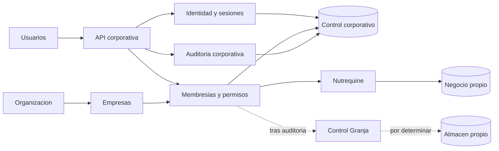

# Tarea 10 — Preparación arquitectónica corporativa

Fecha: 15/10/2026, America/Bogota.
Rama: `codex/reestructuracion-arquitectonica`.
Base examinada: `701ab84ce5c50bc3d9f641727b89e3f1b8f513fb`.
Alcance: diagnóstico y diseño documental; **ninguna implementación multiempresa**.

## Resultado y diagnóstico

Nutrequine dispone de una ruta viable de integración gracias a sus fronteras entre
React, HTTP, autenticación, dominio y persistencia. Sigue siendo una aplicación para
una sola empresa. No tiene catálogo corporativo, membresías, roles corporativos,
selector empresarial, aislamiento entre empresas ni integración con Control Granja.
Su servidor permanece restringido a loopback y no se considera apto para exposición
pública por este informe.

Se recomienda evaluar un **monolito modular con control corporativo compartido y
almacenamiento comercial independiente**. Permite conservar el modelo Nutrequine
y añadir otros modelos auditados sin imponerles sus reglas. Implica coordinar
identidad, selección segura de almacén, versiones y recuperación; no ofrece una
transacción global ni aislamiento ante el compromiso del proceso compartido.

El diseño completo se encuentra en
[arquitectura ERP corporativo](ARQUITECTURA_ERP_CORPORATIVO.md). Distingue decisiones
confirmadas C01–C03, propuestas P01–P03 y decisiones pendientes D01–D03. Ninguna
propuesta equivale a un componente desplegado o a una selección comercial aprobada.

## Documentación y código consultados

Se aplicó la skill instalada `programacion-clara`: intervención mínima, contratos
explícitos, responsabilidades comprensibles y ausencia de abstracciones sin consumidor.

| Fuente                                                      | Uso en esta revisión                                                                                                                                                              |
| ----------------------------------------------------------- | --------------------------------------------------------------------------------------------------------------------------------------------------------------------------------- |
| [Auditoría 01](AUDITORIA_01_ARQUITECTONICA.md)              | Antecedente del acoplamiento original a Sites/Workers/Vinext/D1; no representa dependencias operativas actuales.                                                                  |
| [Plan de migración local](PLAN_MIGRACION_LOCAL.md)          | Invariantes, fases y límites de independencia. Su cabecera vigente y reporte 09 prevalecen para el estado actual frente a propuestas históricas de paquetes y retiros pendientes. |
| [Backend 07](REPORTE_07_BACKEND_NODE.md)                    | Contratos HTTP, roles, sesiones, vinculación de credenciales y límites de recuperación.                                                                                           |
| [Frontend 08](REPORTE_08_FRONTEND_INDEPENDIENTE.md)         | Frontera cliente/servidor, sesión/CSRF, comportamiento de formularios y mismo origen. Sus pendientes de infraestructura retirada se leen como historia de esa tarea.              |
| [Consolidación 09](REPORTE_09_CONSOLIDACION.md)             | Base operativa actual, retiros, 154 pruebas, recorridos locales L01–L15 y límites pendientes.                                                                                     |
| [Arquitectura actual](ARQUITECTURA.md)                      | Estructura real, store, dominio, persistencia y distribución.                                                                                                                     |
| [Especificación maestra MVP](ESPECIFICACION_MAESTRA_MVP.md) | Alcance funcional; secciones 59–61 de roles/integridad/transacciones y preservación de historia, fórmulas y cantidades. No se amplía el MVP a contabilidad corporativa.           |
| [Matriz de regresión](MATRIZ_REGRESION.md)                  | Referencias comerciales estables y evolución de escenarios; sus tablas originales no se presentan como estado actual de plataforma.                                               |
| [Respaldo y restauración](RESPALDO_RESTAURACION.md)         | Restricciones de copia, destino nuevo, autenticación y recuperación autorizada.                                                                                                   |

Se inspeccionaron `client/main.tsx`, el grafo de imports y
`client/vite.config.mts`; `server/application.mts`, `auth-database.mts`; el puerto
`lib/persistence-port.ts`, `application-store.mjs`, `adapters/node-sqlite.mjs`;
`shared/domain/permissions.mjs` y dependencias de `features/*/domain`. También los
controles `tests/architecture.test.mjs`, `tests/node-architecture.test.mjs`,
`package.json`, exclusiones y las instrucciones `AGENTS.md`.
No se inspeccionaron datos operativos, secretos ni código de Control Granja.

## Preparación real y acoplamientos

| Hallazgo confirmado                                                                                                    | Consecuencia para la integración futura                                                                                                 |
| ---------------------------------------------------------------------------------------------------------------------- | --------------------------------------------------------------------------------------------------------------------------------------- |
| El cliente usa transporte y previsualizaciones puras; Vite rechaza imports privados/de plataforma.                     | Reutilizar interfaz y reglas sin incorporar persistencia o autorización autoritativa al navegador.                                      |
| Dominio separado de HTTP, con dependencias internas entre ventas, inventario, cobranza y balance.                      | Mantener esas relaciones dentro de Nutrequine, sin convertir cada feature en un servicio.                                               |
| Store recibe una conexión neutral y persiste con batches atómicos y control de revisión.                               | Componer un store por ámbito autorizado; no introducir repositorios por entidad ni mezclar estados empresariales.                       |
| El puerto expone SQL; plan, esquema y guardas siguen siendo SQLite/Nutrequine.                                         | El desacoplamiento del driver no demuestra compatibilidad automática con PostgreSQL.                                                    |
| Estado global de una empresa, configuración única y revisión global; driver síncrono y cola en el servidor local.      | Medir carga y definir recursos por ámbito antes de compartir proceso entre empresas.                                                    |
| Identidad actual unida al ID comercial; credenciales/sesiones en archivo separado ligado a la ruta comercial canónica. | Un directorio central requiere vinculación autorizada de actores; no reutilizar ese archivo indiscriminadamente para varias bases.      |
| Roles comerciales y control del último ADMIN existen en backend/dominio.                                               | Preservarlos y resolver su convivencia con futuras membresías; un rol corporativo no los sustituye ni crea privilegios automáticamente. |
| La restauración comercial se ensayó hacia un destino nuevo con vinculación autorizada de acceso nuevo.                 | No confundirla con recuperación corporativa de todas las credenciales, sesiones o membresías.                                           |

## Arquitectura, identidad y permisos propuestos

Diagrama conceptual; todos los componentes corporativos son futuros. Control Granja
no tiene aquí un modelo ni una API conocidos.

El [modelo conceptual](ARQUITECTURA_ERP_CORPORATIVO.md#3-modelo-conceptual) define
organización, empresa, unidad opcional, usuario, membresía, roles corporativos y
de empresa, permisos, sesión, vínculo de actor histórico y auditoría. Distingue
identidad de pertenencia y autorización: A puede ser ADMIN en Nutrequine y lector
en otra empresa sin recibir acceso a una tercera. No se modifica ninguna tabla.

La [matriz de permisos](ARQUITECTURA_ERP_CORPORATIVO.md#6-matriz-inicial-de-permisos)
conserva ADMIN/OPERATOR/VIEWER de Nutrequine como referencia y separa administración
corporativa, auditoría y acceso comercial. Para Control Granja solo plantea que
deberá existir un mapa aprobado tras auditar sus roles reales. Incluye el riesgo
de autoasignación de privilegios por administradores de membresías.

Los [contratos propuestos](ARQUITECTURA_ERP_CORPORATIVO.md#5-contexto-seguro-y-contratos-de-api-propuestos)
abarcan autenticación, sesión, empresas autorizadas, selección, membresía propia,
acceso al módulo, autorización interna y auditoría; versionado y errores diferenciados.
Ninguna ruta corporativa existe. La API local mantiene sus contratos actuales;
en particular la revisión obsoleta conserva su respuesta comercial 422, sin adoptar
el 409 propuesto para un contrato futuro distinto.

La empresa de una ruta sería un selector no confiable. Solo el backend resolvería
membresía, módulo, permiso, actor histórico y conexión desde un registro privado.
Cada petición tendría contexto inmutable; no se confiaría en roles enviados ni
en un "empresa activa" global que cambie el destino de otra pestaña. Los IDs no
se convertirían en rutas de archivos. Reintentos, cachés, tareas y auditoría tendrían
ámbito; una respuesta de selección nunca sería una concesión de permisos.

## Comparación de aislamiento y almacenamiento

La [evaluación de alternativas](ARQUITECTURA_ERP_CORPORATIVO.md#4-aislamiento-y-persistencia)
cubre implementación, seguridad, fugas, transacciones, respaldo, restauración,
migraciones, operación local/central, escalabilidad, mantenimiento e integración.

- A, base por empresa: facilita conservar modelos y recuperar una empresa; necesita
  catálogo y operación por base y no resuelve por sí sola identidad compartida.
- B, base comercial compartida: requiere ámbito en consultas y relaciones, cambios
  invasivos del modelo actual y pruebas extensas; restauración selectiva compleja.
- C, servicios corporativos comunes y negocio independiente: recomendada para evaluar
  porque preserva diferencias y recuperación por empresa. Añade coordinación y un
  control común crítico; separar archivos no protege frente a un proceso comprometido.

SQLite sigue siendo adecuado como opción local sujeta a carga medida. Una base
administrada o PostgreSQL se evaluarían por concurrencia, ubicación, continuidad y
coste operativo; no por obligación arquitectónica. El diseño cita documentación
primaria consultada de SQLite, PostgreSQL, OWASP y OpenID Connect para límites
técnicos concretos. La recomendación de integración es un juicio de este análisis.

No se promete atomicidad entre almacenes. La auditoría comercial permanece junto
al negocio; la corporativa necesitaría entrega durable y conciliación cuando se
implemente. Se explicitan carreras de revocación, limitaciones de idempotencia
histórica y recuperación coordinada pendiente. No se crean adaptadores, tablas,
salidas transaccionales ni sincronización.

## Control Granja y secuencia futura

La [secuencia de integración](ARQUITECTURA_ERP_CORPORATIVO.md#9-integración-gradual-y-condiciones-de-avance)
define diez etapas con dependencias y condiciones de avance: auditoría de Control
Granja; servicios compartidos; selección de arquitectura; identidad/permisos;
contratos; almacenamiento; adaptación de Nutrequine; integración auditada de Control
Granja; pruebas de aislamiento; despliegue y validación autorizados.

La auditoría deberá inventariar código, runtime, API real, consumidores, base,
migraciones, reglas, unidades, autorización, historial, copias y pruebas. Observará
comportamientos con datos sintéticos y registrará evidencia por commit. Sin esa
información no se define su conector ni se inventan endpoints. Un servicio propio
podría mantenerse separado si su runtime o requisitos operativos lo justifican.

## Riesgos y decisiones pendientes

| Riesgo                                               | Respuesta propuesta / decisión pendiente                                                                                             |
| ---------------------------------------------------- | ------------------------------------------------------------------------------------------------------------------------------------ |
| Fuga por seleccionar otra empresa o almacén          | Registro privado, autorización por petición/recurso y pruebas con IDs coincidentes; aún no implementados.                            |
| Elevación por administrador corporativo              | Membresías explícitas, separación de funciones y aprobación de asignaciones sensibles; responsables por definir.                     |
| Acceso central equivocado a un actor histórico       | Vínculo comprobado, sin emparejar por correo/nombre ni reescribir historia; procedimiento de transición pendiente.                   |
| Revocación durante un commit o caída de identidad    | Definir semántica de operaciones en curso y coordinación si se exige impedir commits; denegar nuevas autorizaciones no verificables. |
| Caída del proceso común o vecino ruidoso             | Medir cola/SQLite/estado global; presupuestos por ámbito y separación de proceso solo si se justifica.                               |
| Auditoría central fallida tras confirmar negocio     | Entrega durable y conciliación por diseñar; no duplicar operación ni afirmar rollback después del commit.                            |
| Copias incompatibles o reactivación de accesos       | Plan de recuperación de control y negocio, versiones, custodios y RPO/RTO por aprobar y ensayar.                                     |
| Exposición remota prematura                          | Mantener loopback; HTTPS, MFA, secretos, topología y revisión externa antes de autorizar otro perímetro.                             |
| Integración basada en supuestos sobre Control Granja | Auditoría previa y contratos verificados como condición de entrada.                                                                  |
| Consolidar cifras con significados distintos         | Definir métricas/moneda/periodos y permisos antes de cualquier panel consolidado; no sumar balances por defecto.                     |

Se deberá aprobar también si hay varias organizaciones o una sola, qué es empresa
frente a unidad/sede, proveedor de identidad, necesidad offline, duración de accesos,
revocación, retención de auditoría, objetivos de continuidad, motor y alojamiento
central. Ninguna de esas elecciones se presenta como cerrada por este informe.

## Verificaciones y alcance de la evidencia

Cambios limitados a este reporte y `ARQUITECTURA_ERP_CORPORATIVO.md`. No se modifican
código, pruebas, dependencias, configuración, UI, autenticación, esquema, migraciones
ni datos. La eliminación previa del vídeo en `showcase/dist/` permanece fuera de la tarea.

| Verificación de Tarea 10                                                   | Resultado                                                                                                                                                                               |
| -------------------------------------------------------------------------- | --------------------------------------------------------------------------------------------------------------------------------------------------------------------------------------- |
| `node --test tests/architecture.test.mjs tests/node-architecture.test.mjs` | 5 pruebas aprobadas; 0 fallos, canceladas, omitidas o TODO.                                                                                                                             |
| Revisión de fronteras                                                      | Cliente sin store/SQLite/comandos privados; dominio sin HTTP ni autenticación de sesiones; persistencia detrás del puerto; autenticación en `server/`.                                  |
| Ciclos                                                                     | Controles existentes de grafo estático de aplicación y grafo ejecutable Node aprobados. No se añaden imports ni módulos.                                                                |
| Coherencia                                                                 | Rutas corporativas identificadas como inexistentes; API local y roles contrastados con código; Control Granja pendiente de auditoría; recomendación separada de decisiones confirmadas. |
| Enlaces locales y secciones                                                | Comprobados en ambos entregables contra archivos y encabezados existentes.                                                                                                              |
| Formato                                                                    | Prettier de ambos entregables comprobado.                                                                                                                                               |
| Integridad y exclusiones                                                   | Diff y `git diff --check` revisados; únicamente los dos documentos pertenecen al cambio; sin datos privados ni artefactos.                                                              |

El chequeo documental validó 21 enlaces locales, cinco referencias a encabezados,
cinco URLs externas en cuanto a sintaxis y el cierre de bloques en ambos documentos.
Las fuentes externas se consultaron durante el análisis; esto no garantiza su
disponibilidad futura.

Los tests de grafo comprueban imports estáticos conocidos y no prueban un aislamiento
corporativo inexistente. La configuración Vite también contiene controles de bundle;
no se recompiló el bundle en esta tarea documental. Los diagramas Mermaid usan
`flowchart` y relaciones explícitas; se revisó su estructura en el texto, sin afirmar
un renderizado gráfico automatizado.

No se repiten en Tarea 10 la suite comercial completa, TypeScript, ESLint, build ni
E2E: no cambia fuente ejecutable y `app/AGENTS.md` permite verificación documental
en este caso. El antecedente registrado en Tarea 09 es 154 pruebas aprobadas, controles
de tipos/lint/formato/build y E2E local L01–L15 más desarrollo, también en clon limpio;
son resultados históricos, no ejecuciones de esta tarea.

Quedan sin ejecutar las futuras pruebas corporativas de aislamiento, federación,
revocación entre ámbitos, recuperación conjunta, PostgreSQL y Control Granja. Sus
criterios se registran en el diseño, sin crear tests ficticios ni declarar garantías
inexistentes. Producción permanece intacta y no se inicia la siguiente tarea.
