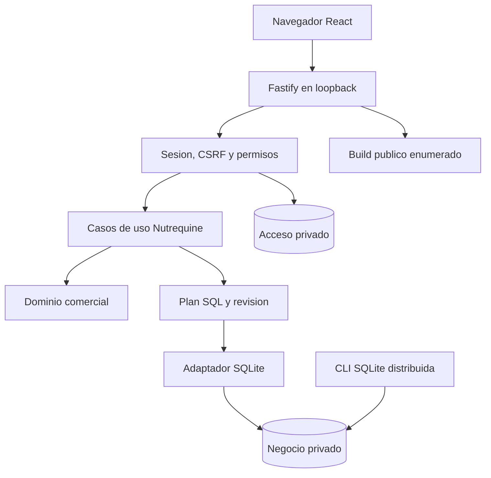

# Tarea 11 — Validación integral y cierre arquitectónico

Fecha: 15/10/2026, America/Bogota. Rama exclusiva:
`codex/reestructuracion-arquitectonica`.
Referencia funcional: `701ab84` (Tarea 09); diseño corporativo: `fdc85f0` (Tarea 10).
Base ejecutable de cierre: `b37c58d683da28e8bba4ec1400daabcfa10a5294`.

**Dictamen: APROBADO CON RESERVAS para el alcance local probado.**

## 1. Resumen ejecutivo

La revisión conserva las reglas comerciales, interfaz, servidor, autenticación,
adaptador, esquema y migraciones históricas. Se ampliaron únicamente verificaciones
y documentación, y se corrigieron dependencias con avisos de seguridad demostrados.
No se utilizaron datos reales ni se modificó producción, main o el perímetro loopback.

La aplicación tiene entradas React/Vite y Fastify/Node autónomas, SQLite en archivos
privados y una distribución con recursos locales y herramientas administrativas.
La independencia se evalúa mediante código, dependencias, contenido distribuido y
ejecución aislada; no se deduce solo de que un test termine correctamente.

La [matriz de aceptación](MATRIZ_ACEPTACION_FINAL.md) detalla requisito, evidencia,
resultado, limitación y estado. La [guía operativa](GUIA_OPERATIVA_FINAL.md) permite
repetir instalación, inicio, parada, respaldo, recuperación y diagnóstico.
El dictamen y los límites de uso se detallan en la sección 15.

## 2. Arquitectura y mantenibilidad verificadas



Se revisaron los grafos ejecutables y sus entradas, imports, transporte HTTP,
autenticación, configuración, dominio, SQL, adaptación SQLite, administración,
compilación y tests. Los controles arquitectónicos y el build comprueban fronteras
y ciclos estáticos; no constituyen una demostración formal para cualquier módulo futuro.

| Zona                                                   | Resultado de revisión                                                                                                                                                                         |
| ------------------------------------------------------ | --------------------------------------------------------------------------------------------------------------------------------------------------------------------------------------------- |
| `client/`, componentes/hooks de `features/`            | Presentación, formularios, navegación, estado de interfaz, sesión y HTTP. Previsualizaciones puras reutilizan reglas; no ejecutan comandos autoritativos ni abren SQLite.                     |
| `server/`                                              | Composición Fastify, identidad local, sesiones, autorización, validación HTTP, cola de operaciones y recursos públicos. La autenticación no reside en los módulos comerciales.                |
| `features/*/domain`, `shared/domain`                   | Producción, ventas, inventario, clientes, cobranza, gastos, balance y configuración sin dependencia del framework HTTP. Referencias entre áreas de Nutrequine conservan coherencia comercial. |
| `lib/application-store.mjs`, `persistence.mjs`, puerto | Coordinación, estado comercial, plan parametrizado y revisión optimista; el controlador queda detrás del contrato.                                                                            |
| `lib/adapters/`, `lib/sqlite/`                         | Archivo persistente, transacción, rollback, verificación, migraciones explícitas y recuperación. Esquema y SQL siguen siendo específicos de Nutrequine/SQLite.                                |

Otro desarrollador puede localizar una pantalla en `features/<área>/components`,
su regla en `domain`, la autorización en `shared/domain/permissions.mjs`, el contrato
HTTP en `server/application.mts`, la sesión en `server/authentication.mts` y el driver
en `lib/adapters/node-sqlite.mjs`. Las guías dan comandos de preparación, verificación
y diagnóstico; el clon limpio prueba esas herramientas, no un estudio de incorporación
de desarrolladores humanos.

Se conservan acoplamientos conocidos: carga de estado completo, revisión global,
configuración de una empresa, driver síncrono y cola del proceso. Son límites de
capacidad/evolución que requieren medición antes de ampliar uso; no se añadieron
repositorios por entidad, microservicios, directorios ni abstracciones cosméticas.

## 3. Fuentes e inventario de pruebas

Se aplicó `programacion-clara`. Se consultaron el estado base de Tarea 00,
auditoría 01, reportes 02–10, plan local, arquitectura actual/corporativa, matriz
de regresión, instalación, desarrollo, respaldo, especificación maestra MVP,
README y ambos AGENTS. Los documentos 00–08 describen sus commits históricos;
el estado consolidado 09 es la referencia operativa. Los acuerdos comerciales
posteriores a MVP v1 (contado parcial/cero, excedentes y crédito explícito) se
conservan como están registrados en README y reporte 02, sin reinstalar reglas antiguas.

| Grupo                  | Evidencia y propósito                                                                                                                                |
| ---------------------- | ---------------------------------------------------------------------------------------------------------------------------------------------------- |
| Regresión consolidada  | 154 tests existentes de dominio, aceptación, configuración, store, persistencia, permisos, UI, HTTP, sesiones, archivos, migraciones y recuperación. |
| Comparación comercial  | Escenarios R01–R24, aceptación original y escenario portable de contado/crédito; no se modifica ninguna expectativa financiera ni fixture histórica. |
| Interfaz de referencia | Los 66 fingerprints HTML independientes existentes se conservan. No se regeneran para ocultar diferencias.                                           |
| E2E principal          | L01–L15, frontend y backend reales, sesiones reales y archivo SQLite externo; L15 ahora exige nueva escritura y otro reinicio después de recuperar.  |
| Desarrollo             | Vite bajo Fastify: mismo origen, HMR, cookies/CSRF y rechazo de fuentes privadas, incluyendo variantes Windows ADS.                                  |
| Validación adicional   | `tests/local-e2e/final-validation.test.mjs`: métricas, carga acotada, idempotencia, lock, entorno mínimo, copia fría de autenticación y teclado.     |
| Inspección y artefacto | Grafos/imports/env, árbol de dependencias, npm audit, auditor de distribución, diff de fuente/SQL/fixtures y revisión documental.                    |

Node cuenta 18 tests E2E al sumar el contenedor principal, sus 15 subtests,
desarrollo y validación adicional. Esto no significa 18 pruebas comerciales nuevas.
Los tests nuevos son de componentes reales; no hay tests ficticios de empresas,
membresías, federación, PostgreSQL o Control Granja.

## 4. Verificaciones ejecutadas y resultados funcionales

| Ejecución                                | Resultado                                                                                                                                                                                                              |
| ---------------------------------------- | ---------------------------------------------------------------------------------------------------------------------------------------------------------------------------------------------------------------------- |
| Principal inicial: `npm run verify`      | 154 aprobadas, 0 fallos/omitidas/canceladas/TODO; 281,05 s. Tres TypeScript, ESLint, Prettier, build y distribución aprobados antes de parches.                                                                        |
| Principal inicial: E2E ampliado          | 18 aprobados; 120,62 s. L01–L15, desarrollo, concurrencia/teclado y copia de acceso.                                                                                                                                   |
| Principal corregido: tests, tipos y lint | 154 aprobadas; 355,35 s. Tres TypeScript y ESLint aprobados con parches. El pipeline se detuvo únicamente por formato de una tabla documental en preparación.                                                          |
| Continuación principal                   | Tabla formateada; formato global, build y auditoría de distribución completados.                                                                                                                                       |
| E2E principal con parches                | 18 aprobados; 188,50 s; cero fallos, canceladas, omitidas o TODO. La batería limpia se ejecutaba en paralelo; estas latencias no son la muestra aislada.                                                               |
| Clon limpio: `npm ci`, `npm run verify`  | Instalación: 380 paquetes, caché nueva, salida 0. Verify completo: salida 0; 154 pruebas aprobadas, 388,22 s, sin fallos/canceladas/omitidas/TODO; los tres TypeScript, ESLint, Prettier, build y auditoría aprobados. |
| Clon limpio: E2E                         | 18 aprobados; 107,74 s; sin fallos/canceladas/omitidas/TODO. L01–L15, desarrollo y validación adicional.                                                                                                               |
| Clon limpio: medición aislada posterior  | Un test adicional aprobado al repetirlo solo; 26,34 s dentro del test, 27,23 s del proceso runner. Sus métricas se detallan a continuación.                                                                            |

Se comprueban producción por núcleos, costos y snapshots de fórmulas/precios,
inventario, clientes, contado y crédito, pagos parciales, saldo a favor, entrega
futura, rectificación, devolución, anulación, reversión, gastos, balances y auditoría.
Los flujos de permisos conservan ADMIN/OPERATOR/VIEWER, actividad actual y protección
del último acceso administrativo vinculado.

Ejemplos reproducidos por L04–L09: confirmar un núcleo agrega 40 sacos; una venta
de dos sacos de 17,001 kg a 73,01 produce 14602 céntimos; el pago de 15003 deja 401
de crédito. La aplicación posterior de crédito/pago conserva deuda y caja; devolución,
rectificación y anulación mantienen la historia y terminan con 44 sacos y 1108004
gramos físicos en ese escenario. El gasto de un céntimo no se pierde por redondeo.

No se altera el tratamiento de ventas con devoluciones anteriores ni el modelo
de egresos a proveedores. El balance sigue siendo económico estimado, no contabilidad
formal ni un informe corporativo consolidado.

## 5. Seguridad local y dependencias

La revisión es interna, basada en fuente, pruebas negativas y comportamiento real;
no es una auditoría externa de penetración ni una certificación de seguridad.

Se verifican scrypt con salt y parámetros identificados; ausencia de contraseñas
predeterminadas; sesiones persistentes con tokens hasheados, caducidad y revocación;
límites de login persistentes; rol/actividad actual comprobados por backend; cookies
HttpOnly/SameSite y Secure con HTTPS real; CSRF; Host/Origin exactos; rechazo de
identidad por cabeceras; cuerpo de 250000 bytes, JSON/UTF-8/chunks; mensajes públicos
sin SQL/stack; encabezados de seguridad; y entrega de archivos públicos enumerados.

La batería añade Hosts percent-encoded por `node:http`, conservando el rechazo 403.
En desarrollo se prueba acceso directo y variantes `::$DATA?raw`/codificadas. Una
ruta desconocida codificada puede devolver HTML de la SPA: se exige tipo HTML,
documento público y ausencia de contenido del módulo privado. No se trata un 200
de fallback como evidencia de exposición ni se acepta un módulo privado dentro de él.

### Correcciones justificadas por los avisos detectados

`npm audit --omit=dev` detectó `fast-uri` 3.1.7, transitiva de Ajv/Fastify, afectada por
[GHSA-hrr3-gc8f-f4qj](https://github.com/fastify/fast-uri/security/advisories/GHSA-hrr3-gc8f-f4qj).
El parser antiguo devolvía `A.com` para `//%41.com`; instalado 3.1.8 devuelve `a.com`
y reconoce equivalencia. El Host de Nutrequine se compara directamente y no depende
de ese parser; no se afirma que se haya demostrado un bypass en la aplicación.

La auditoría completa señaló herramientas vulnerables. Se actualizó Vite 8.0.13 a
8.0.16, parche oficial de
[rutas alternativas Windows](https://github.com/vitejs/vite/security/advisories/GHSA-fx2h-pf6j-xcff),
y versiones compatibles de Babel, browserslist/baseline-browser-mapping,
brace-expansion, js-yaml y source-map-js, con sus transitivos necesarios.
El aviso de Vite tiene condiciones de exposición de red; este sistema permanece
loopback. Corregir la versión no implica que se haya explotado o expuesto una base.

Solo cambia Vite como dependencia directa, manteniendo la misma serie 8.0.
No se introduce un framework, autenticación o dependencia directa nueva. El lock
registra explícitamente las nuevas versiones y metadata; no se usó `audit fix --force`.
Los cambios de compilador pueden cambiar bytes/hash del bundle; se verifican de nuevo
los contratos, fingerprints HTML y flujos, sin actualizar fixtures.
El diff del lock contiene 47 cambios de versión en ubicaciones existentes y una
reubicación de un transitivo WASM; incluye variantes opcionales de plataforma
del bundler. Esas entradas no equivalen a 48 dependencias directas ni a paquetes
nuevos de negocio. La única corrección runtime del árbol es fast-uri 3.1.8.

Resultado fechado tras los parches: **cero avisos operativos**, cero altos/críticos
en el árbol completo, **cuatro avisos moderados de paquetes** en la cadena
Drizzle/esbuild (`drizzle-kit`, `@esbuild-kit/esm-loader`, `@esbuild-kit/core-utils`,
`esbuild`). No son cuatro fallos independientes de la API: incluyen propagación de
avisos por la cadena de dependencias. El remedio automático propone cambiar de serie
Drizzle; se reserva una actualización revisada de herramientas, sin regenerar SQL
histórico. No utilizar Studio/servidores auxiliares o configuraciones no confiables.
Esos paquetes no se distribuyen en el backend operativo.

Los avisos de depreciación de `@esbuild-kit` permanecen documentados. El npm de la
instalación limpia también avisó de scripts esbuild no aprobados por su política;
no se aprobaron globalmente ni se copiaron binarios del checkout original. La
verificación completa del clon aprobó sin aprobar globalmente esos scripts. Los
binarios opcionales declarados bastaron para la compilación y los comandos probados;
no se certifica todo comando futuro de Drizzle ni generación de migraciones nuevas.

## 6. Concurrencia y rendimiento

La validación adicional usa una base sintética pequeña con maestros de fixture;
ejecuta primero el escenario portable real y una producción confirmada. Añade 100
clientes secuenciales, 16 escrituras distintas simultáneas y 16 envíos con el mismo
request_id: los dos últimos grupos crean 17 clientes y 17 auditorías, sin pérdidas
ni duplicación. Agrega 20 gastos de un céntimo, 30 GET state secuenciales y cuatro
ráfagas de ocho GET. Tras un lock y reintento, el dataset final tiene 119 clientes
y 146 auditorías. No se cambia el dataset para favorecer las medidas.

Se mide tiempo desde spawn a LISTENING, HTTP hasta decodificar JSON, navegación
hasta la vista disponible y RSS/peak RSS del PID en Windows. El percentil usa rango
más próximo sobre muestras ordenadas. Se separan escrituras secuenciales, simultáneas
y duplicadas; los grupos comerciales de una o dos operaciones son observaciones,
no percentiles estadísticamente representativos. La lectura de memoria queda fuera
de las ventanas HTTP. Los cronometrajes CLI incluyen proceso y validaciones de
permisos/esquema; no representan únicamente copia de bytes.

Medición aislada del clon: `2026-10-15T14-12-14-759Z-2f8dd3ac`, Chrome
146.0.7680.180, base de 409600 bytes (400 KiB). Tiempos en milisegundos:

| Escenario                                 | n   | Mediana | p95    | Máximo  |
| ----------------------------------------- | --- | ------- | ------ | ------- |
| GET state secuencial                      | 30  | 5,85    | 9,48   | 10,03   |
| GET state, cuatro ráfagas de ocho         | 32  | 27,78   | 43,20  | 44,14   |
| Alta de cliente secuencial                | 100 | 18,73   | 23,38  | 30,92   |
| Altas distintas, concurrencia 16          | 16  | 153,05  | 308,82 | 308,82  |
| Mismo comando/request_id, concurrencia 16 | 16  | 64,31   | 119,52 | 119,52  |
| Registrar gasto                           | 20  | 21,12   | 27,11  | 27,22   |
| Venta, dos observaciones                  | 2   | 17,09   | 30,29  | 30,29   |
| Producción confirmada, observación        | 1   | 23,54   | —      | 23,54   |
| Login HTTP, observación                   | 1   | 435,40  | —      | 435,40  |
| Navegador hasta pantalla de login         | 1   | 657,88  | —      | 657,88  |
| Login navegador hasta dashboard           | 1   | 883,41  | —      | 883,41  |
| Respuesta con SQLite bloqueado            | 1   | 1172,99 | —      | 1172,99 |
| Copia física de acceso cerrado            | 1   | 5,47    | —      | 5,47    |

Los dos arranques de proceso medidos fueron 4672,15 y 3044,10 ms. No se vació la
caché del SO ni se declara un ensayo de arranque en frío del equipo. RSS observada
del servidor: 77,77 MiB tras autenticar, 99,10 MiB tras carga y 82,51 MiB tras
navegador/reapertura; máximo PeakWorkingSet observado: 209,04 MiB. Son muestras del
PID del backend, no memoria total del navegador, runner o equipo.

En el recorrido comercial L15 del clon, sobre su propio estado sintético pequeño,
se midió una ejecución por comando: backup 2765,20 ms; verify-backup 2540,48 ms;
restore 5132,70 ms; verify del restaurado 900,32 ms. Son mediciones CLI con proceso,
ACL e integridad incluidos, distintas del dataset de carga de 119 clientes. No se
suman para prometer un RTO de recuperación organizacional.

El lock produjo 503 sin cambios; el mismo request_id se reintentó y solo creó una
auditoría. Las muestras simultáneas terminaron sin perder ni duplicar registros.

No se fijaron límites artificiales de aprobación de latencia ni se optimizó código
para mejorar cifras. El objetivo es detectar errores de concurrencia y caracterizar
el alcance pequeño. La serialización, carga de estado completo, SQLite síncrono y
comprobaciones de ACL mediante PowerShell explican posibles colas/costes de arranque;
la atribución causal detallada requeriría profiling. No se promete escala empresarial,
carga sostenida, límite máximo de usuarios ni un RPO/RTO derivado de una sola copia.

## 7. Recuperación y persistencia

L14 reinicia proceso y conserva todo el estado y sesión vigente. L15 detiene el
servidor, usa la CLI **distribuida** para backup/verify-backup/restore/verify y restaura
a una ruta nueva. La API debe rechazar el archivo de acceso ligado a la ruta anterior.
La CLI compilada provisiona acceso nuevo con `link --authorize-link`, stdin privado
y el mismo ID histórico ADMIN. No se edita metadata ni se usan credenciales ajenas.

Después del login, la comparación profunda exige igualdad del estado recuperado:
IDs, revisión, relaciones, snapshots, saldos, stock, pagos y auditoría. La ampliación
de L15 crea un cliente por formulario, exige un incremento de cliente/auditoría,
reinicia otra vez y exige igualdad con ese nuevo estado. El SHA-256 del negocio
original permanece intacto. Originales, respaldos, diagnósticos y copias se conservan.

La prueba adicional detiene todas las conexiones de acceso, exige ausencia de
auxiliares, hace una copia física exclusiva de autenticación y compara SHA-256,
integridad y metadata. Dos credenciales sintéticas (ADMIN y VIEWER) autentican usando
esa copia contra el negocio en **su misma ruta canónica original**; el acceso
original no se modifica. No se aplica la CLI de negocio al esquema de autenticación.

Esto demuestra dos procedimientos distintos: recuperar negocio en otra ruta con
vinculación nueva, y copiar acceso cerrado para el mismo negocio. **No certifica
recuperación organizacional completa de todas las credenciales reales**, traslado
sin reaprovisionamiento, pérdida completa del equipo, custodia de claves de cifrado
o sincronización de puntos de recuperación. Los responsables deben inventariar y
ensayar ambos archivos, configuración y secretos con RPO/RTO propios.

En Windows el helper E2E termina procesos con taskkill y verifica reapertura; no se
presenta esa prueba como certificación del cierre por Ctrl+C. La suite Node también
verifica cierre del servidor/conexiones mediante sus APIs. La guía recomienda
parada ordenada y conservar diagnósticos ante un cierre anormal.

## 8. Operación offline e independencia

El build se copia a un directorio temporal fuera del checkout y se ejecuta con Node
desde allí, sin node_modules del proyecto. Incluye React, recursos, backend, CLI,
SQL y dependencias runtime. El guard de test inyectado bloquea conexiones externas
TCP/DNS/UDP/fetch y hace sondas negativas; el navegador bloquea orígenes ajenos.
El servidor adicional usa solo variables estándar del SO, sin variables del agente,
NODE_OPTIONS o NODE_PATH. La instrumentación procede de los tests declarados del
clon, no aporta identidad, negocio ni dependencias a la distribución.

Los flujos comprueban inicio, autenticación, operaciones, disco, reinicio y recuperación
sin servicios externos de ejecución. En fuentes operativas el transporte cliente
usa rutas relativas; los recursos/fuentes son locales. No hay imports de runtime de
Sites/Cloudflare/Next ni conexión a autenticación externa. Referencias documentales,
licencias o reconocimiento de metadatos históricos D1 no son dependencia operativa.

Se distinguen tres evidencias: bloqueo instrumentado del proceso, rutas externas
del navegador observadas/bloqueadas y revisión de imports/artefacto. **No hubo
bloqueo ni certificación del firewall del SO**, ni control de tráfico de todos los
procesos del equipo. npm/Git pueden usar red durante preparación y sincronización;
no son servicios necesarios para las operaciones comerciales del artefacto preparado.

## 9. Instalación limpia y reproducibilidad

Se creó un clon Git nuevo con `--no-local --single-branch`, desde el commit de cierre,
sin objetos compartidos ni copia de node_modules, builds, perfiles, datos o credenciales
privadas del checkout habitual. `npm ci` usa una caché nueva externa al clon.
Node y Chrome son instalaciones estándar del equipo declaradas, no herramientas
extraídas de paquetes multimedia ni cachés Codex. Las bases se crean de nuevo en
directorios privados externos y el artefacto se vuelve a copiar fuera del clon.

Entorno: Windows `10.0.26200`, Node 24.18.0, SQLite 3.53.1, npm 11.16.0,
CPU Intel Core i5-1135G7. El navegador observado inicialmente es Chrome
146.0.7680.180; no se declara Firefox, WebKit ni dispositivos físicos.

OpenSSL CLI 3.6.4 de MSYS2 (`C:\msys64\ucrt64\bin\openssl.exe`, en PATH) generó
el certificado sintético del test HTTPS; no hubo omisión de ese test. Es una
herramienta de preparación de pruebas declarada, no dependencia operativa del
servidor. Windows PowerShell del SO verifica ACL y mide WorkingSet. Node, npm,
Git, navegador y OpenSSL estaban instalados en el equipo; la limpieza del ensayo
es de checkout, dependencias npm, datos y caché, no una reinstalación/VM del SO.

```powershell
git clone --no-local --single-branch --branch codex/reestructuracion-arquitectonica RUTA_REPOSITORIO RUTA_CLON_NUEVA
Set-Location RUTA_CLON_NUEVA\app
npm.cmd ci --cache RUTA_CACHE_NUEVA --no-audit --no-fund
npm.cmd run verify
$env:REGRESSION_BROWSER_CHANNEL='chrome'
npm.cmd run test:e2e
node --test tests/local-e2e/final-validation.test.mjs
```

La última ejecución se realiza sin otra batería en paralelo para separar sus medidas
de la carga de los propios tests. La guía contiene también el clone desde GitHub;
este ensayo usa el repositorio Git local como origen declarado para poder validar
el commit antes de publicarlo. No incorpora cambios sin commit al código del clon.
Los documentos de cierre posteriores se comprueban aparte con formato y enlaces.

La instalación limpia añadió 380 paquetes. Evidencia y ruta exacta del entorno se
registran localmente en `outputs/tarea11-clean-context.json`; no se publica su caché,
bases, perfiles, logs o capturas. Resultados finales del clon y comparación SHA-256
de los artefactos: los **1042 archivos** de ambas distribuciones coinciden por ruta
y SHA-256, con cero diferencias. Cada auditoría registra 50 paquetes runtime,
cero archivos privados y cero paquetes de plataforma retirada detectados.

## 10. Documentación y revisión UX

Se añadieron este reporte, la matriz y la guía operativa. README enlaza el cierre;
desarrollo explica E2E/métricas y el orden build→tests; respaldo diferencia negocio,
copia fría de acceso y vinculación canónica. Se corrigió un párrafo del plan local
que aún indicaba como pendiente la retirada ya completada en Tarea 09. AGENTS y
arquitectura vigente siguen siendo correctos y no necesitan reescritura.

La revisión funcional/visual usa pantallas y trazas sintéticas: login/errores,
dashboard, formularios, tablas, modales, tema oscuro, viewport móvil y permisos.
El ensayo adicional comprueba Tab entre usuario/contraseña/Entrar, Enter para login
y navegación, foco dentro del diálogo y Escape para cerrarlo. No se rediseña UI.
Se revisan capturas de escritorio y de móvil estabilizadas al capturar; no se
actualizan referencias visuales. Se inspeccionaron inventario oscuro de escritorio,
modal de cliente, dashboard vacío móvil e inventario oscuro móvil. Las capturas
móviles adicionales están en `2026-10-15T14-04-50-318Z-77a1a92c`, viewport 390×844;
se adelantaron animaciones finitas únicamente al capturar para revisar su estado
estable. Formularios, tarjetas y tablas conservan presentación; la tabla ancha usa
desplazamiento horizontal. No se observó un bloqueo visual en esas pantallas.

La comprobación es accesibilidad básica en el navegador declarado, sin lector de
pantalla, auditoría completa de contraste ni certificación WCAG. Tablas extensas,
estado completo y carga de muchos registros merecen evaluación con volumen real
anonimizado/autorizado en otra tarea, sin inventar límites de líneas por archivo.

## 11. Hallazgos, severidad y tratamiento

| ID     | Severidad de revisión        | Hallazgo                                                                                                             | Tratamiento/estado                                                                                                                  |
| ------ | ---------------------------- | -------------------------------------------------------------------------------------------------------------------- | ----------------------------------------------------------------------------------------------------------------------------------- |
| H11-01 | MEDIO                        | fast-uri transitiva 3.1.7 con aviso de normalización de host.                                                        | Corregido a 3.1.8; prueba del parser, controles Host y regresión repetidos. No bypass del Host local demostrado.                    |
| H11-02 | ALTO preventivo              | Avisos altos de dependencias de desarrollo, incluido Vite Windows; no se declara explotación local/remota observada. | Parche Vite 8.0.16 y actualizaciones compatibles de transitivos; auditoría final sin altos/críticos.                                |
| H11-03 | MEDIO                        | Cuatro avisos moderados de paquetes en la cadena de desarrollo Drizzle/esbuild.                                      | Pendiente actualización revisada de herramientas; ausentes del artefacto runtime. Sin Studio/serve ni entradas no confiables.       |
| H11-04 | MEDIO                        | Recuperación organizacional de todas las credenciales/pérdida del equipo no certificada.                             | Ensayos sintéticos de negocio y dos credenciales acotados; responsable, inventario, custodia y ejercicio organizacional pendientes. |
| H11-05 | MEDIO                        | Estado completo, cola y SQLite síncrono limitan extrapolación de carga.                                              | Carga pequeña medida, sin fallo funcional en la muestra; profiling/capacidad futura pendiente.                                      |
| H11-06 | BAJO                         | Párrafo obsoleto del plan y falta de una guía de cierre integrada.                                                   | Corregido el estado y añadidas guía, matriz y referencias vigentes.                                                                 |
| H11-07 | BAJO para el alcance probado | Otros navegadores/SO, accesibilidad integral, instalador firmado y auditoría externa pendientes.                     | Reservas explícitas; no se atribuye cobertura ni certificación.                                                                     |

No se encontró un fallo crítico demostrado de negocio, integridad o acceso dentro
del perímetro local probado. No hay un alto pendiente que impida ese alcance una
vez verificado el parche. Esto no demuestra ausencia absoluta de vulnerabilidades.

## 12. Cambios y fallos de verificación investigados

El commit de código cambia paquete/lock y tests/helpers. No cambia servidor, cliente,
dominio, persistencia, SQL, esquema, migraciones o fixtures comerciales. Las capturas,
trazas, distribuciones, bases, respaldos y diagnósticos se conservan localmente
excluidos. La eliminación previa del vídeo de showcase no pertenece a esta tarea.

Se registran también los fallos de la propia validación, sin atribuirlos a negocio:

- Un ensayo adicional empezó mientras otra prueba reconstruía dist-node y copió un
  artefacto sin frontend. Se diagnosticó ausencia de `public-client`; después de un
  build completo, la batería pasó sin cambiar expectativas ni timeouts del producto.
- La prueba nueva esperaba 4xx en toda variante ADS. Se comprobó que la codificada
  recibía el HTML público SPA con 200 y ningún contenido privado; se ajustó la prueba
  a exigir ese contrato y mantener las aserciones de no exposición. No se modificó Vite
  ni el perímetro para convertir ese fallback en una funcionalidad distinta.
- El pipeline principal corregido encontró una tabla documental aún sin formatear.
  Se aplicó Prettier y se continuaron formato/build/auditoría. Las 154 pruebas, tipos
  y lint ya habían aprobado. Los logs completos conservan la salida anterior.
- Actualizar solo el lockfile no demostraba el parche instalado: se comprobó la
  versión física tras npm ci y se repitieron verificaciones con el paquete corregido.

## 13. Reservas y límites pendientes

Persisten avisos de desarrollo indicados, recuperación organizacional completa,
volumen sostenido/objetivos de continuidad, plataformas y navegadores no ejecutados,
accesibilidad integral, firma/instalador y revisión independiente de seguridad.
También las decisiones comerciales previas sobre rectificaciones con devoluciones
y pagos a proveedores. No se usan como justificación para modificar reglas existentes.

El equipo/usuario del SO con control de archivos sigue siendo parte del perímetro
de confianza. No se garantiza protección contra procesos hostiles de esa cuenta,
aislamiento por puerto de cookies, disponibilidad frente a ataques locales o
protección pública/empresarial. Las copias necesitan custodia fuera del equipo.

## 14. Preparación corporativa y recomendaciones futuras

La implementación conserva identidad fuera del dominio, API explícita y persistencia
encapsulada, coherentes con la ruta documentada en Tarea 10. El vínculo actual de
identidad con actor/ruta comercial y el estado global siguen requiriendo adaptación;
no se declaran resueltos por tener interfaces separadas.

Priorizar después, mediante autorización propia: ejercicio de recuperación con
responsables y objetivos; revisión de herramientas Drizzle/esbuild; medición de carga
representativa y accesibilidad; validación de otros entornos; y revisión externa
de seguridad antes de nuevos perímetros. Para ERP, auditar primero Control Granja y
aprobar identidad, membresías, aislamiento y contratos. No implementar company_id,
API corporativa, PostgreSQL o federación dentro de este cierre.

## 15. Dictamen final

**APROBADO CON RESERVAS.** La evidencia reproducida respalda la independencia
operativa, integridad comercial, seguridad dentro del perímetro local declarado,
reconstrucción limpia y recuperación comercial ensayada. No quedan fallos críticos
demostrados ni altos pendientes que bloqueen ese alcance. Las reservas H11-03–H11-07
deben mantenerse visibles y resolverse antes de extender las garantías.

| Ámbito                    | Dictamen de preparación                                                                                                                                    |
| ------------------------- | ---------------------------------------------------------------------------------------------------------------------------------------------------------- |
| Uso local                 | Aprobado con reservas en Windows/Chrome y datos sintéticos; el responsable debe preparar datos/credenciales propios y copias verificadas.                  |
| Producción empresarial    | No certificada: falta ensayo organizacional, recuperación completa, capacidad/continuidad y validación con responsables; no se migró ni aprobó producción. |
| Exposición a Internet/LAN | No habilitada ni aprobada. El servidor sigue en loopback; no convertir este cierre en autorización de exposición pública.                                  |
| Integración multiempresa  | Preparación conceptual aceptada como diseño Tarea 10; no existe aislamiento multiempresa implementado ni Control Granja auditado/integrado.                |

El uso local, producción empresarial, exposición a Internet e integración multiempresa
se evaluarán como estados separados. No se inicia otra tarea, proyecto, migración,
integración o despliegue, ni se fusiona con main.

### Registro de evidencias locales

Logs principales en `outputs/`: `tarea11-verify-main.log`, `tarea11-e2e-main.log`,
`tarea11-verify-patched.log`, `tarea11-final-checks-main.log`,
`tarea11-e2e-patched.log`, auditorías npm y `tarea11-lock-changes.json`.
El contexto del clon está en `tarea11-clean-context.json`; sus propios logs permanecen
en su app/outputs. Cada E2E imprime su directorio de `outputs/frontend-08/` con JSON,
PNG y trazas. Son evidencias locales sintéticas; no se incluyen en commits o pushes.

Identificadores de evidencia final:

| Ejecución                                   | Directorio bajo outputs/frontend-08 |
| ------------------------------------------- | ----------------------------------- |
| Principal con parches, L01–L15              | `2026-10-15T14-04-35-954Z-61f2a589` |
| Principal con parches, validación adicional | `2026-10-15T14-04-35-960Z-8365eda9` |
| Clon, L01–L15                               | `2026-10-15T14-10-36-328Z-416586a2` |
| Clon, desarrollo                            | `2026-10-15T14-10-30-586Z-b3163bd2` |
| Clon, validación adicional dentro de suite  | `2026-10-15T14-10-36-317Z-0c8fcbfc` |
| Clon, mediciones aisladas                   | `2026-10-15T14-12-14-759Z-2f8dd3ac` |

En ambos recorridos finales L01–L15: 15 pasos aprobados, 17 PNG con sus hashes,
trazas presentes, cero errores de página capturados, cero requestfailed y cero
peticiones externas registradas. Se registraron seis respuestas 401/403 esperadas
de los escenarios negativos de autenticación/sesión/CSRF; no son fallos de red.
Las mediciones aisladas también terminaron con cero errores de página, fallos de
petición u orígenes externos en su contexto instrumentado.

`outputs/tarea11-build-comparison.json` registra igualdad del artefacto;
`tarea11-final-evidence-context.json` localiza las evidencias del clon;
`tarea11-document-links.json` y `tarea11-evidence-manifest.json` conservan comprobaciones
documentales y hashes. El commit ejecutable es b37c58d; los documentos de cierre se
añaden en el commit final, cuyo hash y sincronización se informan al entregar.
Se comprobaron 30 documentos, 122 enlaces locales, cinco referencias a encabezados
y cero destinos ausentes en el barrido. El manifiesto local valida 53 archivos
de evidencia de seis ejecuciones, incluidos hashes PNG contrastados con los JSON
de resultados y presencia de trazas; no convierte esas capturas en fixtures nuevas.
