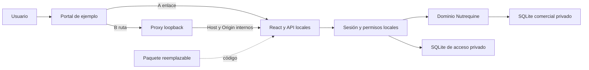

# Tarea 12 — Preparación como módulo integrable

Fecha: 15/10/2026. Rama: `feat/integracion-modulo-erp`.
Base: `5238e6f817d6e8003008d7c95c3abdd5649ea961`, main consolidado tras PR #2.
No se modifica main ni se autoriza una fusión automática de esta entrega.

## Alcance y documentación examinada

Se aplicó `programacion-clara` y se consultaron [arquitectura](ARQUITECTURA.md),
[consolidación 09](REPORTE_09_CONSOLIDACION.md),
[preparación corporativa 10](REPORTE_10_PREPARACION_CORPORATIVA.md),
[diseño ERP](ARQUITECTURA_ERP_CORPORATIVO.md),
[validación 11](REPORTE_11_VALIDACION_FINAL.md) y los procedimientos de instalación,
recuperación y operación. Se inspeccionaron entradas, build, servidor de estáticos,
seguridad HTTP, sesión, transporte comercial y harness de regresión.

Nutrequine conserva React/Vite, Node/Fastify, SQLite, dominio, autenticación y API.
Se entrega una frontera de integración por proceso/HTTP, no una biblioteca que
fusiona entidades. No hay identidad corporativa, multiempresa ni Control Granja.
La eliminación local previa de un vídeo en showcase queda excluida de la tarea.

## Modos preparados

| Modo           | Implementación                                                | Condiciones                                                                                          |
| -------------- | ------------------------------------------------------------- | ---------------------------------------------------------------------------------------------------- |
| A, prioritario | Portal mínimo con enlace a la URL configurada de Nutrequine.  | Backend, origen, sesión y bases propios; sin cambios comerciales.                                    |
| B, opcional    | Frontend compilado con prefijo y proxy local de demostración. | Mismo prefijo en build/proxy, confianza explícita en el portal del mismo origen; solo HTTP loopback. |

El frontend usa metadatos de build para resolver rutas HTTP e imágenes. Vite genera
URLs de JS/CSS/recursos con `--base`; el valor predeterminado sigue siendo `/`.
No se añade `<base>` y se conserva CSP `base-uri 'none'`. La navegación por hash,
formularios y contratos comerciales permanecen iguales. No hay un identificador
de empresa, un endpoint de ERP ni selección de base enviada desde el frontend.

El backend no cambia: continúa verificando Host/Origin exactos, cookies locales,
CSRF, actividad/rol y los mismos comandos. El proxy B valida primero su Host/origen,
rechaza cabeceras de identidad/proxy, rutas ambiguas y cuerpos excesivos, y después
traduce únicamente autoridad/ruta y Cookie Path. No inventa CSRF, no concede rol y
no reintenta escrituras. Conserva errores de negocio y filtra cookies del portal.

Un prefijo **no aísla** aplicaciones del mismo origen. El anfitrión podría leer
sesión/CSRF por HTTP si ejecuta código en ese origen: B exige confianza en todo ese
código. No se habilita LAN/Internet, TLS remoto, HMR a través del proxy, CORS abierto
ni SSO. La adaptación de un proxy/ERP real exige conocer y probar su topología,
identidad, política de cookies y administración de secretos. A sigue siendo preferido.

## Distribución y mantenimiento

`npm run build` crea la distribución A. `npm run build -- --base-path
/modulos/nutrequine/` crea B. `npm run package:module -- --destination RUTA_ABSOLUTA`
audita, copia y verifica una entrega nueva fuera del repositorio. No sobrescribe
destinos. Su contenedor incluye `app/` y un manifiesto SHA-256 de rutas relativas,
tamaños y contenido, sin fecha variable ni rutas privadas.

Se conservan Node compilado, React compilado, recursos, dependencias de ejecución,
SQL histórico/CLI, provisión, licencias y documentación/ejemplo de integración.
Se añaden las licencias de React, React DOM, Lucide, Scheduler y Tailwind al artefacto;
no se añade ninguna dependencia npm. Los archivos de integración se copian por
lista explícita. La auditoría rechaza bases, claves, configuración inesperada,
logs, capturas, source maps, fuentes TS privadas y paquetes de plataforma retirada.
El manifiesto acredita integridad respecto al artefacto comprobado, no una firma
de procedencia ni por sí solo ausencia universal de secretos.

Las bases y configuración permanecen fuera de todo el contenedor reemplazable y
del repositorio anfitrión. La base de acceso conserva su vínculo a la ruta canónica
del negocio. El ejemplo de actualización detiene el proceso, preserva el código
anterior, instala una entrega limpia con las mismas rutas privadas, arranca y
verifica estado y nuevas escrituras tras otro reinicio. No implementa actualizador,
migraciones nuevas ni downgrade automático de esquemas.

## Archivos de entrega y cambios

- [Guía de integración](../integration/README.md): clonación anidada, build,
  empaquetado, provisión segura, ejecución, copia y actualización.
- [Contrato](../integration/CONTRATO_INTEGRACION.md): proceso/puerto, endpoints
  existentes, sesión, CSRF, permisos, errores, reintentos y responsabilidades.
- [Portal](../integration/EJEMPLO_PORTAL.md): comandos y límites A/B.
- `integration/portal.mjs`, `integration/paths.mjs`: demostración y validación
  local del montaje; sin dependencias externas ni API corporativa simulada.
- `client/paths.ts`, sesión e imágenes: resolución del prefijo por metadatos de build.
- Scripts de build y paquete: parámetro explícito, licencias/documentos e inventario.
- Pruebas del cliente/proxy y E2E de integración; harness ampliado solo para
  seleccionar una distribución y un frontend de prueba reales.

No cambian los dominios de `features/`, reglas, persistencia, esquema, SQL,
autenticación ni controles HTTP del backend. Dos componentes de presentación de
Dashboard/Configuración adaptan únicamente el src de sus imágenes. Las fixtures
comerciales/visuales históricas no se regeneran.

## Verificaciones de esta entrega

Entorno local: Windows, Node 24.18.0, npm 11.16.0 y Chrome instalado mediante
`REGRESSION_BROWSER_CHANNEL=chrome`. Los resultados son ejecuciones reales con
datos sintéticos. No certifican otro perímetro ni un ERP no inspeccionado.

| Ejecución                                                | Resultado                                                                                                                                                         |
| -------------------------------------------------------- | ----------------------------------------------------------------------------------------------------------------------------------------------------------------- |
| Contratos de cliente/proxy iniciales                     | 6 pruebas aprobadas.                                                                                                                                              |
| Referencias HTML, fronteras y proxy tras revisión visual | 8 aprobadas; fixtures históricas intactas.                                                                                                                        |
| `npm run verify` principal                               | Salida 0: 158 pruebas (154 existentes + 4), 0 fallos/omitidas/canceladas/TODO, 458,49 s; tres TypeScript, ESLint, Prettier, build y auditoría aprobados.          |
| `npm run test:e2e` principal                             | 20 aprobados, 0 fallos/omitidas/canceladas/TODO, 188,56 s; conserva los 18 previos y añade A/B.                                                                   |
| Clon anidado, instalación limpia                         | Git --no-local --single-branch dentro de otro repositorio inicializado, ruta con espacios; npm ci con caché nueva: 380 paquetes, salida 0, aproximadamente 4 min. |
| Clon actualizado a e7a55db                               | Build independiente y auditoría aprobados; A/B repetidos: 2 aprobados, 0 fallos/omitidas/canceladas/TODO, 186,44 s.                                               |
| CLI prefijada del clon                                   | npm run build -- --base-path /modulos/nutrequine/ y package:module -- --destination aprobados en un destino externo nuevo.                                        |
| Documentos                                               | 34 Markdown y 148 enlaces locales revisados, 0 destinos ausentes; diff sin errores de whitespace.                                                                 |

El primer recorrido A/B pasó las operaciones, pero la revisión manual de capturas
detectó dos imágenes absolutas rotas en B. Se corrigieron ambas; la repetición
añade rechazo de recursos fallidos, carga real de imágenes de Dashboard y
Configuración y nuevas capturas revisables. No se aprobaron nuevas fixtures para
ocultar el problema. El aspecto en / conserva sus fingerprints HTML existentes.

La instalación limpia advierte scripts postinstall esbuild pendientes de aprobación
y deprecaciones heredadas de Drizzle Kit; no se aprobó globalmente su ejecución.
El build y las pruebas funcionan con los binarios opcionales declarados instalados.
No se añaden dependencias ni se modifica package-lock.json. Las dos licencias
adicionales de Scheduler/Tailwind solo afectan al inventario documental del paquete.

El clon es independiente en archivos Git, node_modules y caché; no es una máquina
virtual ni una instalación limpia del sistema operativo. Usa Node/npm/Git/Chrome
preinstalados. Las pruebas A/B aíslan sus bases fuera del checkout, instalación y
repositorio anfitrión. No hay bases operativas ni información de personas reales.

Las pruebas adicionales evalúan componentes implementados; la matriz siguiente
registra evidencia comprobada:

| Área              | Evidencia comprobada                                                                                                            |
| ----------------- | ------------------------------------------------------------------------------------------------------------------------------- |
| Cliente prefijado | Login, ruta comercial, CSRF y mismo cuerpo/request_id.                                                                          |
| Proxy real HTTP   | Host/Origin, cabeceras, rutas, tamaño, cookies, error 422 sin reintento.                                                        |
| Paquete           | Destino nuevo externo, rechazo de sobrescritura, dos manifiestos idénticos, copia hash verificada.                              |
| Navegador A       | Enlace, login real, formulario, escenario portable, reemplazo del código, datos y sesión conservados, nueva escritura/reinicio. |
| Navegador B       | JS/CSS/imágenes, login, Cookie Path/HttpOnly/SameSite, CSRF/Host/Origin, rechazo privado, escenario portable, reinicio/logout.  |
| Clon anidado      | Instalación desde lockfile, build y ejecución con configuración/datos externos, sin herramientas de plataforma.                 |

El escenario portable conserva las mismas expectativas de céntimos, gramos,
inventario, crédito, cobranza, idempotencia e historial de la regresión existente.
Las pruebas solo usan datos sintéticos. PNG y JSON se conservan como evidencia local
ignorada, sin introducir snapshots nuevos ni archivos privados en el paquete.

### Evidencias locales y trazabilidad

outputs/tarea12-verify.log, tarea12-e2e-final.log, tarea12-resources-check.log
y tarea12-nested-context.json localizan las ejecuciones. El último registra el
clon nutrequine-12-host-6a8a94703ef14154adaec1edbd200218/modulos/Nutrequine Pro
en el directorio temporal del operador. Sus logs tarea12-nested-install.log,
tarea12-nested-final-build.log, tarea12-nested-final-e2e.log y
tarea12-nested-prefix-build.log están en su propio app/outputs.

Capturas/JSON finales bajo outputs/frontend-08:

- Principal A: 2026-10-15T16-14-47-990Z-c4d603ad.
- Principal B: 2026-10-15T16-15-47-377Z-2036a436.
- Clon A: 2026-10-15T16-14-48-801Z-8ea4114f.
- Clon B: 2026-10-15T16-15-48-407Z-6658fc39.

El código base se registra en fa674da y la corrección visual/proxy en e7a55db.
El cierre añade resultados, documentación operativa y avisos de licencia sin
modificar las operaciones. La rama y su Pull Request se informan al entregar;
GitHub Actions ejecuta además su propia validación al abrir el PR. No se fusiona.

### Comprobaciones de cierre

La reconstrucción final con documentación y las cinco licencias del frontend
incluye **1052 archivos, 50 paquetes de runtime, cero archivos privados detectados
y cero paquetes de la plataforma retirada**. El paquete externo final se audita
y compara archivo por archivo mediante SHA-256; su ubicación local está en
outputs/tarea12-package-final-context.json. El JS/CSS conserva los mismos hashes
de build que la versión funcional corregida; los últimos cambios son avisos y textos.

El catálogo de Configuración/Productos se comprobó además abriendo su detalle
real: repetición B con una prueba aprobada, 26,77 s, sin omisiones. La captura de
2026-10-15T16-21-20-248Z-0742dd5e se revisó junto con Dashboard y el portal; ya no
presentan las imágenes rotas de la primera revisión.

Se inició también el portal **de la distribución prefijada mediante su CLI**, no
solo la factory de pruebas: login real, escritura, reinicio de backend, comparación
de estado y visualización posterior del cliente aprobaron. Un intento manual
inicial omitió recargar la UI tras una escritura HTTP externa y agotó su espera;
la recarga corregida respeta el comportamiento existente, sin cambiar la aplicación.
La repetición aprobada está en outputs/tarea12-cli-prefix-final.log y el script
reutilizable local en outputs/tarea12-cli-prefix-smoke.mjs. La evidencia del clon
es 2026-10-15T16-25-26-810Z-f41af633, con JSON y PNG sintéticos.

## Pendiente del anfitrión real

Elegir administración de procesos y versiones, puerto/rutas, entrega de Node,
topología/orígenes, custodia de secretos, política de copias/recuperación y aceptación
operativa. Definir un contrato de identidad antes de SSO; no duplicar usuarios ni
interpretar cabeceras como identidad. Control Granja sigue pendiente de auditoría.

No hay prueba de integración con un ERP desconocido, exposición remota, múltiples
empresas o migración de una versión futura. El ensayo de sustitución usa el mismo
esquema y no demuestra compatibilidad con cualquier versión futura. El bloqueo de
red de los tests no es certificación de firewall del sistema operativo. Se conservan
las reservas operativas y de dependencias de desarrollo documentadas en Tarea 11.
