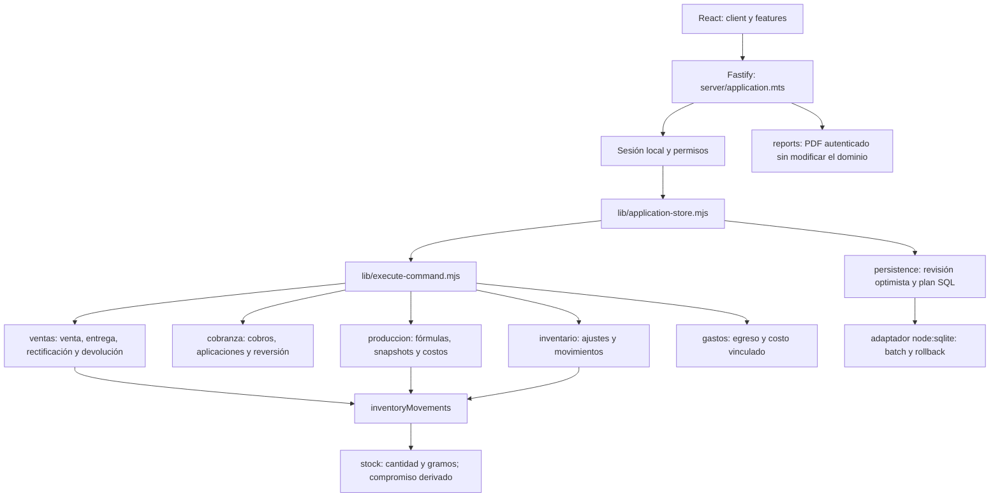

# NQP26-00 · Diagnóstico y punto de partida

Fecha de trabajo: 24 de octubre de 2026, America/Lima.
Estado: en revisión; diagnóstico y controles locales terminados, pendiente de revisión técnica externa. No acredita implementación de NQP26-01–40.

## Alcance y base comprobada

Se interpretó «Empecemos» como comenzar por el diagnóstico inicial del paquete. Las fuentes A y B son requisitos a contrastar, no evidencia de funcionalidades implementadas ni autorización para ejecutar el instalador, fusionar o desplegar.

Base elegida: `origin/main`, SHA `43206560277b704b5c16da5c01702f0cffb97e3f`. Git fetch actualizó la referencia desde `7fe9d7e` y se creó una copia Git aislada, inicialmente en 7fe9d7e, antes de cambiarla a la base actualizada. Rama de trabajo: `codex/nqp26-00-diagnostico`. Node v24.18.0; npm 11.16.0; Windows/PowerShell.

La carpeta original estaba en `codex/presentaciones-cascoplus`, SHA `1a24107`, con AGENTS.md modificado, eliminaciones de demo-linkedin y carpetas locales sin seguimiento. Esos cambios no se incorporan. La copia aislada se encontró limpia antes del diagnóstico. No se abrió SQLite empresarial, configuración privada ni credenciales. Se consultaron el AGENTS.md raíz proporcionado y app/AGENTS.md; el destino versionado de este informe sigue su regla `app/docs/actualizacion-seguridad/`.

Fuentes locales leídas: A_BACKLOG_UX_LOGISTICA_v1.1.md y B_REGLAS_OPERATIVAS_R01_R54.md, además de COMO_EMPEZAR, PLAN_MAESTRO, NQP26-00 y REGLAS_DE_ESTADO del kit. El ZIP de planificación no sustituye el código vigente.

## GitHub y trabajo integrado

Consulta real del conector GitHub: PR #1–#10 cerrados y fusionados; no apareció ningún PR abierto entre los diez resultados devueltos. No se debe reconstruir trabajo ya integrado:

| PR  | Resultado integrado                                                                |
| --- | ---------------------------------------------------------------------------------- |
| #1  | Refactorización por funcionalidades, antecedente D1; no es la arquitectura vigente |
| #2  | React/Vite, Node/Fastify y SQLite local                                            |
| #3  | Módulo integrable y portal local                                                   |
| #4  | Captura de producción, precios por lote y cobro real precargado                    |
| #5  | Navegación e historial de cliente, sedes contextuales                              |
| #6  | Cuatro exportaciones PDF locales                                                   |
| #7  | Presentaciones comerciales, frascos fijos y snapshots históricos                   |
| #8  | T00, línea base y documentación                                                    |
| #9  | T01, contratos estrictos de ocho comandos maestros                                 |
| #10 | Núcleos decimales y sacos completos, cabeza de main consultada                     |

Las ramas locales/remotas antiguas siguen existiendo; su existencia no significa trabajo pendiente de integrar. `main` local de la carpeta original estaba en 54a4ef7. T00/T01 y el resto de estabilización conservan numeración propia. No se fusionaron ramas ni se modificó main.

## Mapa actual comprobado

- `client/admin/AdminWorkspace.tsx` monta ventas, cobranza, clientes, producción, inventario, gastos, balance y configuración. `features/documentos/` prepara exportaciones y `server/reports.mts` las sirve.
- `lib/state-schema.mjs` enumera 25 colecciones de dominio. SQL guarda documentos JSON con columnas de relación y claves foráneas; settings y transaction_guards son infraestructura adicional. La autenticación tiene su propia base, administrada fuera de los datos comerciales.
- Existe una migración comercial `drizzle/0000_nervous_silver_fox.sql`. `lib/sqlite/schema.mjs` y `migrations.mjs` verifican catálogo, versión, huellas y ledger nutrequine_migrations. La adopción histórica y la creación vacía son explícitas, no cambios de esquema improvisados al arrancar.
- `executeCommand` clona estado, comprueba permisos, ejecuta dominio y registra auditoría. El store agrupa escrituras en batch, usa revisión optimista y request_id por actor. La deduplicación actual no comprueba equivalencia del contenido del reintento: preservar el seguimiento de estabilización, no declarar idempotencia universal resuelta.
- Ventas normales desde el formulario envían deliver=true y descuentan al guardar mediante SALE_OUT. Ventas futuras quedan PENDING sin salida; SALE_DELIVER exige stock completo y genera la salida. Cobros y aplicaciones son entidades separadas: cubrir stock no debe generar caja.
- `stock().committed` suma TODA la cantidad solicitada de ventas pendientes; no es una asignación física parcial. `deliveryAvailability` valida stock físico y gramos sin restar ese compromiso. No hay reserva firme por línea ni cola por fecha de entrega.
- `confirmProduction` ingresa sacos calculados y registra consumo de ingredientes al confirmar. `productionClose` verifica conciliación y cierra; no captura un rendimiento físico independiente. Hay snapshots de fórmula, precio, gramos y costos, además de movimientos compensatorios para rectificaciones.

## Brechas y decisiones para NQP26-01

1. Formalizar salida comercial ordinaria al registro (R19), reserva de unidades disponibles para pedidos insuficientes (R22) y salida física, sin descontar dos veces. El modelo actual no implementa esa combinación. Usar asignaciones explícitas o movimientos derivados demostrablemente consistentes; no convertir committed en reserva por un cambio de etiqueta.
2. Añadir fecha de entrega independiente con desempate por registro/ID; conservar reservas firmes existentes al entrar nuevo stock. Elegir una fecha de corte para ventas históricas, sin reasignarlas retrospectivamente por defecto.
3. Separar preparación de micros y cierre real del molino. Hoy confirmar producción crea inventario comercial: cambiar solo la pantalla de cierre duplicaría entradas. Conservar compatibilidad de lotes históricos y tratar nuevos estados de forma explícita.
4. El catálogo de ingredientes y movimientos existentes no equivale a compras multirrenglón, saldo inicial con corte ni promedio ponderado móvil. Se requieren contratos de compra, gasto único, correcciones y valoración histórica.
5. No hay recetas técnicamente aprobadas de los 17 micros en este encargo. Los nombres, dosis, costos iniciales y cantidades físicas quedan como entradas externas futuras; no inventarlos ni derivarlos de macros existentes.
6. La producción multicomponente, las fórmulas versionadas y los cobros reales ya existen parcialmente. Extenderlos, conservar snapshots y probar distribución de costo por producto; no sustituirlos por módulos paralelos.
7. Los permisos actuales reservan a ADMIN confirmación/cierre/corrección de cantidades. El plan nuevo habilita ciertas rectificaciones y sustituciones a OPERATOR: definir matriz por operación y probar backend antes de habilitar controles.
8. El PDF mensual ya usa input type=month. NQP26-16 debe comprobar interacción sin teclear en navegador objetivo y fallback accesible si hace falta; no dar equivalencia por lectura ni reemplazarlo automáticamente.

## Matriz requisito → código comprobado → cobertura existente → siguiente tarea

Rutas abreviadas en la matriz: ventas/, clientes/, configuracion/, inventario/, produccion/, documentos/, gastos/ y balance/ corresponden a app/features/; los nombres persistence, state-schema y execute-command corresponden a app/lib/. Los archivos de prueba se encuentran en app/tests/ y sus E2E en app/tests/local-e2e/. Las pruebas indicadas son archivos de cobertura relacionada; su presencia no demuestra los criterios nuevos. «Brecha» se refiere a inspección estática salvo reproducción expresamente registrada. Los inventarios exhaustivos de columnas y selectores se entregan en NQP26-11 y NQP26-13, antes de implementar su alcance global.

| Tarea / fuente            | Código (relativo a app/)                                                                | Evidencia o brecha                                                        | Pruebas relacionadas / ampliación requerida                                   |
| ------------------------- | --------------------------------------------------------------------------------------- | ------------------------------------------------------------------------- | ----------------------------------------------------------------------------- |
| 00 / contrato             | lib, server, features y drizzle                                                         | Este diagnóstico                                                          | Suite base y controles finales abajo                                          |
| 01 / transversal          | execute-command, persistence, permissions                                               | Diseñar invariantes antes de negocio                                      | application-store, regression-business, node-backend; añadir nuevos contratos |
| 02 / VENTA-01             | ventas/hooks/sale-lines.ts                                                              | addSaleProduct añade otra línea; test actual espera longitud 2            | sale-lines; probar 5 clics y conservar precio/peso                            |
| 03 / VENTA-02             | ventas/components/SaleLineEditor.tsx; domain/operations.mjs                             | Quitar está deshabilitado con una fila; backend rechaza cero artículos    | sale-form E2E y sale-lines; añadir vacío editable                             |
| 04 / LOG-03, R19–22,26    | ventas/domain/commands.mjs; inventario/domain/stock.mjs                                 | Pendiente y pago existen; falta reserva parcial protegida                 | payment-credit-delivery; 35/40 y concurrencia                                 |
| 05 / LOG-03, R23–27       | stock.mjs; produccion/domain/operations.mjs                                             | Falta cola automática y liberación por reserva                            | regression-business; asignación y cancelación deterministas                   |
| 06 / LOG-01, R25          | ventas/hooks/useSaleFormState.ts; commands.mjs                                          | Solo sale_date, falta fecha independiente                                 | sale-form; persistir y conservar edición manual                               |
| 07 / LOG-02               | ventas/components/SaleForm.tsx                                                          | mode immediate/planned y bloqueo por insuficiencia                        | sale-form; separar entrega de cobertura                                       |
| 08 / ALERTA-01            | client/admin/AdminWorkspace.tsx; stock.mjs                                              | Falta aviso global por faltante neto y unidad                             | app-flows; navegación/recarga y sacos frente a frascos                        |
| 09 / UX-02                | clientes/components/CustomerFields.tsx; configuracion/domain/commands.mjs               | Confirmación duplicado existe; aviso contextual y semejanza por completar | regression-business R04; exactos, aproximados y edición                       |
| 10 / UX-03                | ventas/domain/commands.mjs; clientes/domain/sites.mjs                                   | saleSave vincula automáticamente sede ajena                               | customer-navigation; probar solo esta venta                                   |
| 11 / UX-01 inventario     | shared/ui/Table.tsx; features/\*/components                                             | Tabla común sin contrato de ordenación                                    | frontend-static; inventariar columnas y tablas nativas                        |
| 12 / UX-01 implementación | Table.tsx y vistas de módulos                                                           | Falta ordenamiento tipado global                                          | Comparadores, nulos, filtros, teclado y aria-sort                             |
| 13 / UX-07 inventario     | shared/ui/Select.tsx; selects nativos                                                   | Select respeta orden recibido; fuentes diversas                           | Inventariar todos y excepciones semánticas                                    |
| 14 / UX-07 implementación | Select.tsx y fuentes nominales                                                          | Falta política A–Z central                                                | Collator es-PE, números, grupos y selección conservada                        |
| 15 / UX-06                | configuracion/components/ConfigurationView.tsx; inventario/components/InventoryView.tsx | Catálogo existente; trasladar navegación y conservar permisos             | company-catalog, presentations y E2E catálogo                                 |
| 16 / REPORTE-01           | documentos/components/MonthlyBalanceExport.tsx                                          | Ya usa type=month, falta demostrar aceptación completa                    | document-reports, document-export; elección por clic/móvil                    |
| 17 / UX-04                | clientes/components/CustomerDirectory.tsx; domain/commands.mjs                          | Conservar desactivación e historial al cambiar acción                     | customer-navigation, regression-business R05                                  |
| 18 / UX-05                | produccion/components/ProductionIngredients.tsx                                         | Acabado posterior al consumo real                                         | production-entry; conservar descuento y nombre accesible                      |
| 19 / UX-08                | ventas/components/SaleForm.tsx                                                          | Alta rápida existente; ajustar texto y acceso                             | sale-form; alta/selección nueva                                               |
| 20 / R07–08,32,52         | state-schema; inventario/domain/commands; IngredientFields                              | Falta saldo inicial específico de micros y presentación/proveedor         | Nuevas pruebas de catálogo y corte                                            |
| 21 / R53                  | persistence y movimientos                                                               | Falta corte económico/físico sin reconstrucción obligatoria               | Compra anterior al corte no aumenta saldo inicial                             |
| 22 / R29–31               | gastos/domain/commands.mjs; execute-command                                             | Sin comando de compras multirrenglón                                      | Transacción completa, un gasto, reversión al fallar                           |
| 23 / R09                  | produccion/domain/production-snapshots.mjs                                              | Precio histórico existe; no promedio móvil de compras                     | Promedio ponderado y consumo a costo congelado                                |
| 24 / R01–04,52            | produccion/domain/commands.mjs formulaSave                                              | Versionado existente por producto; micros compartidos requieren contrato  | Histórico estable y dos fórmulas con dosis aprobadas                          |
| 25 / R01–05,28            | formulas y production snapshots                                                         | Falta sustitución aprobada por grupos y confirmación pendiente            | Ambas fórmulas futuras; no cambiar parte realizada                            |
| 26 / R10–11               | produccion/domain/operations.mjs                                                        | Borrador existe; no política completa de faltantes de micros              | Guardar pendiente sin consumo ficticio                                        |
| 27 / R12                  | movimientos y producción                                                                | Falta asignación manual de micros a pendientes                            | Competencia por stock y reserva frente a consumo                              |
| 28 / R33–34,42            | confirmProduction; production-quantities.mjs                                            | Consumo según fórmula existe; no preparación real separada                | Plan 20/real 12, exactamente una salida por micro                             |
| 29 / R54                  | productionRows y productionProducts                                                     | Orden multiproducto existe; ampliar estados/composición                   | production-entry; costos separados de tres productos                          |
| 30 / R13–18,35            | confirmProduction; productionClose                                                      | Stock calculado al confirmar, no sacos reales al cierre total             | Sacos completos reales y merma equivalente estimada                           |
| 31 / R35–42               | produccion/domain/summary.mjs; balance/domain/summary.mjs                               | Costos totales existentes; falta reparto real por producto/rendimiento    | Servicio y consumos sobre unidades reales                                     |
| 32 / R40–41               | production-snapshots; useProductionFormState                                            | Cobro real precargado y modo manual ya existen                            | production-entry; conservar excepciones y servicio                            |
| 33 / costo stock          | inventario/domain/stock.mjs                                                             | Sin valoración ponderada explícita en stock()                             | Lotes coexistentes con costo histórico diferente                              |
| 34 / R46–48               | productionCorrectQuantities; productionReconcile                                        | Compensación existe; closed admite recálculo y ADMIN restringe cantidades | Historia cerrada inmutable y operador autorizado                              |
| 35 / R49                  | gastos y persistence                                                                    | Sin corrección de compra específica                                       | Cantidad/gasto/costo sin duplicar ni saldo imposible                          |
| 36 / R44–45               | fórmulas y stock                                                                        | Falta umbral 20 × máximo entre fórmulas activas                           | Preventiva y faltante de orden diferenciados                                  |
| 37 / R05,48               | shared/domain/permissions.mjs; execute-command                                          | Auditoría existente; permisos requieren adaptación acotada                | regression-permissions y node-backend por comando                             |
| 38 / R20,51               | AdminWorkspace y estado global                                                          | Falta sistema de avisos agrupados por causa                               | Persistencia tras navegación/recarga y resolución                             |
| 39 / macros               | formulaSave; ProductionsView.tsx                                                        | Versionado existente; revisar presentación activas/historial              | No reescribir snapshots de lotes previos                                      |
| 40 / cierre               | verify, E2E, distribución y documentación                                               | Pendiente de todas las dependencias                                       | Auditoría transversal sobre SHA final                                         |

## Solución mínima propuesta y secuencia

Continuar con NQP26-01 sobre main actualizado: contratos de reservas, unidades, fechas, corte inicial, consumo real y costos cerrados, con escenarios sintéticos verificables antes de cambiar interfaz. Después separar carrito (02/03), fecha (06) y motor transaccional (04/05), respetando las dependencias del plan. Micros necesitan catálogo/corte y fórmulas aprobadas antes de compras, consumo y costo real. Mantener módulos, snapshots, autenticación y SQLite existentes.

No introducir vencimientos, cuentas por pagar, entregas parciales obligatorias, rutas de transporte ni reconstrucción de producción antigua. No cargar datos empresariales para acreditar pruebas.

## Comandos y resultados

npm.cmd ci --prefix app --ignore-scripts: aprobado, 400 paquetes instalados. npm.cmd run verify: aprobado, código 0; 233 pruebas aprobadas, cero fallos/cancelaciones/omisiones; tres comprobaciones TypeScript, ESLint sin advertencias, Prettier, build y auditoría de distribución aprobados. La suite de pruebas tardó 401209,6163 ms en este equipo. Registro local: 04_EVIDENCIAS/NQP26-00_verify.log. npm.cmd run test:e2e con REGRESSION_BROWSER_CHANNEL=chrome: aprobado, código 0; 29 pruebas aprobadas, cero fallos/cancelaciones/omisiones; duración 745875,8196 ms. Registro local: 04_EVIDENCIAS/NQP26-00_e2e.log. No confundir estas ejecuciones con resultados históricos de PR anteriores.

## Reproducciones sintéticas ejecutadas

Se ejecutó `node --input-type=module -e` importando `addSaleProduct`, `createSaleLine`, `stock` y `deliveryAvailability`, con aserciones de Node y datos efímeros sin persistencia. Salida y código de terminación 0:

- Cinco llamadas a addSaleProduct para el mismo producto dejan cinco filas (assert rows.length === 5).
- Stock físico 35 y venta A pendiente de 40 devuelven committed === 40: la cifra representa demanda, no unidades físicamente reservadas.
- Otra solicitud de 35 unidades y sus gramos completos devuelve missing_quantity === 0 pese al pedido A. Se reprodujo la falta de protección en el cálculo, no se registró ninguna venta empresarial ni se atribuye una prueba HTTP completa a este probe.

NQP26-16: la prueba E2E existente de exportación usa `.fill("2026-10")`; no acredita selección por clic o toque sin escribir. NQP26-39: ProductionsView muestra fórmulas activas e históricas en la misma lista de details, abiertas según is_active. El versionado de dominio se conserva; queda reorganizar su presentación.

## Cierre de entrega

Cambios: únicamente este informe; ninguna modificación de lógica, esquema, dependencias o interfaz. El operador todavía conserva los comportamientos anteriores. Auditoría de distribución: 2071 archivos, 69 paquetes de runtime, cero archivos privados y cero paquetes retirados. git diff --check y formato del informe se verifican antes del commit.

Criterios NQP26-00 cubiertos: base y entorno anotados, PR consultados, arquitectura y migraciones inspeccionadas, mapa de operaciones, brechas reproducidas, matriz de las 41 tareas y suite base real. Pendiente: aprobación técnica externa; no marcar Completada hasta obtenerla. NQP26-01 queda identificado como siguiente paso de diseño, sin implementación anticipada.

Commit y enlace de PR: se registran tras publicar en la copia local 03_REPORTES/NQP26-00_REPORTE.md y 05_BITACORA/REGISTRO_TAREAS.csv; en Git se obtienen con git log -- app/docs/actualizacion-seguridad/NQP26-00_REPORTE.md. No hay issue independiente. Las evidencias no se versionan. No se fusiona ni despliega.

## Revisión documental posterior

La revisión técnica externa del 24 de octubre de 2026 considera el diagnóstico conforme para comenzar NQP26-01. NQP26-00 permanece En revisión y el PR no se fusiona. No se atribuye a esa revisión ejecución del código ni verificación de logs locales.

Entrega original: commit 62d3fdf3903d1028ccd071deb5b7bd1c534305e2; PR https://github.com/VicWaltzO/NutrequinePro/pull/11. Este apartado sincroniza los identificadores ya registrados en la copia local. El SHA identifica la entrega original, no el commit posterior que añade esta nota. Zona operativa del proyecto: America/Lima; la fecha anterior se había expresado con la zona de la sesión.

Las 233 pruebas generales y 29 E2E acreditan únicamente los escenarios cubiertos en la base indicada. No son garantía de ausencia de defectos. Continúan sin corregir la deduplicación de request_id sin comprobar contenido, las reservas parciales efectivas y la recepción del rendimiento real del molino. NQP26-01 definirá sus contratos; no implementará esas funciones.
